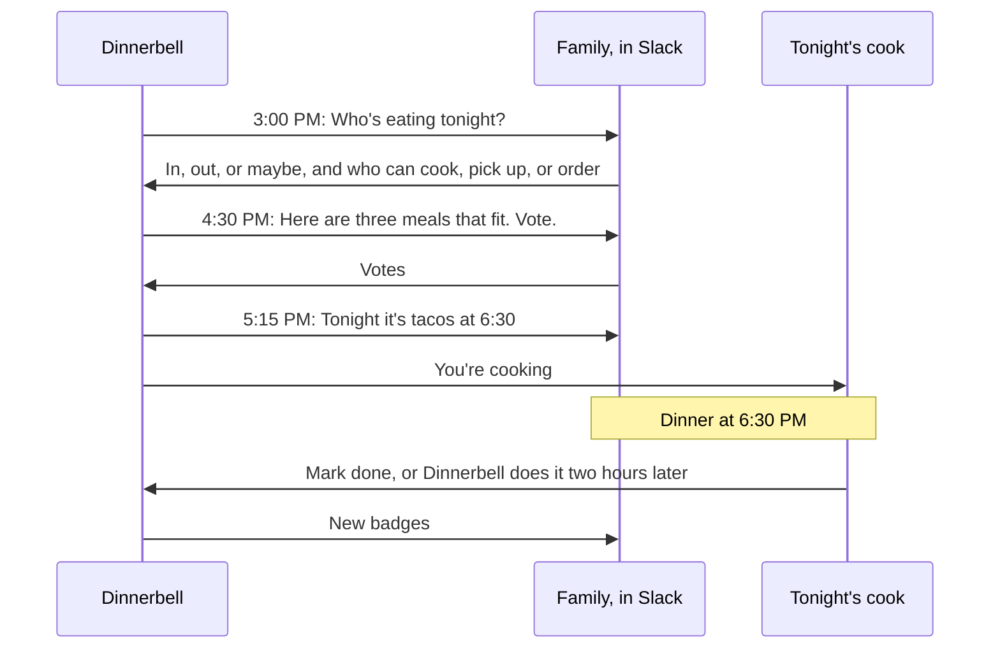
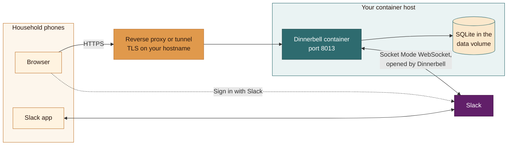

#  Dinnerbell

Dinnerbell answers three questions for your household at the same time each day: who's eating, what are we eating, and who's cooking, picking up, or ordering it.

It asks in Slack, ranks meals that fit everyone eating, assigns the work, and celebrates who did it with badges. It runs as one container on your own hardware, with a mobile-friendly web app for the catalog, preferences, history, and stats.

You need a host that runs containers, a Slack workspace, and an HTTPS hostname your phones can reach.

## How a dinner works

Dinnerbell asks early, so dinner is settled before anyone is hungry. With the default schedule, it asks at 3:00 PM for a 6:30 PM dinner.

1. At 3:00 PM, Dinnerbell posts a dinner call in your Slack channel and mentions everyone. Anyone can change the time on the **Schedule** page.
2. Each person taps **Answer**: in, maybe, or out, and whether they can cook, pick up, or order. Anyone who hasn't answered gets a reminder, unless they turned reminders off.
3. When answers close, Dinnerbell ranks meals from your catalog that fit everyone eating, using vetoes, preferences, variety, and who can do what, and posts the top three for a vote.
4. The vote picks the meal, and Dinnerbell posts the decision with the meal time and who cooks, picks up, or orders. Each of them gets a direct message.
5. After the meal, someone taps **Mark done**, or Dinnerbell marks it done two hours after the meal time. It records who did what and announces new badges.

Lunch and breakfast calls work the same way. Their daily calls are off by default, and anyone can start a call for breakfast, lunch, or dinner when they want one.

## How it runs

Dinnerbell opens the connection to Slack, so Slack never needs to reach your host. The only inbound traffic is HTTPS from phones, through your proxy or tunnel, including the return from Sign in with Slack.

## What you need

| Piece | Why | Alternatives |
|---|---|---|
| A Linux host that runs containers, always on | Runs one container and its data volume | podman with podman-compose 1.0.6 or later, or Docker with the compose plugin |
| A Slack workspace where you can create apps | Calls, buttons, reminders, and sign-in happen in Slack | A new workspace for the household; the free plan is enough |
| An HTTPS hostname that phones can reach | The web app, and the Sign in with Slack redirect, which must land on HTTPS | Any reverse proxy or tunnel with TLS: Pangolin, Cloudflare Tunnel, Tailscale Funnel, or Caddy or Traefik on a public IP |
| Household members in Slack | Each adult answers calls in Slack and signs in to the web app with Slack | Another OpenID Connect provider, such as Google, for sign-in; Slack still carries the calls |
| A test instance | Rehearse releases on a second copy ([test-instance.md](docs/test-instance.md)) | Optional |

You don't need a calendar, an LLM, or an email server. One install serves one household of a handful of adults. Dinnerbell backs up its database every night inside its data volume; you copy the backups off the host.

## Run it

Each release is a prebuilt, attested image on GitHub Container Registry. Start with the [quick install](docs/install.md), or follow the [setup guide](docs/setup.md) to install from a git clone, with every step in detail, upgrades, backups, and troubleshooting. Every setting is in the [configuration reference](docs/configuration.md), and changes are in [CHANGELOG.md](CHANGELOG.md).

 A test instance shows Dinnerbot, Dinnerbone as a half-built blueprint, so you can tell it from production at a glance.

## Status

Pre-alpha. Milestones M0 through M4 are in place: calls in Slack, offers and guests, the catalog, preferences, meal history, and contributions and badges. Start with the [spec](docs/spec.md) and the [decision records](docs/adr/).

## Why

Four adults, four schedules, one kitchen. The daily "what are we eating?" lands at the moment of hunger, takes too long, converges on the same cuisines, and lands on the same person. Dinnerbell moves the question earlier, makes the choice fit the people eating, and makes the decision stick.

## Stack

Python, FastAPI, HTMX, SQLite, Slack Bolt in Socket Mode, one container. See [ADR 0004](docs/adr/0004-stack.md).

## Contributing

See [CONTRIBUTING.md](CONTRIBUTING.md). Commits need a DCO sign-off.

## License

[AGPL-3.0-or-later](LICENSE). See [ADR 0003](docs/adr/0003-agpl-license.md) for why.
