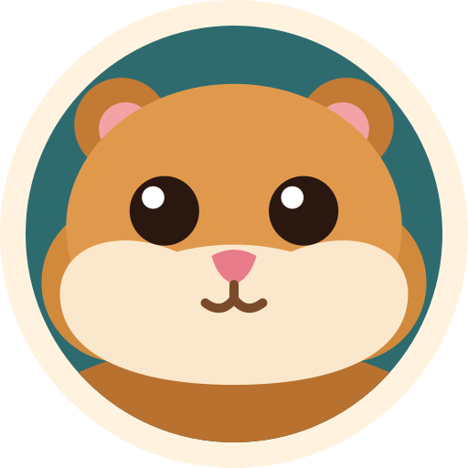
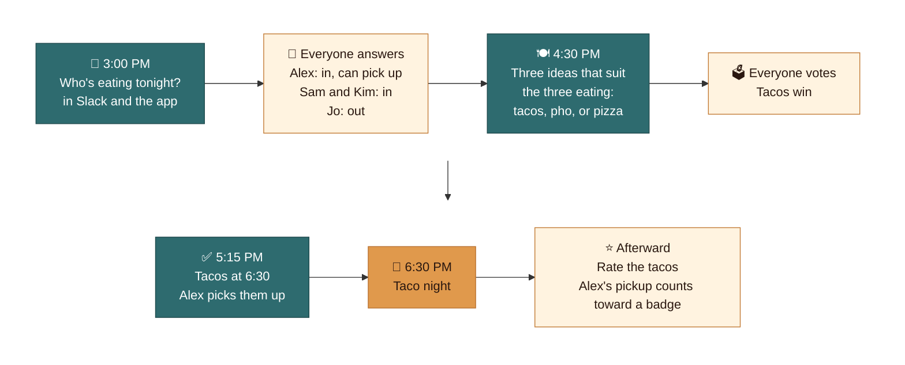
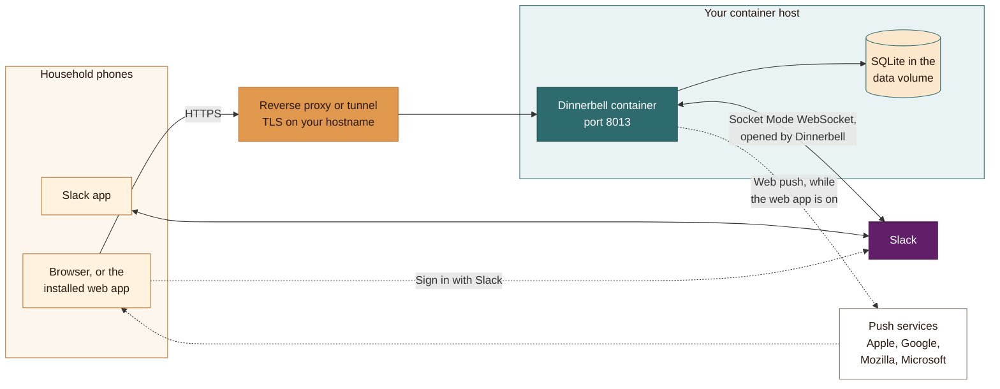
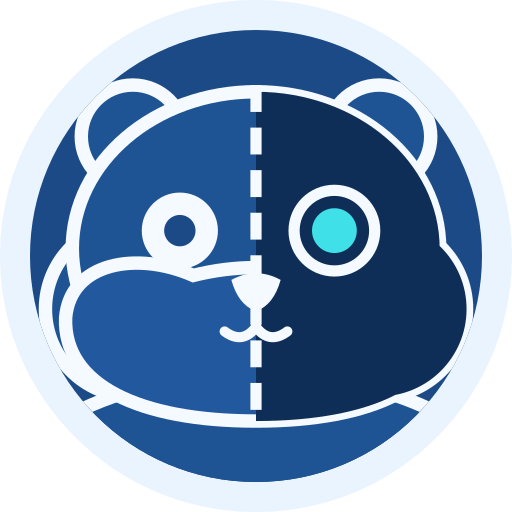

#  Dinnerbell

Dinnerbell answers three questions for your household at the same time each day: who's eating, what are we eating, and who's cooking, picking up, or ordering it.

It asks in Slack, ranks meals that fit everyone eating, assigns the work, and celebrates who did it with badges. It runs as one container on your own hardware, with a mobile-friendly website for the catalog, preferences, history, and stats.

An admin can also turn on the web app: members install Dinnerbell on their phone, answer calls there, and get push notifications. A member who doesn't use Slack signs in with a code an admin gives them.

You need a host that runs containers, a Slack workspace, and an HTTPS hostname your phones can reach.

**Status:** before 1.0, so a minor release can still change settings or behavior; its **Upgrade notes** in the [changelog](CHANGELOG.md) say what to do. [What 1.0 promises](CONTRIBUTING.md#what-10-promises) lists what stays stable from 1.0.

## How a dinner works

Dinnerbell asks early, so dinner is settled before anyone is hungry. With the default schedule, it asks at 3:00 PM for a 6:30 PM dinner. Here's a takeout night for a family of four.

1. **Dinnerbell asks.** At 3:00 PM, it posts in your family's Slack channel, and pushes to phones with the web app: who's eating tonight?
2. **Everyone answers,** in Slack or the app. Tap **In**, **Maybe**, or **Out**, and say whether you can cook, pick up, or order. Dinnerbell reminds anyone who forgets. Going away? Tap **Away until…**, and calls until you're back answer you Out.
3. **Dinnerbell suggests three meals** from your family's list. It skips anything someone eating can't or won't eat, favors what people like, and mixes things up from day to day.
4. **Everyone votes, and dinner is set.** Dinnerbell posts the plan and messages whoever is cooking, picking up, or ordering.
5. **After dinner,** someone taps **Mark done**, or Dinnerbell does it two hours later. Rate the meal if you like, and new badges are announced.

In the diagram, teal steps are Dinnerbell and cream steps are you. The times are the defaults; anyone can change them on the **Schedule** page.

Lunch and breakfast calls work the same way. Their daily calls are off by default, and anyone can start a call for breakfast, lunch, or dinner when they want one.

For the household, these guides explain the rest: [coordinating a meal](docs/coordinating.md), [how Dinnerbell picks meals](docs/ranking.md), [contributions and badges](docs/contributions.md), and [members and guests](docs/members.md).

## How it runs

Dinnerbell opens every outside connection: to Slack; to the push services while the web app is on; to Open-Meteo when you turn on local weather; and to Anthropic and the menu pages members give it when you turn on the assistant. The only inbound traffic is HTTPS from phones, through your proxy or tunnel, including the return from Sign in with Slack.

## What you need

| Piece | Why | Alternatives |
|---|---|---|
| A Linux host that runs containers, always on | Runs one container and its data volume | podman with podman-compose 1.0.6 or later, or Docker with the compose plugin |
| A Slack workspace where you can create apps | Dinnerbell posts calls in a Slack channel, and signs people in with Slack | A new workspace for the household; the free plan is enough |
| An HTTPS hostname that phones can reach | The website and web app, and the Sign in with Slack redirect, which must land on HTTPS | Any reverse proxy or tunnel with TLS: Pangolin, Cloudflare Tunnel, Tailscale Funnel, or Caddy or Traefik on a public IP |
| A way for each adult to answer | Members answer calls and get reminders | Slack, or the [web app](docs/members.md#the-web-app) with push notifications, signing in with a code instead of Slack; Google or another OpenID Connect provider can replace Sign in with Slack |

You don't need a calendar or an email server. The [assistant](docs/configuration.md#the-assistant) is optional and needs an Anthropic API key. One install serves one household of a handful of adults. Dinnerbell backs up its database every night inside its data volume; you copy the backups off the host.

## Run it

Each release is a prebuilt, attested image on GitHub Container Registry. Start with the [quick install](docs/install.md), or the [setup guide](docs/setup.md) to install from a git clone. Then see [Back up and upgrade](docs/backup-and-upgrade.md), the [configuration reference](docs/configuration.md), and [CHANGELOG.md](CHANGELOG.md).

 A [test instance](docs/test-instance.md) shows Dinnerbot, a half-built blueprint of Dinnerbone the hamster, so you can tell it from production at a glance.

## Why

Four adults, four schedules, one kitchen. The daily "what are we eating?" lands at the moment of hunger, takes too long, converges on the same cuisines, and lands on the same person. Dinnerbell moves the question earlier, makes the choice fit the people eating, and makes the decision stick.

## Stack

Python, FastAPI, HTMX, SQLite, Slack Bolt in Socket Mode, one container. See [ADR 0004](docs/adr/0004-stack.md). The [spec](docs/spec.md) and the [decision records](docs/adr/) explain the design.

## Contributing

See [CONTRIBUTING.md](CONTRIBUTING.md). Commits need a DCO sign-off.

## License

[AGPL-3.0-or-later](LICENSE). See [ADR 0003](docs/adr/0003-agpl-license.md) for why. The Figtree font in `src/dinnerbell/web/static/fonts/` is under the [SIL Open Font License 1.1](src/dinnerbell/web/static/fonts/Figtree-OFL-1.1.txt).
