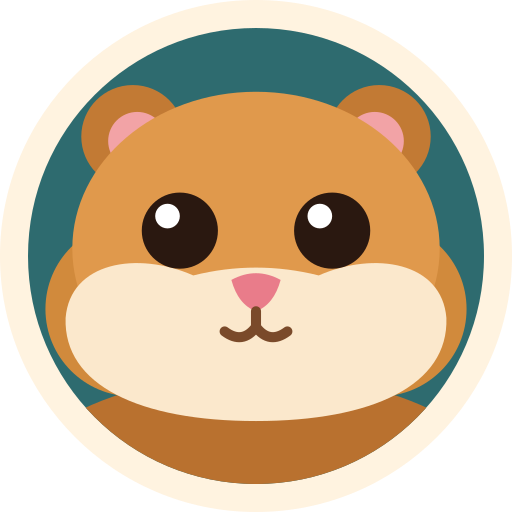
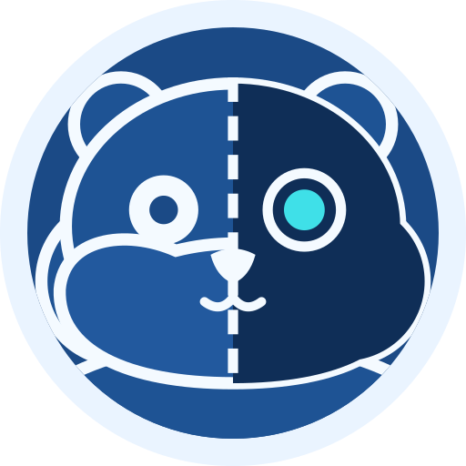

#  Dinnerbell

Dinnerbell helps a household answer, at a fixed time each day, three questions: who is eating, what are we eating, and who is cooking, picking up, or ordering it.

It asks the question in Slack at a scheduled time, collects who's in and what they can do, ranks meals that fit everyone eating (hard vetoes, soft preferences, variety, available roles), assigns the work, and records who did it so the household can celebrate contributions with badges.

It runs as one container on your own hardware. The household's catalog, preferences, history, and stats live in a mobile-friendly web app that Slack messages link into.

## Status

Pre-alpha. Milestones M0 through M2 are in place: the container, configuration, migrations, nightly backups, `/healthz`, sign-in with an invited-members list, the catalog, preferences, meal history, and dinner calls in Slack. Offers and guests arrive in M3. Start with the [spec](docs/spec.md) and the [decision records](docs/adr/).

## Run it

Dinnerbell runs as one container behind a reverse proxy such as Pangolin. Each release is a prebuilt, attested image on GitHub Container Registry. Clone the repository for `compose.yaml` and check out the newest release tag, copy `.env.example` to `.env`, fill it in, write the four secrets to files in `secrets/`, then run `podman-compose pull` and `podman-compose up -d` (or the `docker compose` equivalents). The full walkthrough, including the Slack sign-in app, Pangolin, upgrades, and an optional test instance, is in [docs/setup.md](docs/setup.md). Changes are listed in [CHANGELOG.md](CHANGELOG.md).

 A test instance shows Dinnerbot, Dinnerbone as a half-built blueprint, so you can tell it from production at a glance.

## Why

Four adults, four schedules, one kitchen. The daily "what are we eating?" lands at the moment of hunger, takes too long, converges on the same cuisines, and lands on the same person. Dinnerbell moves the question earlier, makes the choice fit the people eating, and makes the decision stick.

## Stack

Python, FastAPI, HTMX, SQLite, Slack Bolt in Socket Mode, one container. See [ADR 0004](docs/adr/0004-stack.md).

## Contributing

See [CONTRIBUTING.md](CONTRIBUTING.md). Commits need a DCO sign-off.

## License

[AGPL-3.0-or-later](LICENSE). See [ADR 0003](docs/adr/0003-agpl-license.md) for why.
