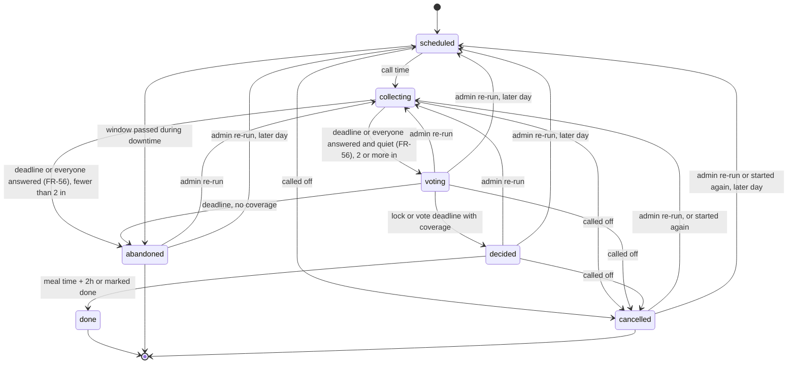

# Dinnerbell: requirements and architecture

| | |
|---|---|
| Status | Draft v0.2 |
| Date | 2026-10-21 |
| Owner | David Morgan |
| Scope | Version 1 (single household) with a roadmap for later phases |

Dinnerbell helps a household answer, at a fixed time each day, three questions: who is eating, what are we eating, and who is cooking, picking up, or ordering it. It runs as one container on a homelab, talks to the family through Slack, and keeps the catalog, preferences, history, and badges in a mobile-friendly web app.

Decisions that shaped this document are recorded in [docs/adr](adr/).

## 1. Problem

Four adults share a home and almost none of their schedules. The question "what are we eating?" arrives at the moment someone is hungry, then takes a long time to settle because:

- Nobody knows who is home, who is hungry, or who can go get food.
- Not everyone eats every option, and the group forgets who won't eat what.
- The household drifts toward the same cuisines week after week.
- The same person ends up coordinating, cooking, and picking up most of the time.

Dinnerbell moves the question to a scheduled time, collects participation and constraints before anyone proposes a meal, ranks options that fit everyone who is eating, assigns the work, and records who did it so the household can celebrate contributions.

## 2. Goals and non-goals

### Goals for version 1

| ID | Goal |
|---|---|
| G1 | Ask the question at a set time, not at the moment of hunger. |
| G2 | Make the choice fit the people eating: hard vetoes, soft preferences, variety, and which roles are actually available. |
| G3 | Make the decision stick: deadlines, named assignments, reminders, and a clear fallback when nobody answers. |
| G4 | Make contribution visible and rewarding. Positive framing only. |
| G5 | Work on iPhones without an App Store app. Slack carries notifications and quick actions; the web app carries depth. |
| G6 | Run as one self-hosted container behind Pangolin, with the code open source under AGPL-3.0. |
| G7 | Let a reluctant adopter participate fully by tapping buttons in Slack, without ever opening the web app. |

### Non-goals for version 1

- Recipes, ingredients, grocery lists, or pantry inventory. Home meals are a name plus tags.
- Cost tracking or bill splitting.
- Writing to anyone's calendar.
- Multiple households in one deployment. The data model carries a household ID so this is a migration later, not a rewrite.
- A native iOS app or chat platforms other than Slack. The channel layer is an adapter so Discord and web push can follow.

### Success criteria

Measure these 30 days after the household starts using Dinnerbell for dinner.

| Metric | Target |
|---|---|
| Dinners decided through Dinnerbell before the decision deadline | At least 80% of days with two or more participants |
| Roles (cook, pickup, order, coordinate) filled by someone other than the admin | At least 40% of decided dinners |
| Same cuisine chosen twice within 7 days | Only when the household votes for it over a higher-ranked alternative |
| Members who respond to the call on a typical day | At least 3 of 4 |

## 3. People and roles

| Role | Who | Can do |
|---|---|---|
| Admin | David | Everything a member can, plus: invite and deactivate members, make a guest a member or remove a guest, turn joining from the channel on or off, edit household settings other than the meal schedule, override or reassign a coordinator, lock or cancel a decision, rename and merge tags, connect Slack. |
| Member | Each household adult | Respond to calls, make offers, change the meal schedule, claim roles, propose and vote, maintain the catalog, set their own preferences, invite guests, log meals, give feedback on meals, view history and badges. |
| Guest | A partner or friend at a meal (#38) | Eats with the household when a member invites them to a call, one call at a time. Once invited, answers In or Out, offers to cook, pick up, or order, can be assigned those roles, and can coordinate the logistics: Close now while answers are open, marking it done, the meal time, who does what, and handing off. Never votes, proposes, suggests, vetoes, locks a pick, breaks a tie, calls a call off, starts or posts a call, makes or joins an offer, or gives feedback. Their dietary needs are hard constraints. A **registered guest** has a Slack account and answers for themselves; for an **unregistered guest** the inviting member answers and gets their messages. On the web a registered guest sees only the calls they're invited to and their own dietary needs. Someone who joins on their own starts as a guest; only an admin makes a guest a member. A member can also still bring head-count guests on their own response (5.5). |

Each member declares capability flags: can cook, can pick up, can order. The flags are defaults. A member can still volunteer for a role on a given day, and the flags drive who gets asked.

## 4. Concepts

| Term | Meaning |
|---|---|
| Household | The one family using this deployment. Owns members, catalog, settings, and history. |
| Slot | A meal of the day: breakfast, lunch, or dinner. Each slot has its own schedule and defaults. |
| Event | One coordination of one slot on one date. Two kinds: Call and Offer. |
| Call | The scheduled group question: who is in, what can you do, what do you suggest. Produces a decision with assignments. |
| Offer | One person announcing a meal they are already getting or making, with spare capacity: "I'm picking up Thai at 12:30, three servings spare." Others join until it's full. |
| Response | A member's answer to an event: in, out, or maybe; guest count; the window when they can eat; roles they can fill; a suggestion. |
| Coordinator | The member who owns a Call's decision. Self-nominated. The admin can assign or override. Defaults to nobody, in which case the system's top-ranked option is proposed and the admin can lock it. |
| Catalog item | Something the household can eat. Kind: home meal or restaurant. Carries tags, supported fulfillment modes, and the meals it's for (breakfast, lunch, dinner). |
| Fulfillment mode | How the food arrives: cook, pickup, or delivery. |
| Tag | A label on catalog items: cuisine (Thai, Mexican), protein (chicken, vegetarian), dietary (gluten-free option), or other. |
| Preference | A member's stance on a tag or item: a hard veto, or a soft score from −2 to +2. |
| Proposal | A candidate (item plus fulfillment mode) put forward for a Call, by the ranking engine, the coordinator, or a member. |
| Decision | The locked outcome of a Call: item, mode, meal time, and assignments. |
| Assignment | A member attached to a decision in a role: cook, pickup, order, or coordinator. |
| Meal log | The record of what the household ate, whether or not Dinnerbell coordinated it. Feeds variety and history. |
| Contribution | A counted act: cooked, picked up, ordered, coordinated, added a catalog item, responded on time, hosted guests, participated. |
| Badge | A named award earned by reaching a contribution milestone. Every slot counts the same: a breakfast cooked is a meal cooked. |
| Feedback | A member's reaction to a meal they ate, on up to three subjects: the food, the place (restaurants), and the cook (home meals). |

## 5. How it works

### 5.1 A dinner call

Default times are configurable per slot. The example uses the defaults.

| Time | What happens |
|---|---|
| 15:00 | The bot posts the dinner call in the Slack channel and mentions every active member. Buttons: **Answer**, which opens your own card with In, Maybe, Out, the role offers, I'll coordinate, and Details. **Details** opens a modal for guest count, eat window, a suggestion, and a note. |
| 15:00 to 16:30 | Members respond. The call message updates in place with the roster, roles offered, and suggestions. |
| 16:15 | Members who haven't responded get one direct-message reminder. |
| 16:30 | Response window closes. Maybes become outs. If fewer than two people are in, the bot posts "Everyone's on their own tonight" and the event ends. Otherwise the bot posts the top three ranked proposals with a one-line reason each and a **Vote** button per proposal. The coordinator sees **Lock this** on each. |
| 16:30 to 17:15 | Members vote. The coordinator can lock early, add a proposal, extend the window, break a tie, or shuffle the picks (FR-16, FR-61). Anyone who missed the answers can still join late with **I'm in (late)**; their vote shows but counts only if the coordinator says so (FR-60). |
| 17:15 | Vote window closes. The highest-voted proposal wins; the coordinator breaks ties, or the admin does if there's no coordinator. The bot posts the decision with the meal time, the item, and named assignments, and direct-messages each assignee with details and a link. |
| Meal time plus 2 hours | The event is marked done. Contributions are recorded. Any new badges are announced in the channel. |

If nobody claims **I'll coordinate**, the system's top-ranked proposal is the default and the vote decides. If nobody votes either, the top-ranked proposal is announced as the decision as long as its roles are covered. If no one can fulfill it, the bot posts the on-your-own message.

### 5.2 A lunch offer

Lunch has no scheduled call by default, so offers are the normal path for lunch. David, working from home, taps **Make an offer** in the App Home or runs `/dinnerbell offer`, picks a catalog item or types one with its cuisine, sets the time and spare servings, and posts. The form starts on lunch before lunch's usual meal time, with lunch's defaults (FR-1): pickup at 12:30. The channel message reads "David is picking up Siam Garden for lunch at 12:30 PM. 3 servings spare." with **Count me in** (tap again to drop out) and **+1 guest** buttons. Guests take seats, the offerer's own guests too; the offerer's own seat was never spare. The message updates as people join, and when the capacity is reached its buttons give way to **Can't make it**, which frees a seat, and the offerer gets one direct message. The offer closes at the stated time: it's on, and takes nobody else. Two hours later it's done, and the meal goes in the meal log with everyone who joined. The offerer, or an admin, can call it off until then. A member has at most 3 offers on for one slot and day.

### 5.3 A cooking offer

Any member can make an offer for dinner too: "I'm making tacos tonight, 6 servings." A cooking offer posted before the dinner call replaces that day's call: a call scheduled for that day is called off quietly, and its starter is told, and a daily call not created yet doesn't go out while the offer stands. If the offer is called off before that call's responses would have closed, the call goes out after all. Members join, add guests within capacity, and the cook sees the head count and guests' dietary needs. The cook earns the cook contribution when the event completes.

An offer for a slot whose call is already open (collecting or voting) doesn't post on its own. It becomes a pick on the call, as an added proposal (FR-13): the offerer is counted in and offers the role it takes, and it must pass the same vetoes and guest needs. While voting, only someone who's in can add one, because a new person's vetoes would change what the picks must pass. If someone who answers later can't eat it, it's dropped when voting starts (FR-29). A call has one pick per place (FR-13): an offer for a place that's already a pick in another mode takes that pick over when ranking proposed it or the offerer added it, which switches it to the offer's mode, makes it the offerer's, and keeps its votes. An offer for another member's pick, or for a pick in the same mode, is refused. Once a call is decided or over, an offer stands on its own.

### 5.4 Nobody answers

A call with fewer than two people in at the response deadline ends with the on-your-own message. A call where nobody votes and nobody can fulfill the top proposal ends the same way. Nothing is assigned and no one is nagged further.

### 5.5 Guests

A member adds guests to their own response: a head count and, optionally, dietary needs chosen from the dietary tags. Guest needs act as required tags in ranking. Guests count toward capacity on offers and toward the head count in the decision message. The member who brought guests earns the hosted contribution (section 12).

A guest can also be a person in their own right (#38, section 3): a guest record with a name, dietary needs, and, for a registered guest, a Slack user. Any active member invites one to a call while answers are open, from **Invite a guest** on their Your answer card or on the web: a saved guest, or someone new with their dietary needs. A registered guest gets a direct message with **In** and **Out**; an unregistered guest is counted in at once, and the member who invited them answers and offers roles for them on their card or the web, and gets their assignment messages. A guest's dietary needs apply whenever they're in or maybe, as a member's guests' needs do, and their own stances never count. When a guest coordinates, a tied vote goes to whoever invited them, then to an admin.

**Joining from the channel.** Someone in the Dinnerbell channel whom Dinnerbell doesn't know gets **Join Dinnerbell** when they tap a button, open App Home, or run the command (option A), and Sign in with Slack joins them too (option B). Slack is asked first: only a real user of the configured workspace (no bot or app, no deactivated account, nobody from another organization over Slack Connect) who's in the configured channel right now may join; a Slack guest account joins as a guest. Joining makes a guest linked to their Slack user, or links an invited member whose email Slack shares. Each active admin gets a direct message with **Make member** (which needs the email Slack shares) and **Remove**. The admin's **Join from the channel** setting, on by default, turns it off. Joins are rate-limited per Slack user, every join and refusal is audited, and someone an admin removed is refused until the admin adds them back. On Admin > Members, the admin can also add people from the channel in one step, as guests or as members (option C).

### 5.6 Logging a meal outside Dinnerbell

Anyone can record what the household ate when there was no call or offer, with `/dinnerbell log` or from the web app. Logged meals feed variety and history but award no role contributions.

### 5.7 Admin override

The admin can, from Slack or the web app: assign or replace the coordinator, extend or shorten a window, lock a decision, re-run a call, skip a day's call before it goes out (today or up to 7 days ahead), and correct an assignment after the fact.

Calling a call off and closing a window now aren't admin-only (FR-56). The coordinator can do both, and whoever started an ad-hoc call can call it off until it's decided. Any member who's in can become coordinator with **I'll coordinate**, so nobody has to wait for an admin.

### 5.8 Changing the schedule

Calls run at the same times every day by default. Any member can change a slot's standing schedule, such as moving the dinner call from 15:00 to 14:00, on the web app's Schedule page; `/dinnerbell schedule` shows the schedule and links there. The bot posts the change in the channel with who made it, and the change applies from the next call. Moving only today's call is an admin override.

### 5.9 Feedback after meals

When an event is done, the decision message gains a **How was it?** button, and the meal shows on the member's App Home and History page as awaiting feedback. Feedback is three quick taps, each optional:

- **Food**: loved it, fine, or not again.
- **Place** (restaurants only): loved it, fine, or not again, with optional chips such as "late," "wrong order," or "cold."
- **Cook** (home meals only): a thank-you, with an optional short note.

There's no nudge by default. A member who wants one turns on a feedback reminder in Preferences and gets one direct message per meal, unless they muted direct-message reminders, which stops every reminder. Feedback stays open for 7 days after the meal: through the seventh day after its date, in the household's time zone. A cook doesn't thank themselves, and a logged meal has no cook on record, so it takes food feedback (and place feedback for a restaurant) but no thank-you. App Home lists meals from calls; logged meals take feedback on History. Changing a meal's item deletes its feedback, and taking someone off a meal deletes theirs.

In version 1, feedback is collected and displayed but doesn't affect ranking. After at least 8 weeks of data, a later milestone decides how feedback should influence proposals.

### 5.10 A breakfast call

The household coordinates breakfast now and then: weekends, guests, holidays. So breakfast has no daily call by default, and none ever posts on its own unless a member turns its schedule on (FR-1, FR-2). On Saturday at 7:30 AM, Sam runs `/dinnerbell call breakfast`, or taps **Start a breakfast call** on Home or starts it from the web app's Today page. The call runs as a lunch or dinner call does: in, maybe, or out, roles, offers, proposals, a vote, a decision, and assignments, with breakfast's windows (30 minutes to answer, 15 to vote). Ranking proposes places whose meals include breakfast first, and tops up with others, marked such as "Usually for lunch and dinner.", when too few fit (section 7). With no eat window given, the meal time is breakfast's usual 8:00 AM. Called off, it can be started again with **Start breakfast again**.

## 6. Functional requirements

Requirements use "must" for version 1 and "should" for items that can slip to a later milestone without blocking launch.

### 6.1 Schedule and events

| ID | Requirement |
|---|---|
| FR-1 | Each slot has: call enabled or disabled, call time, response window length, vote window length, reminder lead time, default fulfillment modes, and a usual meal time for when nobody gives an eat window (FR-19). Dinner defaults: enabled, 15:00, 90 minutes, 45 minutes, 15 minutes, pickup and delivery, 18:30. Lunch defaults: disabled, 10:30, 60, 30, 15, pickup, 12:30. Breakfast defaults: disabled, 07:00, 30, 15, 10, cook and pickup, 08:00 (#58). The schedule is the same every day of the week. Any member edits it (FR-44). |
| FR-2 | The scheduler must post a call for each enabled slot once per day at the configured time, in the household time zone, and must not double-post after a restart. It never posts one for a disabled slot: breakfast and lunch post nothing on their own unless a member turns their schedule on. A call whose response window ended while the server was down is not posted, and a call is only ever posted on its own day: it's stale at midnight after it, so a call time late in the evening gets cut off at midnight. |
| FR-3 | Any member must be able to start an ad-hoc call for a slot and date from Slack or the web app. A call for today opens at once; a call for a later day, up to 7 days ahead, opens at the slot's call time, and the reply says when. Any member who could start it can post a scheduled call early instead (issue #59): responses open at once, while the response deadline, the reminder, and voting keep that day's times. Posting early is audited, and a call that's open already is left as it is. A call posted early stays posted when it's re-run or called off and started again: the new run opens at once, with that day's deadlines. A slot has at most one call per date. |
| FR-4 | Any member must be able to post an offer with item, fulfillment mode, day (today or up to 7 days ahead), time, and capacity (1 to 20 spare servings), from Slack and the web. Members join, and bring guests, until the capacity is reached; the offer closes at its time and is done two hours later (spec 5.2). |
| FR-5 | An offer for a slot that already has an open call must attach to it as a proposal; a cooking offer posted before the call must replace that day's call (spec 5.3). |
| FR-6 | The admin must be able to extend, shorten, lock, cancel, and re-run events, and skip a daily call up to 7 days ahead before it opens. Re-running a voting, decided, abandoned, or cancelled call reopens it with fresh windows: now for today's call (not after the usual meal time plus two hours), or at the slot's call time for a later day, unless it was posted early. Responses stay; proposals, votes, the decision, and assignments are cleared. Cancelling isn't admin-only: see FR-56. |
| FR-56 | **Call it off.** An admin or the coordinator can call off a call in any open state, and the member who started an ad-hoc call can while it's scheduled, collecting, or voting. An optional reason of up to 140 characters goes with it. The call ends as cancelled and nothing goes in the meal log. Everyone who was in or maybe and the coordinator are told in the call's thread, and each active member assigned to cook, pick up, or order gets a direct message; assignment and reminder messages not yet sent are dropped. A call that was never posted posts nothing; its starter gets a direct message if someone else called it off. Any member can start a called-off call again, the same way as a new one, until the usual meal time plus two hours; it starts with no coordinator. **Close now:** the coordinator or an admin ends the open window early: "Start the vote now" while collecting, "Decide now" while voting. Responses also close on their own once every active member has answered in this run of the call and nobody is a maybe: at once when everyone is out, and otherwise only once no response has changed for 10 minutes, so people can add guests or details after tapping In, and, with two or more eating, someone can cook, pick up, or order. Answers kept from before a re-run or restart don't count. |

### 6.2 Responses

| ID | Requirement |
|---|---|
| FR-7 | A member responds in, out, or maybe, and can change the response until the response window closes. |
| FR-8 | A response may include guest count, guest dietary needs, an eat window (earliest and latest), roles offered (cook, pickup, order, coordinate), one or more suggestions, and a free-text note. |
| FR-9 | "Maybe" counts toward hard-veto filtering and not toward capacity. Unresolved maybes become out at the deadline and the member is told; they can still join late while voting (FR-60). |
| FR-10 | The first member to claim coordinate becomes coordinator. The coordinator can hand off. The admin can reassign. Offering to cook, pick up, or order counts a member in unless they said maybe; saying out withdraws their offers. The coordinator also has the powers over the vote and the roles in FR-16 and FR-61: break a tie, shuffle the picks, and choose the winning pick's mode and who does it. Each is the coordinator's, or an admin's when nobody coordinates or a guest does, except choosing roles, which a guest coordinator and any admin may also do (FR-58). |
| FR-11 | Non-responders receive exactly one direct-message reminder per call at the configured lead time. Guests invited to the call who have Slack get it too (#38). |
| FR-57 | **Guests** (#38). Any active member can invite a guest to a call while answers are open: a saved guest or someone new, with up to 5 dietary needs. A guest is in only by invitation, one call at a time, and only to calls. An invitation belongs to the call, so it stays when the call is called off and started again, or re-run, and a guest with Slack who hasn't answered the new run is invited again. A guest with Slack answers themselves; for one without, whoever invited them, or an admin, answers and gets their messages. A guest's dietary needs are hard constraints whenever they're in or maybe, and a member's own dietary needs, such as a promoted guest's, are too. A guest's stances never count. |
| FR-58 | **What a guest may do** (`domain.guests`): answer In or Out, offer to cook, pick up, or order, coordinate, and, as coordinator, close the answers early (not the vote: "Decide now" picks the plan), change the meal time and assignments, hand off, and mark done. Never vote, propose, suggest, veto, lock, join late or switch a late joiner's taking part or vote (FR-60), call off, start or post a call, make or join an offer, or give feedback; with a guest coordinating, a tie goes to whoever invited them, then an admin. On the web a guest sees only their invitations and their own dietary needs; every other page refuses them on the server. Nobody waits for a guest to close a call early, but a guest's answer counts toward who's in. |
| FR-59 | **Joining from the channel** (#38 addendum). Someone in the configured channel of the configured workspace, checked with Slack and never a bot, a deactivated account, or someone over Slack Connect, can join as a guest from Slack or by signing in with Slack, while the admin's **Join from the channel** setting is on (default on). Joins are rate-limited per Slack user and audited; someone an admin removed is refused. Someone whose Slack email belongs to a member Dinnerbell can't link them to on its own isn't made a guest: they're asked to ask the admin, and the admins get a message to link them by hand (so does a Slack account the hourly email match finds linked to someone else). A joined guest keeps the email Slack shares, so adding a member with it offers to promote that guest instead. When Slack lists only part of a large channel, someone not in that part is asked to ask the admin rather than to join the channel. Each admin gets a message with **Make member** and **Remove**. Only an admin makes a guest a member, and every promotion is audited. The admin can add people from the channel as guests or members, and link a guest to the member they really are. A display name proves nothing, so the join message and the guest row show the Slack account and the email Slack shares; a link whose emails differ, or of a Slack guest account, needs the admin to see both emails and type the member's name, and is audited as an override. A guest is never linked to an admin, who sets their own Slack member ID by hand. |

### 6.3 Proposals, ranking, and voting

| ID | Requirement |
|---|---|
| FR-12 | At the response deadline the ranking engine produces N proposals (default 3) from the catalog, filtered, scored, and drawn as described in section 7, each with a human-readable reason. Places suggested for the call are among them ahead of the draw when they fit, up to N − 1 of them (section 7, step 5), so the last place is not reserved for a suggestion; the rest are a weighted random draw, so a better score makes a place more likely without always winning. Each is a different place, and none is a place an offer already made a pick (FR-5); those picks come after the N. Items for the call's meal come first; items for other meals fill the N only when too few for the meal fit, and their first reason says what they're usually for, such as "Usually for dinner." |
| FR-13 | The coordinator and any member can add a proposal from the catalog or as free text during the vote window. A free-text proposal needs a cuisine, and creates a catalog item on decision. A call holds at most 10 proposals, and each member adds at most 3. A call has one proposal per place, whatever the mode: a place is a catalog item, or free text, by its kind and name, so adding a place that's already a pick is refused with "Pho Place is already a pick (delivery). Vote for it instead." Whoever adds a proposal does it: they must be in, and adding it offers the role its mode needs (pick up, cook, or order), so it's covered (FR-17). The exception is an item with a cook list the adder isn't on: they take no role, and it's added only if a cook on the list who's in offered to cook; otherwise it's refused because they aren't on the list. Someone who isn't in is asked "You missed the answers. Join late?" first, and saying yes joins them late (FR-60) before the pick is checked; without that yes, nothing changes. Added proposals pass the same vetoes, guest needs, and coverage checks as ranked ones; a refusal for a veto or a guest need always reads "That doesn't work for everyone who's in tonight." so it can't reveal whose stance it was (FR-29). The meals an item is for never refuse a pick, because people know better than the catalog: the catalog list shows items for the call's meal first, then the rest marked such as "(usually dinner)". A free-text proposal's catalog item is for the call's meal and the default meals, lunch and dinner. |
| FR-14 | Each member casts at most one vote per proposal and can change it until the vote closes. Votes are visible, including those that don't count: a late joiner's, unless the coordinator says otherwise, are shown marked, such as "Kim (late)" (FR-60). Someone who isn't in is asked to join late before their vote is cast. |
| FR-15 | The coordinator can lock any proposal at any time during the vote window. |
| FR-16 | At the vote deadline the system decides: the pick with the most votes, counting only votes that count (FR-60). **Break the tie** (#87): while voting, when two or more covered picks share the most votes (at least one), the coordinator, or an admin when nobody coordinates or a guest does, gets **Break the tie** beside each tied pick, on the picks message and the event page, and may choose one even without having voted. It decides at once and the decision says "Tied; Kim (coordinator) chose". If nobody chooses, the deadline breaks the tie without waiting, trying these in order and keeping only the tied picks each leaves: (1) the pick the coordinator voted for (with a guest coordinating, the member who invited them); (2) the pick more admins voted for, only when nobody coordinates, or after (1) for a guest coordinator; (3) the pick the household ate longest ago, where never eaten counts as longest; (4) the order the picks were drawn in (section 7). The decision says how, as "Tied; Kim (coordinator) voted for it", "Tied; an admin voted for it", "Tied; least recently eaten", or "Tied; drawn at random". A vote that doesn't count breaks no tie and makes none, even the coordinator's. A guest coordinator can't break a tie by choosing. `domain.events.counted_votes` is the one place the tally, ties, and the decision get their counts, and `domain.events.decide_winner` the one place a tie is broken. |
| FR-60 | **Joining late** (#76). While a call is voting, a member who's out, was a maybe at the deadline, or never answered can join with **I'm in (late)**: on the call message, their Your answer card, App Home, or the event page. Voting or adding a pick while not in asks "You missed the answers. Join late?" and joins them on yes. Guests can't: they come by invitation while answers are open (FR-58). Nobody joins once it's decided; they ask the coordinator, or make an offer. A late joiner is in, marked late on the call message, the proposals, and the decision, and can offer roles while voting and add picks. The coordinator has two switches per late joiner, on the event page and in the ⋯ beside them on the proposals message: **Taking part**, on by default (off, they're out for this call, are told, and can't rejoin on their own; on, they count in the head count, coverage, and roles), and **Vote counts**, off by default (off, their votes show but are left out of the tally, ties, and the decision; on, they count like anyone's). Only the coordinator, or an admin when nobody coordinates or a guest does, changes them, while voting; each change is audited and updates the messages. A late joiner's stances and dietary needs never filter picks, even with **Vote counts** on, and their own picks pass everyone who answered on time. Only the late joiner sees which picks miss their own stances or needs, on their card, Home, and event page (FR-29); a pick that misses the needs of a guest they bring is held to as any guest's needs are (below), as those are public. A maybe the deadline turned out keeps their stances applying, as they did on time. A re-run makes late joiners ordinary answers: one who is in stays in, one the coordinator switched off stays out, unless they had been a maybe, who is a maybe again. Joining late clears guests, their needs, and an eat window left on an earlier answer, so it never changes the head count or meal time beyond the joiner. |
| FR-61 | **Shuffle and role choice** (#87). *Shuffle picks*: while voting, the coordinator, or an admin when nobody coordinates or a guest does, can redraw the picks, at most 3 times a call. With nobody having voted, every ranked pick is redrawn; once anyone has voted, only ranked picks with no votes at all, counted or not (a late joiner's vote keeps its pick too). Picks a member added, an offer made, or someone suggested are never redrawn. The redraw is the same ranking (section 7) with the next seed, `ranking_seed(household, call, run, shuffle)`, so it is reproducible, and every hard filter holds: vetoes, guests' needs (a late joiner's guests' too), someone to do it, the variety window, the meal, and one pick per place. The places just shuffled out are left out unless nothing else fits, and a shuffle that would change nothing is refused and doesn't count. The picks message updates in place with "Kim shuffled the picks (2 replaced)." and mentions nobody, a short note goes in the call's thread, and the web and App Home show the new set on refresh. It is audited (`event.shuffled`) and logged (`shuffle`, with the counts). A shuffle count and its note are cleared when a call starts a new run. *Assign roles*: when the winning pick's role has no clear owner, because more than one person offered for its way of getting it or nobody did, and someone coordinates, the coordinator gets a direct message and the decision shows **Assign roles**; the assignment of that role waits. They may switch the winning pick to another way the place allows (such as pickup to delivery) and assign anyone who's in, a volunteer preselected, and themselves. Someone assigned who hadn't offered is told the coordinator assigned them; they can't refuse in the app, but can tell the coordinator. If the coordinator hasn't chosen within the household's time (**Admin > Ranking**, default 15 minutes), the automatic assignment (the first volunteer, FR-17) stands, so the meal never stalls. The time never runs past the meal time, and marking the meal done ends it with the automatic assignment. With no coordinator the automatic assignment is made at once, and an admin may still choose. A guest coordinator may choose too (FR-58). Choosing is audited (`event.roles_assigned`) and logged (`assign_roles`). Every other person is refused with a reason code (#75), and each action names the run the person saw. |
| FR-17 | A proposal is only eligible if its fulfillment mode is covered: cook requires a member who offered to cook and can cook the item, pickup requires a member who offered to pick up, delivery requires any participating member who can order. Adding a proposal or an offer to a call counts as offering its role (FR-5, FR-13). The member's usual **Cook** and **Pick up** settings in Preferences don't count; usually ordering does. Only active members who are in count. A member can cook an item when it has no cook list or they are on it. The first volunteer is assigned; the coordinator or admin can change it (FR-61). |

### 6.4 Decisions and assignments

| ID | Requirement |
|---|---|
| FR-18 | A decision records item, fulfillment mode, meal time, participants with guest counts, and assignments. |
| FR-19 | Meal time defaults to the latest "earliest" across participants' eat windows, rounded up to the quarter hour, or the slot's usual meal time when nobody gave one, and never earlier than the decision. The coordinator can change it. |
| FR-20 | Each assignee receives a direct message with the decision, their role, meal time, item link, head count, and dietary notes: the needs of guests, and of members who are eating, except a late joiner's own, which would give them away when they are the only one (FR-60). |
| FR-21 | Events become done at meal time plus 2 hours, or when any participant marks them done once it's meal time (the admin can at any time). Contributions are recorded on done. |
| FR-22 | Done events open feedback for their participants, as specified in section 6.10. |

### 6.5 Catalog

| ID | Requirement |
|---|---|
| FR-23 | Any member can add, edit, and deactivate catalog items. Deactivation hides an item without deleting history. |
| FR-24 | A catalog item has: kind (home meal or restaurant), name, tags, supported fulfillment modes, the meals it's for (at least one of breakfast, lunch, and dinner; default lunch and dinner), optional URL (menu or recipe link), optional order URL (restaurants), optional notes, optional default servings (home meals), optional list of members who can cook it (home meals). |
| FR-25 | Tags are shared across the household. Any member can add a tag; the admin can merge and rename tags. Tag kinds: cuisine, protein, dietary, other. A cuisine tag merges only into another cuisine tag, so every item keeps a cuisine. Merging moves the tag's items, preferences, and meal-log references to the surviving tag; when a member has a stance on both, a veto wins, otherwise the lower score. |
| FR-26 | Any member can bulk-import tags and catalog items from a file in the format defined in [catalog-format.md](catalog-format.md), by paste or upload, with a validated preview before anything is saved. The same file can seed the catalog at first run. Imports never delete. |

### 6.6 Preferences

| ID | Requirement |
|---|---|
| FR-27 | Each member sets, for any tag or item: veto, or a soft score of −2, −1, 0, +1, +2. Default is 0. |
| FR-28 | A veto on a tag excludes every item carrying that tag whenever that member is in or maybe. A veto on an item excludes that item. |
| FR-29 | Members see and edit only their own preferences. Known limit: in a group of two, "Not everyone's favorite" next to your own stance, or watching which picks are accepted before and after the other person answers Out, can reveal that person's stance. The aggregate the spec allows is as small as the group is. The coordinator sees an aggregated "won't work for" list per proposal, not who vetoed what. Every proposal, ranked or added, must pass the combined vetoes and dietary needs of everyone in or maybe who answered on time before it exists, and a decision rechecks them. Late joiners (FR-60) relax that guarantee for themselves only, so their list can be non-empty, and it stays unshown: with one late joiner, any per-pick signal from their stances or own dietary needs would say what that person vetoes, to the coordinator or anyone else. Only the late joiner sees "⚠ This pick doesn't fit your preferences" on the picks that miss their own, which tells them nothing new. Guests' dietary needs are public and safety-relevant, so a late joiner's guests' needs are held to as any guest's: they filter picks drawn or added from then on, while a pick already proposed stays and warns everyone, and the warning stays on the decision: "⚠ A guest of someone who joined late needs Vegetarian, and this isn't marked that way." |

### 6.7 Variety and history

| ID | Requirement |
|---|---|
| FR-30 | The meal log records every decided event and every manually logged meal with date, slot, item, cuisine tags at the time, and participants. |
| FR-31 | The variety window is configurable; default 7 days. The same item within the window is excluded from ranking unless no other eligible item exists. The same cuisine within the window is penalized in proportion to recency. |
| FR-32 | The web app shows history by week and the cuisines eaten in the current window. |

### 6.8 Notifications

| ID | Requirement |
|---|---|
| FR-33 | Notifications are produced by the domain layer as typed events and delivered by a channel adapter. Version 1 ships the Slack adapter. |
| FR-34 | The notification matrix in section 9 defines what is sent, to whom, and where. Every notification is queued in the outbox with an idempotency key, so a transition that is retried queues it once. A clean restart doesn't send it twice. A crash during delivery can: the row is redelivered after its 5-minute lease, so delivery is at least once. A channel outage never uses up a row's attempts: the row keeps retrying for 24 hours after it was queued, then fails with a logged reason instead of being sent late. |

### 6.9 Web app

| ID | Requirement |
|---|---|
| FR-35 | The web app is mobile-first and works in Safari on iOS with no installation. |
| FR-36 | Pages: Today, Catalog, Preferences, History, Stats and badges, Admin. See section 11. |
| FR-37 | Every Slack message about an event links to that event's page. |

### 6.10 Feedback

| ID | Requirement |
|---|---|
| FR-45 | Any participant in a done event, or a member named on a logged meal, can give feedback for up to 7 days after the meal. Each member gives at most one feedback per meal and can edit it within the window. Feedback does not affect ranking in version 1. All feedback is stored with the item, mode, cook, and participants at the time, so a later milestone can use it. |
| FR-46 | Feedback has up to three subjects, each optional. Food: loved it, fine, or not again. Place, restaurants only: loved it, fine, or not again, plus optional issue chips (late, wrong order, cold, other). Cook, home meals only: a thank-you plus an optional note up to 200 characters. |
| FR-47 | Feedback is available from a button on the decision or offer message, from App Home, and from the History page. Feedback is never required. |
| FR-48 | Each member has a feedback reminder setting, default off. When on, the member gets one direct message per done meal they participated in. |
| FR-49 | The catalog item shows how many loved the food and how many loved the place. "Fine," "not again," and place issues are stored for a later milestone but never shown, not even as counts, because in a small household a count can name the one person who gave it. Cook thank-yous and notes are shown to the cook. Other members see only the thank-you count. No one sees who chose "not again." Each member sees only their own food and place answers; no page, message, export, log, or audit row says who gave which. A thank-you belongs to the cook it named when it was given, so if the cook changes later, the new cook never sees notes written to the old one, and the count is about the meal's cook now. |

### 6.11 Metrics and badges

| ID | Requirement |
|---|---|
| FR-38 | Contributions in section 12 are counted per member when an event is done (feedback, when it is given), exactly once however often the event is finished. The first start after the upgrade counts the meal log already there, in batches, and every start counts a done call that has none. A failure while counting never blocks marking a call done. |
| FR-39 | Badges in section 12 are awarded when thresholds are met, once per member and tier, announced once in the channel (never for a badge earned while catching up, and never Food Critic, which gets no post of its own), and shown on the member's Stats page and App Home. |
| FR-40 | A monthly recap posts on the first day of the month, from 9 a.m. in the household time zone, for the month before: meals, cuisines tried, new catalog items, badges earned, and a thank-you naming the members who cooked, picked up, ordered, or coordinated, grouped by how and in name order, with no one's count. It posts once however often Dinnerbell restarts; if Dinnerbell was down on the first, it posts on the next tick up to the seventh and otherwise leaves that month out. A month with no meals posts nothing. It never ranks members from worst to best. |

### 6.12 Administration

| ID | Requirement |
|---|---|
| FR-41 | The admin invites a member by email. The member's first sign-in with that email activates the account and links the identity. Unknown emails are refused with a message to ask the admin. |
| FR-42 | The admin maps or confirms each member's Slack user ID. Default mapping is by email match. |
| FR-43 | The admin edits time zone, variety window, ranking weights, ranking randomness (the temperature in section 7), and badge thresholds in the web app. |
| FR-44 | Any active member can edit the standing schedule for a slot, on the web app's Schedule page: call enabled, call time, window lengths, reminder lead time, usual meal time, and default fulfillment modes (everything in FR-1). Times are wall-clock times in the household's time zone. Windows run 5 to 360 minutes, the reminder comes before responses close, the call's windows end by midnight, and, while the slot is on, voting closes before the usual meal time; a slot can always be turned off. Each change is written to the audit log with who changed what, old and new, and announced in the channel with the member's name, what changed, and the first day it applies. A save that changes nothing posts nothing, and a save over someone else's newer change is refused. A change applies from the next call: a call that's open, or already scheduled for a later day, keeps the times it was created with, and so does a day an admin skipped. A call started again, by a re-run or after a call-off, gets fresh windows from the current schedule. When today's call hasn't been created yet, today follows the new schedule if its call can still open today; if it can't, but the old schedule would still have opened one, today's call is scheduled at the old time, and the announcement says so. Turning a slot off applies today. `/dinnerbell schedule` shows each slot's schedule and links to the page; editing stays on the web. Ranking weights and randomness, the proposal count, the variety window, and skipping a day stay admin-only (FR-43, FR-6). |

### 6.13 Later phases

| ID | Requirement | Phase |
|---|---|---|
| FR-50 | Each member may paste a Google Calendar secret iCal URL. The app polls it read-only and shows "busy at usual dinner time" as a hint on the call roster. Never writes to any calendar. | Calendar |
| FR-51 | A member can ask the assistant in natural language: "something we haven't had in a month that works for everyone in," or "tacos at 7, I'll cook." The assistant turns requests into proposals and offers through the same domain API and never bypasses filters. | Assistant |
| FR-52 | A Discord adapter implements the channel interface. | Channels |
| FR-53 | Web push for Home Screen web apps as an optional additional channel. | Channels |
| FR-54 | Multiple households per deployment. | Multi-tenant |
| FR-55 | Feedback influences ranking, for example a "not again" from a participant acting as a soft penalty for that item. The design is decided from at least 8 weeks of collected data and recorded in an ADR. | Feedback-informed ranking |

## 7. Ranking

Ranking is explainable and reproducible: hard filters decide what can be picked, a score decides how likely each place is, and a seeded draw decides among them. Given a Call with participants P (in and maybe), roles offered R, and guest needs G:

1. **Candidate set.** All active catalog items that aren't already picks (an offer's, FR-5), expanded into (item, mode) pairs for each mode the item supports. In version 1 every slot allows every mode; the slot's default modes earn the default-mode bonus.
2. **Hard filters.** Drop a pair if:
   - Any member in P vetoes the item or any of its tags. P counts maybes, so ranking runs before the deadline turns them out.
   - Guest needs in G include a dietary tag the item lacks.
   - The mode is not covered by R (FR-17).
   - The item was eaten within the variety window, unless that empties the set. This applies once, across items for every meal (FR-31): a repeat comes back only when nothing fresh is left for any meal.

   Then keep only items for the call's meal: a lunch call's candidates are items whose meals include lunch. These are the **meal group**. The rest are the **top-up group** (step 8). An item "fits" a call when it passes all of these. So a fresh item beats meal fit, and meal fit beats score: when the only lunch place was eaten yesterday and fresh dinner places pass, the vote is dinner places, each marked as one. Nothing later in ranking can bring back a pair these filters dropped.
3. **Score.** For each remaining pair, sum:

| Component | Formula | Default weight |
|---|---|---|
| Soft preference | Sum over members in P of their item score, plus 0.5 × sum of their tag scores for the item's tags | 1.0 |
| Cuisine variety | For each cuisine tag eaten within the window, −(1 − days_since / window) | 3.0 |
| Novelty | +1 if the item has never been eaten | 1.0 |
| Suggested today | +1 for each participant who suggested the item in this call | 2.0 |
| Default mode | +0.5 if the mode is one of the slot's default fulfillment modes | 1.0 |
| Volunteer fit | +0.5 if the mode is cook and the volunteer cook is on the item's cook list | 1.0 |

   Scores are rounded to 6 decimal places, so sums that a person would call equal tie.
4. **One mode per item.** An item is proposed once, in its best mode: the one whose mode components (default mode, volunteer fit) score higher, with ties going to cook, then pickup, then delivery. So the picks are N different places.
5. **Suggestions first.** A place a participant suggested for this call, and that passed step 2, is proposed before any draw, but at most N − 1 places are guaranteed this way, counting both groups, so the last place in a vote is not reserved for a suggestion (with N = 1, none is guaranteed; a suggestion then competes in the draw like any place). When more suggestions fit than there are guaranteed places, the highest-scoring ones go in, with ties drawn as in step 6 at temperature 0, and the rest stay in the draw with their suggestion's score. A suggested place for another meal is in the top-up group, so it's proposed only when the top-up has room.
6. **Draw.** Fill the rest of the N by weighted random sampling without replacement from the group's other candidates. Each candidate's weight is `exp((score − best) / T)`, where `best` is the best score left in the group and `T` is the household's **ranking temperature**: default 1.0, from 0 to 3, set on Admin. So equal scores have equal chances until a pick shares their cuisine (step 7), and at T = 1 a place one point better is about 2.7 times as likely. At T = 0 only the best score left has any weight: the picks are in score order, and ties are drawn at random, never by name. Each draw is one step of the Efraimidis–Spirakis method, with keys compared as logarithms so that no weight overflows.
7. **Variety within the vote.** After each pick, including a suggestion, every candidate sharing one of its cuisines has its weight multiplied by 0.3, a fixed constant. So a vote rarely holds three taco places when other cuisines fit. At T = 0 this only changes the chances among tied scores.
8. **Top up.** If the meal group runs out before N picks, steps 5 to 7 run again over the top-up group, from step 2, to fill the N. Top-ups come after every pick for the meal, whatever their scores, so a lunch call never proposes a dinner-only place while N lunch places fit. A catalog with too few items for a meal still produces a vote.
9. **Explain.** Each proposal carries the top two positive components and any penalty as a sentence: "Suggested by Alex. Nobody has had Ethiopian in 3 weeks." A top-up's first sentence says what it's usually for: "Usually for dinner." Winning a draw isn't a reason and isn't mentioned. Ranking also reports each proposal's score, which is stored with it, and how many candidates in its group had the same score, which isn't stored yet.

The proposals are stored in the order steps 5 to 8 produced them. That order is each proposal's rank, the one FR-16 uses to break a tie at the deadline when no coordinator or admin voted.

**The seed.** The draw uses a seed derived with SHA-256 from the household, the call, and the call's run, passed in with the snapshot. Ranking the same run again, with the same inputs, gives the same picks. A re-run or a restart after a call-off (FR-6, FR-56) is a new run and draws again. The coordinator's shuffle (FR-61) draws again too, with the seed of the call, its run, and the number of shuffles so far; the first draw is shuffle 0, so it keeps the seed it always had.

Feedback is not an input in version 1; FR-55 adds it once there is enough data. Weights and the temperature are household settings. The engine is a pure function over a snapshot that includes its seed, so it is unit-testable without a database ([ADR 0007](adr/0007-seeded-weighted-ranking.md)). [Ranking](ranking.md) explains it for the household, with a worked example.

## 8. Event lifecycle



Offers use a shorter chain: open (stored as `collecting`, and "full" while no seat is left), then closed at the stated time (`decided`: it's on), then done at the stated time plus two hours, or when someone who ate marks it done. An offer has no reminder, windows, or votes, and after downtime it catches up to done instead of expiring: its plan was set when it was posted. The offerer or an admin can call it off (`cancelled`) until it's done. A cancelled or abandoned event records nothing in the meal log and awards nothing.

Transitions are driven by two sources: user actions through a channel or the web, and scheduler ticks. Every transition is a single transaction that updates state, writes the notification outbox, and records the audit row. The outbox is drained by the channel adapter so a Slack outage never loses a state change.

The scheduler doesn't keep a job per deadline. One tick every 30 seconds opens each household's due calls and walks every open event through each step it owes, in order, so downtime past several deadlines is caught up on the next tick. A reminder whose response deadline has already passed is skipped.

Catch-up stops where it would be too late to matter. An undecided call (scheduled, collecting, or voting) expires once it passes the later of the slot's usual meal time plus two hours and its own vote deadline plus two hours, and always at midnight after its day; a scheduled call whose response window passed while the server was down expires without being posted (FR-2); and a decision whose meal time would fall after its day expires instead. An expired call is abandoned with the reason "missed", quietly: no new channel post and no direct messages, only its existing messages updated. [docs/channels.md](channels.md) is the outbox and adapter contract.

## 9. Notifications

| Trigger | Audience | Where |
|---|---|---|
| Call opens | All active members | Channel post with mentions |
| Response window closing | Non-responders | Direct message, once |
| Maybe turned out at the deadline | That member | Direct message (FR-9) |
| Proposals ready | All participants | Top-level channel post, mentioning everyone who is in |
| Decision made | All participants | Top-level channel post, mentioning everyone who is in |
| Assignment | Each assignee | Direct message |
| Abandoned | All members | Channel post |
| Offer posted | All active members | Channel post |
| Offer full | Offerer | Direct message |
| Badge earned | Everyone | Channel post |
| Monthly recap | Everyone | Channel post |
| Call called off | Everyone who was in or maybe, and the coordinator | Channel post, threaded. None for a call that was never posted |
| Called off after the decision | Each member assigned to cook, pick up, or order | Direct message |
| Unposted call called off by someone else | The member who started it | Direct message |
| Schedule changed | Everyone | Channel post naming who changed it, what changed, and the first day it applies (FR-44). No mentions |
| Feedback reminder | Participants who turned the reminder on and haven't muted reminders | Direct message, once per meal |

Each member can mute direct-message reminders in their preferences. Channel posts are never suppressed per member. The call, proposals, and decision messages are also edited in place as they change; see [docs/channels.md](channels.md).

## 10. Slack design

The adapter lives in `src/dinnerbell/channels/slack/`. `dinnerbell slack preview KIND` prints any message, modal, or Home tab as Block Kit JSON for Slack's [Block Kit Builder](https://app.slack.com/block-kit-builder).

**Connection.** The app uses Socket Mode, so Slack never calls an inbound URL. Only the web app is exposed through Pangolin. Dinnerbell connects when `DINNERBELL_SLACK_BOT_TOKEN`, `DINNERBELL_SLACK_APP_TOKEN`, and `DINNERBELL_SLACK_CHANNEL` are all set. In the background it checks the bot token (`auth.test`), that the token's workspace matches `DINNERBELL_SLACK_TEAM_ID` when that is set, the app-level token, and that the bot is a member of the channel. A failed check is logged once with the fix and shown in `/healthz` as `error`; Dinnerbell checks again every minute until it passes, then hourly. The web app stays up either way. The Socket Mode client pings Slack and reconnects by itself after a drop, shown as `disconnected` meanwhile.

**Bot scopes.** `chat:write`, `channels:read`, `im:write`, `files:write` (uploads badge art, #105), `users:read`, `users:read.email`, `commands`. Events: `app_home_opened`. Interactivity: block actions and view submissions. The channel must be public; a private channel would also need `groups:read`. The full configuration is [deploy/slack-app-manifest.yaml](../deploy/slack-app-manifest.yaml).

**Sign in with Slack.** User scopes `openid`, `email`, `profile`. Slack publishes an OpenID Connect discovery document, so the generic OIDC client in the web app works unchanged.

**Channel.** One configured channel, default `#dinnerbell`. The bot posts calls, proposals, decisions, offers, badges, and recaps there. The proposals and the decision post at the top level, not in the call's thread, so the newest message is the one to act on (#92); only a call-off notice replies under the call message. Each starts with a title line ("Dinner picks · Tuesday, Oct 27"), so posts from different calls on one day can't be confused. Messages are short and encouraging: they thank people for pitching in and never scold anyone for not answering. Times show in the household's time zone, such as "5:15 PM". Every message links to its event page (FR-37).

**Call message.** Header with slot and date, and a status line: who's in and the response deadline, then voting ("the picks are posted below"), decided (it names the result: "It's decided: Pho Place, pickup, at 6:30 PM"), done, on your own, cancelled, or, for a call that went stale while the server was down, "This call ended without a decision." The roster section updates in place: who's in with guests, guests' dietary needs, roles offered, eat windows, suggestions, and notes; maybes and outs; who hasn't answered yet (by name, never a mention); and the coordinator. While responses are open, the message has one **Answer** button (primary, with a screen-reader label that says what it does), which posts the tapper's Your answer card, then **View on web**. The choices themselves (**In**, **Maybe**, **Out**, the role offers, **I'll coordinate**, and **Details**) are only on each person's card: everyone sees the same message, so it can't show anyone's own choices, and the roster is the shared summary. **Answer** names the call's run; on a message left over from before a restart or call-off, or after responses closed, it posts a card saying "This call moved on." While voting with nobody coordinating, **I'll coordinate** stays on the message, because no card is offered then and someone can still take the vote in hand; it names the run, like **Answer**. A call posted before its day says which day it's for and that answers are due that day. Call messages posted before **Answer** existed keep their old buttons until they're redrawn, and those still post a card. While a window is open, a ⋯ menu (`call_menu`) next to **View on web** has **Call it off** and Close now, labeled **Start the vote now** while collecting and **Decide now** while voting (FR-56). Once the call is decided, only **Call it off** is left, as a plain button, because Slack has required at least two options in an overflow menu. Slack shows everyone the same message, so the menu follows the call's state; picking an option checks who may, and anyone else gets a private reply saying who can. **Call it off** opens a modal with an optional reason of up to 140 characters; submitting it is the confirmation. Slack can't color a modal's submit button, so it isn't red. Close now opens a short confirmation modal instead of Slack's confirm dialog, because an overflow menu can confirm only all of its options or none; past the window's deadline it opens nothing and says the call has moved on, and if the call has moved on to the next window by the time someone confirms, nothing changes. Every menu option, button, and modal names the run of the call it was drawn for, so one left over from before a re-run or a restart says "That can't happen anymore." instead of acting on the newer run. A called-off call's status reads "Called off by {name}." with the reason. **Details** opens a modal with guest count, guest dietary needs, an eat window, a catalog suggestion or a new idea, and a note, prefilled with the member's response. The opening post mentions every active member.

**Your answer card.** **Answer** on the call message posts an ephemeral card only the tapper sees (a guest's has only **In**, **Out**, the role offers, and **I'll coordinate**; a member's also has **Invite a guest**, and a row of **In**, **Out**, and role buttons for each guest without Slack they invited, at most five): the call, their answer and offers ("Your answer: **In** · can cook or order"), the coordinator, the response deadline, and the same buttons with their own choices selected. A selected button is primary and its text starts with "✓ " ("✓ In", "✓ I can cook"), so the state doesn't depend on color. Role buttons on the card say which way they go, offer or withdraw, so a double tap can't undo itself. A tap on the card replaces the card in place through that tap's `response_url`, and adds no message. A tap on the call message can't: its `response_url` would rewrite the call for everyone, and Slack can't edit an ephemeral any other way, so each **Answer** posts a new card. When Slack refuses to replace a card (a `response_url` lasts 30 minutes and 5 uses), Dinnerbell posts a new one. Nothing about cards is stored; each is drawn from the member's response. Every card button names the call's run, like the ⋯ menu; a card for a call that has started again, closed responses, or been called off says "This call moved on." with the call's state instead of acting. **Details** opens the Details modal, which names the run it was opened for. It opens from the card or Home, and from older call messages only. Two quick taps on one call are handled in order, so the card always ends on the last. Problems a tap runs into, such as someone else coordinating already, show on the card. App Home's call card has the same buttons, drawn by the same builder (see App Home).

**Proposals message.** A top-level post that opens with the title line and mentions everyone who is in, guests with Slack and late joiners included after the instructions and deadline. Only this first post mentions anyone: an edit shows the same people as plain names, because Slack may notify a mention an edit adds. A very large household is split across a few sections and cut off with a pointer to the web. One section per proposal, at most 10: name (linked when it has a URL), mode, cuisine, reason, vote count, and voters. Each has **Vote** (tap again to take the vote back; a private message confirms which) and **Lock this** with a confirmation. Slack shows everyone the same message, so everyone sees **Lock**; the service refuses anyone but the coordinator and the admin. An **Add proposal** button opens a modal: how (cook, pickup, delivery), a catalog item or something new, and a cuisine for something new.

**Decision message.** The same title line ("Dinner decision · Tuesday, Oct 27"), then item, mode, meal time, head count with guests, assignments with mentions, guests' dietary needs, a closing "In:" list that mentions everyone who is in (not only people with a role; plain names on an edit, split and capped for a large household), guests' dietary needs, item and order links, event link. **Mark done** button, which asks to confirm; members can mark it done once it's meal time, the admin any time. A **Call it off** button stays until the meal is done. A called-off decision is struck through, with who called it off and why. After the event is done, a **How was it?** button opens the feedback modal: the food, the place for a restaurant, and a thank-you with an optional note for the cook of a home meal, prefilled with the member's answers. It names the call's run, like a card button. Feedback never changes the shared message.

**Direct messages.** The reminder has **In**, **Maybe**, and **Out** buttons, unselected until the member answers. They're card buttons, naming the run, and a tap edits the reminder itself with `chat.update` to show the answer selected, as on the card; a reminder for a call that has moved on says so instead. If Slack won't edit it, a private line says what was saved. A maybe turned out at the deadline is told so, kindly. Each assignee gets one message listing all their roles, the item, the meal time, the head count, guests' dietary needs, and links.

**Offer message.** Offerer, item, mode, time, spare servings, roster, and guests' dietary needs. **Count me in** (tap again to drop out) and **+1 guest** while seats are left; when it's full, only **Can't make it**, which frees a seat. Slack shows everyone the same message, so the buttons can't show anyone's own place; the private reply does ("You're in for Siam Garden with 1 guest. 1 spare."). Each button names the offer's run, like a card button. After its time, **Mark done**; once done, **How was it?**, as on a decision. **Call it off** stays until it's done, and the service lets only the offerer or an admin use it. A call-off threads under the offer message. The offer message is its event's only message, keyed like a call message, so a discard on a test instance edits it too.

**App Home.** Today's events with the member's status and the buttons of their Your answer card while answers are open (**In**, **Maybe**, **Out**, **I can cook**, **I can pick up**, **I'll order**, **I'll coordinate** while nobody is, **Details**, and **Invite a guest**; a guest's **In**, **Out**, the role offers, and **I'll coordinate**), with their choices selected as on the card (#84), then **Mark done**, Close now and **Call it off** for whoever may (below), and **Open**. Home and the card draw these buttons from one builder, in the same rows (the answers; the roles; then **Details** and **Invite a guest**, followed on Home by the call's own buttons), with the same action IDs. No row has more than five buttons, so Slack never folds one under **+ N more**. Each names the call's run, so a tap on Home acts as a tap on the card does, and one from a Home drawn before the call moved on is refused with the card's reason. Rows for a member's guests without Slack stay on the card. While the call is open, Home says who's coordinating ("You're coordinating. Thanks for steering!" or "**Coordinator:** Sam"). **Start a dinner call**, **Start a lunch call**, or **Start a breakfast call** for any slot without a call today, **Start dinner again**, **Start lunch again**, or **Start breakfast again** for a slot called off today until the usual meal time plus two hours (in that order, most used first, so breakfast comes last; with **Make an offer** that's four buttons in one row, so it costs no blocks), calls posted early for a later day with that day named, a **Coming up** list of calls scheduled for later ("Lunch · Sunday, Oct 25 · posts at 10:30 AM") with **Post it now** for any member and **Call it off** for whoever may, links to preferences, the catalog, and history on the web, and the version line from the help reply at the bottom. Home is per member, so it shows **Call it off** (red) and Close now (**Start the vote now** or **Decide now**, with Slack's confirm dialog) only to people allowed to use them: the coordinator and admins, and the starter of an ad-hoc call for **Call it off** until it's decided (FR-56). It's published when the member opens it and after each tap there, with the result as a notice at the top. Today's offers show among the calls, with what, when, the seats left, and the member's own place ("You're in with 1 guest."), and **Count me in**, **+1 guest**, **Can't make it**, **Mark done**, and **Call it off** for whoever may. **Make an offer** starts the row of start buttons; a slot with a live cooking offer today has no **Start a call** button. Calls and offers still open from earlier days, which the scheduler normally closes, including a call that never posted, come after the start buttons and **Coming up**, newest first and at most three, with a line linking Today on the web for the rest; a guest's Home orders their invitations the same way. When Home would pass Slack's 100 blocks, it leaves whole cards to the web from the bottom up, never a card without its buttons, and a line says how many; the start buttons and links always show. Below the calls, "How was it?" lists up to five meals from calls and offers in the last week that the member ate and hasn't given feedback on, each with **How was it?**, and links to History for the rest. A member's Home ends with a short "Your badges" section: their own badges and the one closest to its next tier. A guest's Home has none.

**Slash command.** `/dinnerbell` (or the command `DINNERBELL_SLACK_COMMAND` names) with subcommands `call`, `offer`, `log`, `cancel`, `schedule`, `prefs`, `catalog`, `history`, `version`, and `help`. `call` starts a dinner call today; add `breakfast` or `lunch`, `tomorrow`, or a date such as `2026-10-24`. A later day's call is scheduled, and the reply says so ("Scheduled the lunch call for Sunday, Oct 25. It posts in #dinnerbell at 10:30 AM that day.") with a **Post it now** button; `now` or `early`, as in `call lunch tomorrow now`, posts it at once, and also posts one that's scheduled already. Replies that link the channel or have buttons come as an ephemeral in the household channel, and otherwise as a direct message, where their buttons work. `cancel [breakfast|lunch|dinner] [today|tomorrow|YYYY-MM-DD] [reason]` calls off a call, with the rest of the line as the reason; without a slot it calls off that day's only open call, and asks which when more than one is open ("Breakfast, lunch, and dinner are all open today. Which one? …"). The day defaults to today. `version` names the running version as the web footer shows it, the instance label if one is set, the database's schema revision, and a link to the release notes, or to the commit for a `main` build; it needs the right workspace and a Dinnerbell member: anyone else gets "You're not in Dinnerbell yet. Open the Dinnerbell app's Home tab to join, or ask the admin.", as they do from `help`, `prefs`, `catalog`, and `history`, with no URL, version, or revision. One Slack user Dinnerbell doesn't know gets at most five answers from the app in five minutes. Help ends with a version line, such as "Dinnerbell 0.3.0+abc1234 · TEST". `schedule` shows each slot's call time, when answers and voting close, and the usual meal time, with a **Change the schedule** button that opens the web app's Schedule page; changing it from Slack would need a modal as long as the web form, so it stays on the web. `offer` opens the offer modal, as **Make an offer** on Home does. `log` opens a modal to log a meal eaten outside Dinnerbell (spec 5.6): a catalog item, the meal, the day (today or earlier), and who ate, starting with the person who opened it. The others reply with links. Replies are ephemeral.

**Identity.** The bot acts only for Slack users linked to active members or guests, and only on payloads from the configured workspace. A guest's taps are limited to answering In or Out, the role offers, and coordinating's logistics; anything else gets "Guests can answer and pitch in, but not that." (#38). Someone in the channel whom Dinnerbell doesn't know is offered **Join Dinnerbell** (5.5). Message buttons work only in the configured channel and in the bot's direct message with the member who taps (checked with `conversations.open`). Unlinked users get **Join Dinnerbell**, or, while joining from the channel is off, a message asking them to sign in on the web once or ask the admin. Members are linked by the `https://slack.com/user_id` claim when they sign in with Slack, by email every hour (`users.lookupByEmail`), or by hand on Admin > Members (FR-42). An email match links only a full member of the configured workspace: never a guest, a bot, an external (Slack Connect) user, or a deactivated account. A link the admin sets or clears by hand is locked, so neither the email match nor sign-in changes it.

**Errors.** Every interaction is acknowledged within Slack's 3 seconds before any work. Rule violations come back as ephemeral messages, or as a notice on the Home tab when the tap was there. Modal fields that are wrong on their face (a negative guest count, an eat window backwards, something new without a cuisine) are flagged next to the field before the modal closes. Rate limits and outages are retried by the outbox; errors no retry can fix, such as a member with no Slack account, close the notification at once.

## 11. Web app

Mobile-first server-rendered pages with HTMX for in-place updates. No JavaScript build step.

| Page | Content |
|---|---|
| Today | For a guest, only the calls they're invited to, with In, Out, the roles, and coordinating's logistics, and a page for their dietary needs. For members: open events with roster, proposals, votes, and the same actions Slack offers, including **Call it off** and **Close now** for whoever FR-56 allows. A called-off call shows who called it off and why, and **Start {slot} again**. **Coming up** lists calls scheduled for later, when each posts, and **Post it now**. Start a call, now or for a later day, optionally posting it now, or post an offer. |
| Catalog | Search and filter items by tag, kind, mode. Add and edit items. See last eaten and feedback counts. Tag management: any member adds tags; the admin renames and merges them. Import a catalog file with a preview (FR-26). |
| Preferences | Tags and items with veto and −2 to +2 controls. Capability flags. Mute reminders. Feedback reminder on or off. Calendar URL (later phase). |
| History | Meals by week. Cuisines in the current variety window. Give or edit feedback on recent meals. |
| Stats | Contribution counts, badges with progress to the next tier, household totals and newest badges. Guests see only their own pitching-in badges. |
| Schedule | Each slot's standing schedule, which any member can change (FR-44). |
| Admin | Members and invitations, Slack mapping, guests (add, edit, link Slack, link to a member, promote, remove), **Join from the channel**, **Add people from the channel**, skipping a day's call (FR-6), time zone, ranking weights and randomness, badge thresholds, backup status. |

## 12. Metrics and badges

### Contributions

A contribution is one thing a member did for a meal. They are counted when a call or offer reaches done (FR-38), except feedback, which counts when it is given. Counting is idempotent: a call counts once per member and kind however many times it is finished, re-run, or finished at the same moment from two places, and the first answer to a feedback form counts once however often it is changed. Nothing is counted for a call that was called off, abandoned, or discarded, and a meal someone logged by hand has no roles or answers to count.

| Kind | Recorded when |
|---|---|
| cooked | Assigned cook on a done event, or offerer of a done cooking offer |
| picked_up | Assigned pickup on a done event, or offerer of a done pickup offer |
| ordered | Assigned order on a done event, or offerer of a done delivery offer |
| coordinated | Coordinator of a done call |
| participated | In on a done event, including a late joiner (#76) who is taking part |
| responded_on_time | Answered a call (in, maybe, or out) within 15 minutes of it opening, and the call is done. Offers and late joiners never earn it |
| suggested | Made a pick (a member's or the coordinator's, not one the system drew) that became the decision |
| added_item | Created a catalog item that was first chosen on this event (counted once per item, to its creator) |
| explored | Made a pick that won and was new to the household: an item or a cuisine it had never eaten before that meal |
| hosted | Brought one or more guests to a done event: a head count on their answer, or an invited guest who is in |
| gave_feedback | Gave feedback on a meal, once per meal (FR-45's window applies) |
| gambled | In (not a late joiner, not a guest) on a done call with at least 3 picks, and the final votes (after any taken back) were every pick, or none of them, whether or not anyone else voted (#108, #125). Offers never earn it |

**Who earns what.** Pitching in (cooked, picked_up, ordered, coordinated) goes to whoever the event assigned, a guest included: a guest who picks up picked up. Everything else goes to members only, because a guest comes by invitation, never chooses what is eaten, and gives no feedback (#38); the member who brought them earns hosted. Their badges are kept and announced like anyone's. A guest's App Home has no badge section, but they see their own pitching-in badges on the Stats page (Your badges in the navigation), and nothing of the household's or the members'. History stays under the guest record (it is not merged when an admin links a guest to a member). "Never eaten" counts every meal in the log, including meals logged by hand, ordered by day, then slot, then the order logged.

### Badges

Every badge uses one ladder of five tiers, with a different shape for each so tiers differ without color:

| Count | Tier | Shape |
|---|---|---|
| 1st | First | Ribbon rosette (teal) |
| 10th | Bronze | Medal |
| 50th | Silver | Medal |
| 100th | Gold | Medal with a sparkle |
| 200th | Diamond | Faceted gem with a sparkle |

The five counts are the household's **badge thresholds** (FR-43), 1, 10, 50, 100, and 200 by default. They must be whole numbers from 1 to 10,000, each higher than the one before, and an admin saves all five together. Raising a threshold takes no badge away; lowering one awards the tiers members already have the counts for, quietly (below).

| Badge | Icon | Counts |
|---|---|---|
| Chef | Chef hat | cooked |
| Road Runner | Car | picked_up |
| Order Up | Takeout bag | ordered |
| Quarterback | Dinner bell | coordinated |
| Full Table | Fork and knife | participated |
| Early Bird | Alarm clock | responded_on_time |
| Bright Idea | Lightbulb | suggested |
| Scout | Recipe card | added_item |
| Explorer | Compass | explored |
| Good Host | Extra chair | hosted |
| Food Critic | Star | gave_feedback |
| On a Roll | Flame | the most calendar weeks (Monday to Sunday, in the household's time zone) in a row with at least one cooked, picked_up, or ordered |
| Gambler | Single die | gambled |

Rules: every slot's events count alike, so a breakfast cooked counts toward Chef as a dinner does. A member earns each badge tier once. A badge earned live starts pending announcement; the channel is told once (FR-39) in one post for each done call, mentioning each member by name order and never ordered by what they earned, and an award records when it was earned and whether and when it was announced. Food Critic is earned and shown like every other badge (Stats, App Home, art, the recap, and the household's newest badges) but never announced by itself: it is earned when a member gives feedback, often days after the call, and a post would interrupt the channel each time. Its awards are marked `announced` without a post, and it is never added to a done call's post. A badge says only that a member gave feedback some number of times, never what the feedback said, so FR-49 (answers are never shown, not even as counts) still holds. A badge earned while catching up, which is the first start after the upgrade that counts the meal log, the one-time Gambler catch-up for a household that had already run it, and a lowered threshold, is never announced. The Stats page (`/stats`) shows each badge with its tier and progress toward the next, the badges earned in the last two weeks (never ones earned while catching up or after a lowered threshold), and, for members, the household's totals and its newest badges by recency, with names; a tier already earned stays reached even if the admin later raises its threshold. Nothing in the app ranks members against each other or names who did the least: a member sees only their own counts, the household sees totals and the newest badges, and no view orders members by a count.

## 13. Architecture

### 13.1 Components

```
                 ┌──────────────┐  Socket Mode (outbound WebSocket)
   Slack ◄──────►│ Slack adapter│◄────────────┐
                 └──────┬───────┘             │
                        │ channel interface   │
                 ┌──────▼───────┐      ┌──────┴──────┐
 Pangolin ─────► │  Web (FastAPI│      │  Scheduler  │
 HTTPS           │  + HTMX)     │      │ (APScheduler│
                 └──────┬───────┘      └──────┬──────┘
                        │   domain services   │
                 ┌──────▼─────────────────────▼──────┐
                 │  Domain: events, ranking, badges, │
                 │  catalog, preferences, outbox     │
                 └──────────────┬────────────────────┘
                                │ SQLAlchemy
                         ┌──────▼──────┐
                         │   SQLite    │  /data/dinnerbell.db
                         └─────────────┘
```

One container, one Python process, one asyncio event loop running the web server, the scheduler, the Slack Socket Mode client, and the outbox drainer. SQLite in WAL mode handles the household's write volume with room to spare. If the process ever needs to split, the outbox table is the seam.

### 13.2 Layers

| Layer | Responsibility | Depends on |
|---|---|---|
| `domain` | Entities, state machine, ranking, badge rules, notification events. Pure Python, no I/O. | nothing |
| `services` | Use cases: respond to call, post offer, lock decision. Transactions, outbox writes. | domain, db |
| `db` | SQLAlchemy models, Alembic migrations, repositories. | domain |
| `channels` | `Channel` protocol plus `channels/slack`. Renders notification events to Slack blocks, maps interactions back to service calls. | services |
| `web` | FastAPI routes, Jinja templates, HTMX fragments, auth. | services |
| `scheduler` | Cron-style jobs: open calls, close windows, mark done, monthly recap, calendar poll, backups. | services |

The rule that keeps this maintainable: `domain` imports nothing from the other layers, and only `services` writes to the database.

### 13.3 Data model

Every table carries `household_id`. Timestamps are UTC; the household time zone is a setting.

| Table | Key fields |
|---|---|
| household | name, timezone, settings (JSON: slots, weights, ranking temperature, variety window, badge thresholds, slack channel) |
| member | display name, email (members sign in with it; a guest never has one), slack_email (a joined guest's Slack email, never used to sign in), slack_guest_account, oidc_subject, slack_user_id, slack_link_locked, role (admin, member, guest), can_cook, can_pickup, can_order, mute_dm_reminders, feedback_reminder, dietary_needs (a guest's dietary tags), join_refused (an admin removed this guest), active |
| tag | kind (cuisine, protein, dietary, other), name |
| catalog_item | kind (home, restaurant), name, notes, url, order_url, modes (cook, pickup, delivery), meals (bits: breakfast 1, lunch 2, dinner 4; 1 to 7, default 6), default_servings, created_by, active |
| catalog_item_tag | item, tag |
| catalog_item_cook | item, member |
| preference | member, tag (nullable), item (nullable), veto, score (−2 to +2). Exactly one of tag and item is set (check constraint); both are foreign keys. A veto has score 0, and neutral stances aren't stored. |
| event | slot, date, kind (call, offer), state, run (admin re-runs), version (the write lock), created_by, coordinator, opens_at, respond_deadline, vote_deadline, reminder and vote window lengths copied from the schedule, reminder_sent_at, decided_item, decided_mode, meal_time, decided_at, done_at, end_reason, locked_by, ended_by and end_note (who called it off and why), capacity (an offer's spare servings, 1 to 20; NULL for a call, by check constraint). One call per household, slot, and date. An offer keeps its item, mode, and time in decided_item, decided_mode, and meal_time from the start, closes at respond_deadline (its time), and its offerer is created_by, with an assignment for the mode's role and a response; joining is a response with guests. Slack message references live in the Slack adapter's own table or in the outbox, not here |
| invitation | event, guest, invited_by. One per guest per call (#38) |
| response | event, member, status (in, out, maybe), guests, guest_needs (tags), eat_from, eat_until, offers_cook, offers_pickup, offers_order, note, maybe_at_deadline, late (joined while voting, FR-60; while late, status out means the coordinator switched them off), vote_counts (the coordinator counts a late joiner's votes). Coordinating is event.coordinator, not a response field |
| suggestion | event, member, item (nullable), free_text |
| proposal | event, item (nullable), free_text and its cuisine (until it wins), mode, rank, score, reasons (JSON), source (system, coordinator, member), proposed_by |
| vote | proposal, member |
| assignment | event, member, role (cook, pickup, order, coordinator) |
| meal_log | date, slot, item, cuisine_tags snapshot, participants snapshot, event (nullable, unique), logged_by |
| feedback | meal_log (deleting the meal deletes its feedback), member, food (loved, fine, not_again, null), place (same, null), place_issues (JSON), cook_thanks (bool), cook_note, and a snapshot of the meal when saved: item, item name, item kind, mode (null for a logged meal), cook_member and cook name (nullable), participants (JSON); created_at, updated_at. One per member per meal |
| contribution | member, kind, day, event or meal (exactly one: a call for most kinds, a meal for feedback), item (added_item only), created_at. Unique per member, kind, and source, and per kind and item, so counting twice counts once. Deleted with its call or meal |
| badge_award | member, badge_key, tier, event (cleared if the call is deleted), awarded_at, announcement (pending, announced, or skipped), announced_at. Unique per member, badge, and tier |
| outbox | event, notification type, payload (JSON), idempotency_key, message_key, thread_key, available_at, claim_token, claimed_until, attempts, last_error, delivered_at, failed_at, and the delivered message's reference |
| session | id, member, created_at, expires_at, last_seen |
| audit | actor, action, target, payload, created_at |

### 13.4 Channel interface

```python
class Channel(Protocol):
    async def deliver(self, notification: Notification, *, thread: MessageRef | None = None) -> DeliveryResult: ...
    async def update(self, ref: MessageRef, notification: Notification) -> None: ...
```

`Notification` is a tagged union over the triggers in section 9, carrying only domain data. The protocol lives in `domain/notifications.py` so services can name it; `channels/base.py` re-exports it with `NullChannel`. [docs/channels.md](channels.md) has the full contract. The Slack adapter owns Block Kit rendering and the mapping from button payloads to service calls. A Discord adapter implements the same protocol. Nothing in `domain` or `services` imports from `channels`.

### 13.5 Authentication and authorization

- **Web sign-in** uses OpenID Connect with discovery, `state`, `nonce`, and PKCE where the provider supports it. The provider is configuration. The household configures Slack; open-source users can configure Google or any OIDC provider. See [ADR 0002](adr/0002-oidc-sign-in.md).
- **Membership** is invite-only. The admin creates a member with an email. On first sign-in the OIDC email must match an invited, active member; the subject is then stored and future sign-ins match on subject. Email matching requires the provider to report the email as verified.
- **Sessions** are server-side rows referenced by an `HttpOnly`, `Secure`, `SameSite=Lax` cookie. Lifetime 90 days, sliding. Sign-out deletes the row.
- **CSRF**: every state-changing request carries a per-session token, sent by HTMX via the `hx-headers` attribute, and the server also checks `Origin`.
- **Slack identity**: interactions are trusted because Socket Mode authenticates the connection with the app-level token. The adapter resolves `slack_user_id` to a member and refuses unknown users.
- **Guests** (#38) are refused by every web route unless it opts in (`GuestOrMember`): Today with only their invitations, those calls' pages and the actions a guest may take, their own dietary needs, and sign-out. Each service checks again that the call is one they're invited to (`domain.guests`).
- **Authorization** is role-based: admin or member, plus ownership checks (members edit only their own preferences and responses; the coordinator and admin may lock).
- **Pangolin** is configured with resource authentication off for the production resource, because stacking Pangolin's login in front of the app's login would mean two sign-ins per device and would break OIDC redirects. Pangolin still provides TLS, the public hostname, and its connection-level protections.

### 13.6 Configuration

All configuration comes from environment variables with a `DINNERBELL_` prefix, read once at start by a pydantic settings model. Secrets are never logged.

| Variable | Purpose |
|---|---|
| `DINNERBELL_DATABASE_URL` | SQLite path, default `sqlite:////data/dinnerbell.db` |
| `DINNERBELL_BASE_URL` | Public HTTPS URL as exposed by Pangolin |
| `DINNERBELL_SECRET_KEY` | Signing key for cookies and CSRF tokens |
| `DINNERBELL_ADMIN_EMAIL` | Bootstrap admin; created as a member on first start if missing |
| `DINNERBELL_HOUSEHOLD_NAME` | Seeds the household name on first start, default `Home`. Afterward the household row is authoritative |
| `DINNERBELL_OIDC_ISSUER`, `_CLIENT_ID`, `_CLIENT_SECRET` | OIDC provider; issuer must publish discovery |
| `DINNERBELL_OIDC_SCOPES` | Requested scopes, default `openid email profile` |
| `DINNERBELL_SLACK_TEAM_ID` | Required when the OIDC issuer is `https://slack.com`; Dinnerbell refuses to start without it. Sign-in requires the ID token's Slack team to match, which blocks accounts from other workspaces. Unused with other providers |
| `DINNERBELL_SLACK_BOT_TOKEN`, `_SLACK_APP_TOKEN` | Bot token (`xoxb-`) and Socket Mode app token (`xapp-`) |
| `DINNERBELL_SLACK_CHANNEL` | Channel ID for household posts |
| `DINNERBELL_TIMEZONE` | Seeds the household time zone on first start, default `America/New_York`. Afterward the household row is authoritative and is edited in Admin |
| `DINNERBELL_SEED_FILE` | Optional YAML of tags and catalog items to import on first start |
| `DINNERBELL_LOG_LEVEL` | Default `INFO` |
| `DINNERBELL_SLACK_COMMAND` | Slash command the app registers and names in replies, default `/dinnerbell`. Must match the Slack app manifest. The test instance uses `/dinnerbell-test` |
| `DINNERBELL_INSTANCE_LABEL` | Empty in production. When set (at most 16 characters from `A-Z`, `a-z`, `0-9`, space, and hyphen), shows a marker such as `TEST` on the web, in Slack posts, on App Home, in `/healthz`, and in logs; limits mentions and direct messages to members of `DINNERBELL_SLACK_CHANNEL`; and allows `dinnerbell scrub-test`, discarding a call (**Discard (test)**, `/dinnerbell-test discard`, `dinnerbell discard-call`), and starting a called-off call again at any time (#60). See ADR 0006 |
| `DINNERBELL_FEATURES` | Comma-separated feature flags to turn on. Unknown names stop startup. Flags exist only for features that must ship turned off, and each is removed one release after it turns on in production |
| `DINNERBELL_BUILD` | Set by the image, not the operator: the short commit hash of a `main` build, shown after the version in the footer and `/healthz` (`0.2.0+abc1234`). Empty on release images |
| `DINNERBELL_TAG` | Compose only, not read by the app: image tag. Defaults to the release the checkout is on; release commits bump it. Set only by `deploy/dinnerbell-test`, never in `.env` |
| `DINNERBELL_ENV_FILE` | Compose only: env file the container reads, default `.env`. Set only by `deploy/dinnerbell-test`, which pairs `.env.test` with the `dinnerbell-test` project and its explicitly named volume |
| `DINNERBELL_PORT` | Compose only: host port, default `8013`. Set only by `deploy/dinnerbell-test`, to `8014`, never in `.env` |
| `DINNERBELL_BIND` | Compose only, not read by the app: host address that `compose.yaml` publishes the port on, default `127.0.0.1`. Set it to the interface the reverse proxy reaches |
| `DINNERBELL_TRUSTED_PROXIES` | Comma-separated IPs or CIDRs whose `X-Forwarded-For` is trusted for client IPs. Optional; leave it empty unless you need per-client rate limiting behind a proxy. Set one proxy address, never a range, and never an address that other clients share, such as a container gateway |

Household-level settings that change over time (slot schedule, weights, thresholds) live in the database and are edited in Admin, not in environment variables.

### 13.7 Deployment

- **Image**: multi-stage `Containerfile`, Python 3.12 slim, non-root user, dependencies installed from `uv.lock`, read-only root filesystem with `/data` as the only writable volume. CI publishes it to `ghcr.io/dsmorgan/dinnerbell` only after the checks and the image scan pass: `main` and the short commit SHA on every push to `main`, and `X.Y.Z`, `X.Y`, and `latest` on each release tag. Images carry build provenance and SBOM attestations, checked with `gh attestation verify` pinned to `ci.yml` and the release tag. A release's digest never changes; a fix is a new release.
- **Run**: `compose.yaml` for podman-compose with one service, one named volume, `restart: unless-stopped`, and a health check on `/healthz`. It pulls the release tag pinned in the file; `compose.build.yaml` builds from source instead. Production never runs `latest` or `main`.
- **Expose**: one Pangolin resource pointing at the container's port 8013 with resource authentication off.
- **Test instance** (ADR 0006): a second compose project, `dinnerbell-test`, from the same `compose.yaml` plus `deploy/compose.test.yaml`, which names its volume. It is always run through `deploy/dinnerbell-test`, which sets the project, env file, tag, and port together and refuses to run without a label or with production's `.env` or project name. It runs `main`, or a release before promotion, on port 8014 with its own volume, `.env.test`, Slack app (`deploy/slack-app-manifest.test.yaml`), channel, and hostname. Its Pangolin resource keeps resource authentication **on**, because only the owner uses it and it runs unreleased code. It is stopped when not in use. `dinnerbell scrub-test` makes a restored production backup safe to use there. An admin can discard one call there, deleting it and everything in it so a fresh call can start for its slot and day, and a called-off call can start again at any time (#60, [setup](setup.md#discard-a-call-and-start-again)).
- **Backups**: a nightly scheduler job runs SQLite's online backup into `/data/backups/`, keeps 14 daily and 8 weekly copies, and exposes the last success time in Admin and `/healthz`. Copying `/data` off the host is the operator's existing backup routine.
- **Upgrades**: back up, check out the new release tag (its `compose.yaml` pins the matching image), pull and verify the image, and recreate the container. Production's clone follows release tags, never `main`. Alembic migrations run at startup and refuse to start on an unknown schema version, so a rollback restores the pre-upgrade backup with the previous tag. With a test instance, each release is rehearsed there on a scrubbed copy of production data first.

### 13.8 Security requirements

| ID | Requirement |
|---|---|
| SEC-1 | No secrets in the repository or image. All secrets arrive by environment or secret file. |
| SEC-2 | The web app sets `Content-Security-Policy` (self only, no inline scripts except HTMX with a nonce), `X-Content-Type-Options`, `Referrer-Policy`, and `Permissions-Policy`. HSTS is set by Pangolin. |
| SEC-3 | Authentication endpoints are rate-limited per IP and per session. |
| SEC-4 | All database access goes through the ORM with bound parameters. All inbound data is validated with pydantic models before reaching services. |
| SEC-5 | Logs contain member display names and IDs, never emails, tokens, or calendar URLs. |
| SEC-6 | Calendar secret URLs (later phase) are encrypted at rest with a key derived from `DINNERBELL_SECRET_KEY` and never rendered back in full. |
| SEC-7 | Dependencies are pinned with `uv.lock`, scanned in CI with `pip-audit`, and updated by Dependabot. |
| SEC-8 | The container runs as non-root with a read-only root filesystem and no added capabilities. |
| SEC-9 | Every admin action and every decision lock writes an audit row. |
| SEC-10 | The repository ships a `SECURITY.md` with a disclosure contact. |

### 13.9 Observability

- `/healthz` returns the version (with the build stamp on `main` builds), database reachability, scheduler last tick, Slack socket connection state, outbox backlog, and last backup time. Uptime Kuma polls it.
- Structured JSON logs to stdout with request ID, member ID, and event ID fields.
- Optional `/metrics` in Prometheus format behind an admin-only flag.

### 13.10 Testing

| Level | What | How |
|---|---|---|
| Unit | Ranking, state machine, badge rules, time-window math | pytest over `domain`, no database, property-style tests for ranking invariants |
| Service | Use cases against an in-memory SQLite with migrations applied | pytest fixtures, one transaction per test |
| Channel | Block rendering and interaction mapping | Golden-file tests for blocks; fake Slack client records calls |
| Web | Routes, auth flow, CSRF, authorization | httpx `TestClient`; a fake OIDC provider fixture |
| End to end | Scheduler drives a full call through decision with a fake clock | pytest with frozen time |

CI on every pull request: `ruff` (lint and format), `mypy --strict` on `domain` and `services`, pytest with coverage, `pip-audit`, and a container build. Coverage threshold starts at 85% for `domain`.

### 13.11 Repository layout

```
dinnerbell/
  src/dinnerbell/
    domain/        entities, state machine, ranking, badges, notifications
    services/      use cases and transactions
    db/            models, repositories, alembic/
    channels/      base.py, slack/
    web/           app.py, routes/, templates/, static/
    scheduler/     jobs
    config.py
    main.py
  tests/
  docs/
    spec.md
    adr/
  seed/            example tags and catalog YAML
  deploy/          Slack app manifests, test-instance wrapper
  Containerfile
  compose.yaml     compose.build.yaml
  .env.example     .env.test.example
  CHANGELOG.md
  pyproject.toml
  uv.lock
  README.md  LICENSE  SECURITY.md  CONTRIBUTING.md
```

## 14. Roadmap

| Milestone | Delivers | Done when |
|---|---|---|
| M0 Scaffold | Repository, CI, container, config, migrations, `/healthz`, OIDC sign-in with member allowlist | The admin signs in on a phone through Pangolin |
| M1 Catalog and preferences | Tags, catalog, preferences, manual meal log, catalog import with preview, History page | The family's catalog is loaded and each member has set vetoes |
| M2 Dinner call | Scheduler, Slack adapter, call lifecycle through decision, ranking, assignments, reminders, abandon path, admin overrides | A week of dinners decided through Slack |
| M3 Offers and guests | Offers with capacity, cooking offers replacing the call, guests with dietary needs, lunch defaults, ad-hoc calls, schedule changes by any member, feedback collection | Lunch offers and guest dinners work without workarounds |
| M4 Contributions and badges | Contribution counting, badges, channel announcements, Stats page, monthly recap | First badges awarded |
| M5 Calendar hints | Secret iCal URL polling, busy hints on the roster | Hints show for members who opted in |
| M6 Assistant | Natural-language proposals and discovery through the domain API; drafting catalog entries from a description or menu link, through the import preview | "Find us something new" produces valid, filtered proposals |
| M7 Feedback-informed ranking | An ADR on how feedback affects ranking, then the implementation. Starts after 8 weeks of feedback data and can move ahead of M5 or M6. | Proposals reflect "not again" and "loved it" with reasons that say so |
| Backlog | Discord adapter, web push, multi-household, recipes | |

M0 through M2 are the minimum for the household to switch over. M3 and M4 follow within weeks. Each milestone is a set of pull requests with review before merge.

## 15. Open questions

| # | Question | Default until answered |
|---|---|---|
| 1 | ~~Exact call and deadline times for weekdays versus weekends~~ | Resolved: same times every day; any member can change the standing schedule (FR-44) |
| 2 | ~~Should votes be anonymous?~~ | Resolved: visible, per FR-14 |
| 3 | ~~When two members both offer to cook, who decides?~~ | Resolved: the coordinator; with no coordinator, ranking's volunteer-fit bonus decides |
| 4 | ~~Should a "maybe" at the deadline be nudged once more before converting to out?~~ | Resolved: no; one reminder total, and maybes become out at the deadline |
| 5 | ~~Should the Slack workspace be new or an existing one?~~ | Resolved: one workspace named for the household. The test instance uses the same workspace with its own Slack app and channel (ADR 0006) |
| 6 | ~~Seed list of cuisines and dietary tags~~ | Resolved: `seed/example.yaml` in the format from catalog-format.md |
| 7 | ~~Should feedback adjust ranking automatically?~~ | Resolved: collect only in version 1; decide in M7 after 8 weeks of data |
| 8 | ~~Should cook notes be visible to the whole household or only the cook?~~ | Resolved: only the cook a thank-you names sees who sent it and the note; everyone else sees the thank-you count (FR-49) |

## 16. Decision records

| ADR | Decision |
|---|---|
| [0001](adr/0001-slack-first-channel.md) | Slack is the first channel, behind a channel adapter |
| [0002](adr/0002-oidc-sign-in.md) | Generic OpenID Connect sign-in with Slack as the configured provider; Pangolin resource open |
| [0003](adr/0003-agpl-license.md) | AGPL-3.0 license |
| [0004](adr/0004-stack.md) | Python, FastAPI, HTMX, SQLite, one container |
| [0005](adr/0005-deterministic-ranking-first.md) | Deterministic, explainable ranking before any LLM |
| [0006](adr/0006-test-instance.md) | Test in a second instance of the same image, not a second channel |
| [0007](adr/0007-seeded-weighted-ranking.md) | Ranking draws at random among the places that pass every filter, weighted by score, from an explicit seed |
