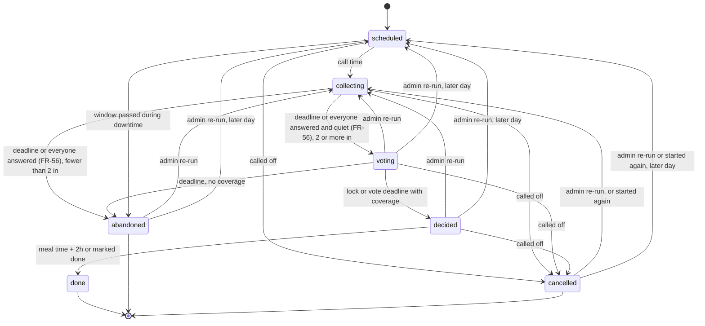

# Dinnerbell: requirements and architecture

| | |
|---|---|
| Status | Draft v0.2 |
| Date | 2026-10-21 |
| Owner | David Morgan |
| Scope | Version 1 (single household) with a roadmap for later phases |

Dinnerbell helps a household answer, at a fixed time each day, three questions: who is eating, what are we eating, and who is cooking, picking up, or ordering it. It runs as one container on a homelab, talks to the family through Slack, and keeps the catalog, preferences, history, and badges in a mobile-friendly web app.

Decisions that shaped this document are recorded in [docs/adr](adr/).

## 1. Problem

Four adults share a home and almost none of their schedules. The question "what are we eating?" arrives at the moment someone is hungry, then takes a long time to settle because:

- Nobody knows who is home, who is hungry, or who can go get food.
- Not everyone eats every option, and the group forgets who won't eat what.
- The household drifts toward the same cuisines week after week.
- The same person ends up coordinating, cooking, and picking up most of the time.

Dinnerbell moves the question to a scheduled time, collects participation and constraints before anyone proposes a meal, ranks options that fit everyone who is eating, assigns the work, and records who did it so the household can celebrate contributions.

## 2. Goals and non-goals

### Goals for version 1

| ID | Goal |
|---|---|
| G1 | Ask the question at a set time, not at the moment of hunger. |
| G2 | Make the choice fit the people eating: hard vetoes, soft preferences, variety, and which roles are actually available. |
| G3 | Make the decision stick: deadlines, named assignments, reminders, and a clear fallback when nobody answers. |
| G4 | Make contribution visible and rewarding. Positive framing only. |
| G5 | Work on iPhones without an App Store app. Slack carries notifications and quick actions; the web app carries depth. |
| G6 | Run as one self-hosted container behind Pangolin, with the code open source under AGPL-3.0. |
| G7 | Let a reluctant adopter participate fully by tapping buttons in Slack, without ever opening the web app. |

### Non-goals for version 1

- Recipes, ingredients, grocery lists, or pantry inventory. Home meals are a name plus tags.
- Cost tracking or bill splitting.
- Writing to anyone's calendar.
- Multiple households in one deployment. The data model carries a household ID so this is a migration later, not a rewrite.
- A native iOS app or chat platforms other than Slack. The channel layer is an adapter so Discord and web push can follow.

### Success criteria

Measure these 30 days after the household starts using Dinnerbell for dinner.

| Metric | Target |
|---|---|
| Dinners decided through Dinnerbell before the decision deadline | At least 80% of days with two or more participants |
| Roles (cook, pickup, order, coordinate) filled by someone other than the admin | At least 40% of decided dinners |
| Same cuisine chosen twice within 7 days | Only when the household votes for it over a higher-ranked alternative |
| Members who respond to the call on a typical day | At least 3 of 4 |

## 3. People and roles

| Role | Who | Can do |
|---|---|---|
| Admin | David | Everything a member can, plus: invite and deactivate members, make a guest a member or remove a guest, turn joining from the channel on or off, edit household settings other than the meal schedule, see and change any member's preferences (#181), override or reassign a coordinator, lock or cancel a decision, rename and merge tags, connect Slack. |
| Member | Each household adult | Respond to calls, make offers, change the meal schedule, claim roles, propose and vote, maintain the catalog, set their own preferences, invite guests, log meals, give feedback on meals, view history and badges. |
| Guest | A partner or friend at a meal (#38) | Eats with the household when a member invites them to a call, one call at a time. Once invited, answers In or Out, offers to cook, pick up, or order, and can be assigned those roles. Never coordinates (FR-58, #227), which means using Dinnerbell to steer a call, so never does what a coordinator does or marks the meal done. Never votes, proposes, suggests, vetoes, calls a call off, starts or posts a call, makes or joins an offer, or gives feedback. Their dietary needs are hard constraints. A **registered guest** has a Slack account and answers for themselves; for an **unregistered guest** the inviting member answers and gets their messages. On the web a registered guest sees only the calls they're invited to and their own dietary needs. Someone who joins on their own starts as a guest; only an admin makes a guest a member. A member brings guests to an offer as a head count on their own answer instead, since offers have no invitations (5.5). |

Each member declares capability flags: can cook, can pick up, can order. The flags are defaults: answering in on a call turns on the offers they stand for, once, and the member can turn any off or offer another role for that call (FR-8).

## 4. Concepts

| Term | Meaning |
|---|---|
| Household | The one family using this deployment. Owns members, catalog, settings, and history. |
| Slot | A meal of the day: breakfast, lunch, or dinner. Each slot has its own schedule and defaults. |
| Event | One coordination of one slot on one date. Two kinds: Call and Offer. |
| Call | The scheduled group question: who is in, what can you do, what do you suggest. Produces a decision with assignments. |
| Offer | One person announcing a meal they are already getting or making, with spare capacity: "I'm picking up Thai at 12:30, three servings spare." Others join until it's full. |
| Response | A member's answer to an event: in, out, or maybe; the window when they can eat; roles they can fill; a suggestion. On an offer, a guest count too (5.5). |
| Coordinator | The member who owns a Call's decision. Self-nominated, and always in: coordinating puts them in, and saying out ends it (FR-10). The admin can assign or override. When voting starts with nobody coordinating, Dinnerbell picks a member who's in at random (FR-10); with no member in, nobody coordinates, and the vote decides. [Coordinating](coordinating.md) explains it for the household. |
| Catalog item | Something the household can eat. Kind: home meal or restaurant. Carries tags, supported fulfillment modes, and the meals it's for (breakfast, lunch, dinner). |
| Fulfillment mode | How the food arrives: cook, pickup, or delivery. |
| Tag | A label on catalog items: cuisine (Thai, Mexican), protein (chicken, vegetarian), dietary (gluten-free option), or other. |
| Preference | A member's stance on a tag or item: a hard veto, or a soft score from −2 to +2. |
| Proposal | A candidate (item plus fulfillment mode) put forward for a Call, by the ranking engine, the coordinator, or a member. |
| Decision | The locked outcome of a Call: item, mode, meal time, and assignments. |
| Assignment | A member attached to a decision in a role: cook, pickup, order, or coordinator. A home meal has a cook; delivery has an orderer; pickup has an orderer and a pickup person, who may be the same person (#178). |
| Meal log | The record of what the household ate, whether or not Dinnerbell coordinated it. Feeds variety and history. |
| Contribution | A counted act: cooked, picked up, ordered, coordinated, added a catalog item, responded on time, hosted guests, participated. |
| Badge | A named award earned by reaching a contribution milestone. Every slot counts the same: a breakfast cooked is a meal cooked. |
| Feedback | A member's reaction to a meal they ate: one rating of the meal, what went wrong (restaurants), and a thank-you to the cook (home meals). |

## 5. How it works

### 5.1 A dinner call

Default times are configurable per slot. The example uses the defaults.

| Time | What happens |
|---|---|
| 15:00 | The bot posts the dinner call in the Slack channel and mentions every active member. Buttons: **Answer**, which opens your own card with In, Maybe, Out, the role offers, I'll coordinate, and Details. **Details** opens a modal for an eat window, a suggestion, and a note. Guests come from **Invite a guest** (5.5). |
| 15:00 to 16:30 | Members respond. The call message updates in place with the roster, roles offered, and suggestions. |
| 16:15 | Members who haven't responded get one direct-message reminder. |
| 16:30 | Response window closes. Maybes become outs. If fewer than two people are in, the bot posts "Everyone's on their own tonight" and the event ends. Otherwise, if nobody coordinates, the bot picks a member who's in to coordinate, at random, and the bot posts the top three ranked proposals with a one-line reason each and a **Vote** button per proposal. **Lock this** is in the ⋯ menu beside each, for the coordinator or an admin (FR-61). |
| 16:30 to 17:15 | Members vote. The coordinator can lock early, add a proposal, extend the window, break a tie, or shuffle the picks (FR-16, FR-61). Anyone who missed the answers can still join late with **I'm in (late)**; their vote shows but counts only if the coordinator says so (FR-60). |
| 17:15 | Vote window closes. The highest-voted proposal wins; the coordinator or an admin can break a tie before then. The bot posts the decision with the meal time, the item, and named assignments, and direct-messages each assignee with details and a link. |
| Meal time plus 2 hours | The event is marked done. Contributions are recorded. Any new badges are announced in the channel. |

If nobody claims **I'll coordinate** before voting starts, Dinnerbell picks a coordinator at random from the members who are in (FR-10). The vote still decides. If nobody votes either, the top-ranked proposal is announced as the decision as long as its roles are covered. If no one can fulfill it, the bot posts the on-your-own message.

### 5.2 A lunch offer

Lunch has no scheduled call by default, so offers are the normal path for lunch. David, working from home, taps **Make an offer** in the App Home or runs `/dinnerbell offer`, picks a catalog item or types one with its cuisine, sets the time and spare servings, and posts. The form starts on lunch before lunch's usual meal time, with lunch's defaults (FR-1): pickup at 12:30. The channel message reads "David is picking up Siam Garden for lunch at 12:30 PM. 3 servings spare." with **Count me in** (tap again to drop out) and **+1 guest** buttons. Guests take seats, the offerer's own guests too; the offerer's own seat was never spare. The message updates as people join, and when the capacity is reached its buttons give way to **Can't make it**, which frees a seat, and the offerer gets one direct message. The offer closes at the stated time: it's on, and takes nobody else. Two hours later it's done, and the meal goes in the meal log with everyone who joined. The offerer, or an admin, can call it off until then. A member has at most 3 offers on for one slot and day.

### 5.3 A cooking offer

Any member can make an offer for dinner too: "I'm making tacos tonight, 6 servings." A cooking offer posted before the dinner call replaces that day's call: a call scheduled for that day is called off quietly, and its starter is told, and a daily call not created yet doesn't go out while the offer stands. If the offer is called off before that call's responses would have closed, the call goes out after all. Members join, add guests within capacity, and the cook sees the head count and guests' dietary needs. The cook earns the cook contribution when the event completes.

An offer for a slot whose call is already open (collecting or voting) doesn't post on its own. It becomes a pick on the call, as an added proposal (FR-13): the offerer is counted in and offers the role it takes, and it must pass the same vetoes and guest needs. While voting, only someone who's in can add one, because a new person's vetoes would change what the picks must pass. If someone who answers later can't eat it, it's dropped when voting starts (FR-29). A call has one pick per place (FR-13): an offer for a place that's already a pick in another mode takes that pick over when ranking proposed it or the offerer added it, which switches it to the offer's mode, makes it the offerer's, and keeps its votes. An offer for another member's pick, or for a pick in the same mode, is refused. Once a call is decided or over, an offer stands on its own.

### 5.4 Nobody answers

A call with fewer than two people in at the response deadline ends with the on-your-own message. A call where nobody votes and nobody can fulfill the top proposal ends the same way. Nothing is assigned and no one is nagged further.

### 5.5 Guests

On an offer, a member adds guests to their own answer as a head count (**+1 guest** and **−1 guest** in Slack, a number on the web), optionally with dietary needs chosen from the dietary tags. Guests count toward capacity on offers and toward the head count. A call has no head count of guests (#240): its guests come only from invitations, below, which name each one. A count saved on a call's answer before that keeps counting, in the head count, ranking, the decision, history, stats, and contributions, and saving **Details** leaves it as it is; nothing on a call saves a new one. Guest needs act as required tags in ranking. The member who brought or invited guests earns the hosted contribution (section 12).

A guest can also be a person in their own right (#38, section 3): a guest record with a name, dietary needs, and, for a registered guest, a Slack user. Any active member invites one to a call while answers are open, from **Invite a guest** on their Your answer card or on the web: a saved guest, or someone new with their dietary needs. A registered guest gets a direct message with **In** and **Out**; an unregistered guest is counted in at once, and the member who invited them answers and offers roles for them on their card or the web, and gets their assignment messages. A guest's dietary needs apply whenever they're in or maybe, as a member's guests' needs do, and their own stances never count.

**Joining from the channel.** Someone in the Dinnerbell channel whom Dinnerbell doesn't know gets **Join Dinnerbell** when they tap a button, open App Home, or run the command (option A), and Sign in with Slack joins them too (option B). Slack is asked first: only a real user of the configured workspace (no bot or app, no deactivated account, nobody from another organization over Slack Connect) who's in the configured channel right now may join; a Slack guest account joins as a guest. Joining makes a guest linked to their Slack user, or links an invited member whose email Slack shares. Each active admin gets a direct message with **Make member** (which needs the email Slack shares) and **Remove**. The admin's **Join from the channel** setting, on by default, turns it off. Joins are rate-limited per Slack user, every join and refusal is audited, and someone an admin removed is refused until the admin adds them back. On Admin > Members, the admin can also add people from the channel in one step, as guests or as members (option C).

### 5.6 Logging a meal outside Dinnerbell

Anyone can record what the household ate when there was no call or offer, with `/dinnerbell log` or from the web app. Logged meals feed variety and history but award no role contributions.

**Editing and deleting a meal in History.** A member edits or deletes the meals they logged, and an admin any meal. Changing the item of a meal logged by hand drops its feedback, and taking someone off a meal drops theirs. A meal from a call has one way to change its place: **Change the plan** on the call's page, for admins (5.7). History's form shows its place read-only, with a link there for an admin and without one for anyone else, and a changed item on it is refused with where to correct it, so a form left open from before can't change it (#224). An offer's meal has no correction, so its item stays editable in History. That changes the meal only, not the offer. The edit and delete forms carry what they showed: the meal's date, meal, item, and who ate. If any of those changed since, the save or delete is refused with a message to look again, so a form opened before a correction can't put the old place back or delete the feedback that moved. A second tap on Save is refused the same way. A form from before this check carries nothing, and saves as it did.

### 5.7 Adjusting the plan, and admin overrides

Once a call is decided, and until it's done, the coordinator can change the meal time, change the place (#219), switch the pick to another way the place allows (cook, pickup, or delivery), change who cooks, picks up, or orders to someone else who's in, and hand off coordinating to someone who's in, from Slack or the web app (#154). That includes correcting who did what after the meal, until it's marked done: contributions are counted then, so the correction is what counts. After that, only an admin corrects it, and the meal's count for the role moves with the correction: the new assignee earns the badges it reaches, pending announcement, and the old one loses any tier their counts no longer reach on the current ladders (#162). The correction is audited as `event.contributions_recounted`. Before the meal time, whoever loses a role to someone else is told, and whoever gets it is told as before; from the meal time on, a change corrects the record and messages nobody, except that whoever a hand-off makes coordinator still gets a message, since the meal is theirs to finish. In Slack it's one **Adjust** modal, on the decision message, on the coordinator's App Home card, and on the message that says a guest with a role left: the meal time, the place (below), **How** (when the place allows more than one way), **Who cooks** or **Who orders**, **Who picks up** (at a place that allows pickup, #178), and the coordinator. The way and who does what are one part, as in **Assign roles**: changing any of them saves them all, and each person must be able to do their role (FR-17, the cook list for a home meal); a role nobody is named for goes to its first volunteer. Takeout keeps its orderer when it switches between pickup and delivery; switching to delivery drops the pickup person. It opens with the plan as it is and saves only what they changed from that: the meal time first, then the place or the role, then the hand-off, since handing off ends their say. Something changed elsewhere while the modal was open, such as with **Assign roles** or on the web, stays as it is; changing it in the modal too is refused with "The plan changed since you opened this. Open it again." Each part is checked again under the call's lock as it's saved, so a change saved elsewhere after the modal was submitted is refused the same way, not written over. A refusal, such as a meal time before the decision, shows next to its field and saves nothing. If a later part is refused after an earlier one was saved, as when someone leaves in between, the reply says what was saved and why the rest wasn't. The decision message shows the change, and whoever gets the role or coordinating is told once, naming the new coordinator after a hand-off, as the one to ask if it doesn't work for them. Adjust is the coordinator's alone; anyone else who taps it, an admin included, is told why not. On the web, the coordinator does the same with **Assign roles** (the way, who cooks or orders, and who picks up), **Change the plan** (the meal time, the place, and one role at a time, among the roles the way has), and the hand-off form.

**Changing the place** (#219) records where they're really eating. The coordinator or an admin on the web chooses any active catalog place, for any meal, or types a new name, with an optional cuisine; a name the catalog has, for that way's kind, is that place, and any other becomes a catalog item, as a free-text pick that wins does (FR-13). Vetoes, dietary needs, the variety window, and who offered don't block it. It needs a way the place allows. In Slack, which can't redraw a field when another changes, that's its own field, **How, at a new place**, with every way on it. Left empty, the change takes the only way the place has, or the way it has now if the place allows it, and otherwise asks. A new name always needs a way, which says whether it's a home meal or a restaurant. The modal lists the place as it is, so picking it again takes back a pick; picking another place and typing a name is refused next to the field. People keep their roles if the new way still has them, and a cook off the new place's cook list stays the cook, since the change records what happened: they can be switched. A role the new way doesn't have is dropped. A new role goes to whoever the same save names, who must be able to do it (FR-17), or else its first volunteer, or else nobody, and the reply says so. While the coordinator is still choosing roles, a change that names nobody leaves that open: the time runs on, and the automatic assignment that ends it uses the new place. A place that was a pick keeps its votes and who added it, and is chosen in the new way. Any other place gets a proposal row outside the picks (rank 0): it shows on no picks message, nobody voted for it, and it earns nobody Bright Idea or Explorer credit, a new name earns nobody Scout credit, and it doesn't count as a pick for Gambler. The decision message and the call message update in place and stop saying how the old place won ("Locked in by", the tie line). Before the meal time, each person who's in gets one direct message naming the new place and the old one, except whoever made the change. Whoever gains a role hears it in their assignment message. Anyone else gets a message about the change, which says any role they lost. Someone handed coordinating in the same save gets that message and the hand-off's, which lists their roles. A guest without Slack is told through whoever invited them, unless that person made the change, or is in and the guest lost no role. From the meal time on, it corrects the record and messages nobody, except whoever a hand-off in the same save makes coordinator. **Mark done** logs the new place, so history, ratings, and **How was it?** name it. A place changed elsewhere since the modal or page opened is refused with the same "The plan changed" message, and a change names the run. So are roles saved from an **Adjust** or **Assign roles** that showed another place, or from an **Assign roles** that showed another way. A done call refuses; an admin corrects it instead (below). It's audited as `event.place_changed`, with the old and new item and way, and logged as `change_place`.

**Correcting the place after Mark done** (#220). A meal marked done before the household changed its mind stays wrong in History, so an admin can correct the place on the web, as they can correct who did what (#162), under **Change the plan** on the call's page. Only an admin can: never the coordinator, a member, or a guest. It's only for a done call, not a cancelled or abandoned one or an offer. They choose as in a change of place: any active catalog place or a new name, with an optional cuisine and a way the place allows, and filters don't block it. People keep their roles if the new way has them, a role the new way doesn't have is dropped, and a new role goes to its first volunteer, or to nobody, for the admin to correct. A place that was a pick keeps its votes and who added it, and any other gets the rank 0 row, which a later correction replaces. Choosing the same place in another way is refused here too. A place changed elsewhere since the page opened, or a call that started a new run, is refused. A meal an admin deleted from History has nothing to correct: the form isn't offered, and a page left open is refused. A correction starts from what the meal says, which a History edit before #224 can have left apart from the call: the form shows the meal's place as the current one. Correcting to the place the call still names moves the meal back. The call's roles and how it won stay, and so do its counts, unless other meals have changed how new the place was, as with any correction. If that place has left the catalog, it isn't in the menu: the admin types its name with a way to correct back to it. Keeping the meal's place, choosing it, or naming it, with the call still on another, brings the call into line, in a way that place allows, like any other correction, even if the place has left the catalog since. Otherwise the same place is refused, as above.

History, stats, the variety window, and ranking read the corrected place, because the correction changes the meal log's item and cuisine snapshot as well as the call. The meal keeps its date, meal, and who ate. Feedback on the meal moves to the corrected place: each row's item, name, kind, and way change, and when it was saved doesn't, so ratings and issues count toward the new place from the meal's date (FR-55). An answer that doesn't fit the new kind stays stored and stops counting until a correction brings the kind back: on a home meal, what went wrong leaves the member's own view and the household hint, and on a restaurant, a thank-you leaves the count and the cook's view of it. A member who saves their feedback in the meantime replaces it, as always. A member left with no answer that fits sees none, and can give feedback again while it's open.

The meal's counts follow (section 12), with the rules of a corrected role: `cooked`, `picked_up`, and `ordered` follow the roles, `suggested` and `explored` follow the proposal row of the place, and `added_item` follows the catalog item. Whoever loses a count loses each tier their counts no longer reach, with `announcements.take_back`, whoever gains one earns what it reaches, pending, and running it again changes nothing. The counts match the place and roles the corrected call has, so correcting back restores the counts and the badges, except that a role the way dropped doesn't come back on its own: it goes to its first volunteer, and an admin who had named someone else names them again in the role form, which restores theirs. `added_item` is one count per item, on the first call that chose it, so if another counted call chose the old item, the count moves there and its adder keeps it; if the only other call was never counted, the count goes, and the backfill adds it back when it counts that call; a call that becomes an item's first leaves a count a later call already holds where it is. Other meals' counts don't change, even when the correction changes how new their place was: `explored` says what was new when that meal was counted, as it does when someone edits a logged meal. A call that was never counted is left to the next start's backfill. The recount is audited as `event.contributions_recounted` when anything changed.

Nobody is messaged about the correction. The call message, the picks message, and the decision message update in place, and stop saying how the old place won. A badge it earns is announced like any other. It's audited as `event.place_changed` with `after_done`, `feedback_moved` (a number), and the fields above, plus `from_meal_item_id` when the meal said something other than the call, and logged as `change_place` with `after_done`.

The admin's overrides are on the web app only: assign or replace the coordinator, extend or shorten a window (except the decision time, which an admin, like the coordinator, can also move from the call message's ⋯ menu, FR-6), re-run a call, skip a day's call before it goes out (today or up to 7 days ahead), change the meal time while the call is decided, and correct an assignment, after the fact too. On the web, an admin can also change the place while the call is decided (5.7). In Slack an admin can lock a pick and assign roles (FR-61), and break a tie, shuffle the picks, and switch a late joiner's taking part or vote, alongside the coordinator (#179).

Calling a call off and closing a window now aren't admin-only (FR-56). The coordinator can do both, and whoever started an ad-hoc call can call it off until it's decided. Any member can become coordinator with **I'll coordinate** while the call is open, so nobody has to wait for an admin; it puts them in (FR-10).

### 5.8 Changing the schedule

Calls run at the same times every day by default. Any member can change a slot's standing schedule, such as moving the dinner call from 15:00 to 14:00, on the web app's Schedule page; `/dinnerbell schedule` shows the schedule and links there. The bot posts the change in the channel with who made it, and the change applies from the next call. Moving only today's call is an admin override.

### 5.9 Feedback after meals

When an event is done, the decision message gains a **How was it?** button, and the meal shows on the member's App Home and History page as awaiting feedback. Feedback is a few quick taps, each optional:

- **Rating**, for every meal: hated it, didn't like it, it was fine, liked it, or loved it.
- **What went wrong** (restaurants only): chips for "wrong order," "late," "cold," and "other," with a few words to say what "other" was.
- **Cook** (home meals only): a thank-you, with an optional short note.

There's no nudge by default. A member who wants one turns on a feedback reminder in Preferences and gets one direct message per meal, unless they muted direct-message reminders, which stops every reminder. Feedback stays open for 7 days after the meal: through the seventh day after its date, in the household's time zone. A cook doesn't thank themselves, and a logged meal has no cook on record, so it takes a rating (and what went wrong, for a restaurant) but no thank-you. App Home lists meals from calls; logged meals take feedback on History. Changing a meal's item deletes its feedback, and taking someone off a meal deletes theirs.

A rating moves the member's own score for the place or recipe, and everyone sees a hint for each item built from everyone's ratings and issues, such as "Mixed reviews · recently late", that names nobody (FR-55, [ADR 0008](adr/0008-feedback-informed-ranking.md)). The admin's **Feedback** setting turns the first part off; the hints always show.

### 5.10 A breakfast call

The household coordinates breakfast now and then: weekends, guests, holidays. So breakfast has no daily call by default, and none ever posts on its own unless a member turns its schedule on (FR-1, FR-2). On Saturday at 7:30 AM, Sam runs `/dinnerbell call breakfast`, or taps **Start a breakfast call** on Home or starts it from the web app's Today page. The call runs as a lunch or dinner call does: in, maybe, or out, roles, offers, proposals, a vote, a decision, and assignments, with breakfast's windows (30 minutes to answer, 15 to vote). Ranking proposes places whose meals include breakfast first, and tops up with others, marked such as "Usually for lunch and dinner.", when too few fit (section 7). With no eat window given, the meal time is breakfast's usual 8:00 AM. Called off, it can be started again with **Start breakfast again**.

### 5.11 Going away

Kim is away Thursday through Saturday. A week ahead, she sets the first and last day under **Away** on Preferences; or, if she forgot, she taps **Away until…** on Thursday's dinner card, posted early the evening before, and picks Sunday, the day she's back. Thursday's, Friday's, and Saturday's calls answer her Out, marked "away until Oct 25", without mentioning or reminding her, so nobody waits on her, and the call can still close early, as FR-56 says. Her card and Preferences say "Away until Sun, Oct 25" with **I'm back**. If plans change, she taps In on Friday's call, which holds for Friday only, or **I'm back**, which ends the window and asks her again on any call still taking answers (FR-63).

## 6. Functional requirements

Requirements use "must" for version 1 and "should" for items that can slip to a later milestone without blocking launch.

### 6.1 Schedule and events

| ID | Requirement |
|---|---|
| FR-1 | Each slot has: call enabled or disabled, call time, response window length, vote window length, reminder lead time, default fulfillment modes, and a usual meal time for when nobody gives an eat window (FR-19). Dinner defaults: enabled, 15:00, 90 minutes, 45 minutes, 15 minutes, pickup and delivery, 18:30. Lunch defaults: disabled, 10:30, 60, 30, 15, pickup, 12:30. Breakfast defaults: disabled, 07:00, 30, 15, 10, cook and pickup, 08:00 (#58). The schedule is the same every day of the week. Any member edits it (FR-44). |
| FR-2 | The scheduler must post a call for each enabled slot once per day at the configured time, in the household time zone, and must not double-post after a restart. It never posts one for a disabled slot: breakfast and lunch post nothing on their own unless a member turns their schedule on. A call whose response window ended while the server was down is not posted, and a call is only ever posted on its own day: it's stale at midnight after it, so a call time late in the evening gets cut off at midnight. |
| FR-3 | Any member must be able to start an ad-hoc call for a slot and date from Slack or the web app. A call for today opens at once; a call for a later day, up to 7 days ahead, opens at the slot's call time, and the reply says when. Any member who could start it can post a scheduled call early instead (issue #59): responses open at once, while the response deadline, the reminder, and voting keep that day's times. When everyone answers early, voting opens at once and still closes at that day's decision time (FR-56), so the call is never decided the day before on its own; a call everyone is out of ends at once. Posting early is audited, and a call that's open already is left as it is. A call posted early stays posted when it's re-run or called off and started again: the new run opens at once, with that day's deadlines. A slot has at most one call per date. |
| FR-4 | Any member must be able to post an offer with item, fulfillment mode, day (today or up to 7 days ahead), time, and capacity (1 to 20 spare servings), from Slack and the web. Members join, and bring guests, until the capacity is reached; the offer closes at its time and is done two hours later (spec 5.2). |
| FR-5 | An offer for a slot that already has an open call must attach to it as a proposal; a cooking offer posted before the call must replace that day's call (spec 5.3). |
| FR-6 | The admin must be able to extend, shorten, lock, cancel, and re-run events, and skip a daily call up to 7 days ahead before it opens. Re-running a voting, decided, abandoned, or cancelled call reopens it with fresh windows: now for today's call (not after the usual meal time plus two hours), or at the slot's call time for a later day, unless it was posted early. Responses stay; proposals, votes, the decision, and assignments are cleared. Cancelling isn't admin-only: see FR-56. Neither is moving the decision time while voting (#198): the coordinator moves it earlier or later with the admin's limits (15 or 30 minutes later, or 15 earlier, a move at a time; never past 23:59 on the call's day), on the event page or with **Move the decision time** in the call message's ⋯ menu. The "Vote by" time and the messages that show it update as after an admin's move, and a time already past closes voting at once, as **Decide now** does. A deadline that has already passed doesn't move, for the coordinator or an admin, since the scheduler is about to close that window. It is audited as the admin's is (`event.deadline_moved`, naming who moved it and as what) and logged (`move_deadline`); anyone else, and anyone outside voting, is refused with a reason code (#75). The response window stays the admin's. |
| FR-56 | **Call it off.** An admin or the coordinator can call off a call in any open state, and the member who started an ad-hoc call can while it's scheduled, collecting, or voting. An optional reason of up to 140 characters goes with it. The call ends as cancelled and nothing goes in the meal log. Everyone who was in or maybe and the coordinator are told in the call's thread, and each active member assigned to cook, pick up, or order gets a direct message; assignment and reminder messages not yet sent are dropped. A call that was never posted posts nothing; its starter gets a direct message if someone else called it off. Any member can start a called-off call again, the same way as a new one, until the usual meal time plus two hours; it starts with no coordinator. **Close now:** the coordinator or an admin ends the open window early: "Start the vote now" while collecting, "Decide now" while voting. Responses also close on their own once every active member has answered in this run of the call, whether In, Maybe, or Out; answers kept from before a re-run or restart don't count. Only outs end a call early: with fewer than two in, counting guests, a maybe keeps answers open until the deadline, because they might still make it two, and so does a member who hasn't answered, who could come in with a guest. When everyone is out, the call ends on-your-own at once, with no vote, even for a call posted before its day. A lone In with everyone else out waits 10 minutes to add a guest, then ends the same way. With two or more in, responses close once no response has changed for 10 minutes, so people can add guests or details after tapping In, and someone can cook, pick up, or order. Closing early turns maybes out, as the deadline does, and because they answered on time, a maybe who then joins late has a vote that counts. Voting opens at once, but the decision time doesn't move: voting closes at the response deadline from before the close plus the slot's time to vote, so members have that whole time to look at the picks, and a call never decides sooner on its own. Everyone voting doesn't end it either. **Start the vote now** keeps the decision time the same way, and so does an admin's shorter response deadline that lands in the past; a shorter one still ahead moves the decision time as much (FR-6). Only the coordinator or an admin ends voting sooner, with **Decide now**, **Lock this** (FR-15), or **Break the tie** (FR-16), and either can move the decision time, earlier or later (FR-6, #198). A call whose decision time would be midnight or later gets the slot's time to vote from the close instead. Either way, the decision time stops at 23:59, the last minute of the call's day, so the call still decides that day (#215). A call posted early whose answers close before its day votes until 23:59 on its day. Answers that close during the last minute decide at once, with no vote, so the tie rules pick (FR-16): the pick eaten longest ago, then the top-ranked one. |

### 6.2 Responses

| ID | Requirement |
|---|---|
| FR-7 | A member responds in, out, or maybe, and can change the response until the response window closes. A member away on the call's day is answered out for them (FR-63); their own answer, In included, replaces it for that call. |
| FR-8 | A response may include an eat window (earliest and latest), roles offered (cook, pickup, order, coordinate), one or more suggestions, and a free-text note. It has no guest count (#240): a call's guests come by invitation (FR-57). A count and guests' dietary needs saved on an answer before that keep counting, and **Details** leaves them as they are; a Details form or modal opened before then, which still posts them, saves the rest and ignores them. An offer's answer keeps its guest count (FR-4). **Usual offers start on** (#180): a member's usual offers turn on once per call, the first time they count as in, however that happens; after that the call's offers are theirs. Tapping In, saving Details before answering, claiming coordinating, being handed it or assigned it, and joining late (FR-60) all turn on the offers their usual **Cook**, **Pick up**, and **Order** settings in Preferences stand for, and they can turn any off for that call. Being counted in by offering a role, or by adding a pick while answers are open (an offer that joins the call, FR-5), is their own choice of offers, so that first time turns on only that role; while voting, adding a pick joins late first, which turns them on. Turning an offer off while a maybe also ends the turn. Nothing turns an offer back on: not answering In again, not In after Out, and not a refreshed card. Maybe and Out turn none on. Answers saved before #180 keep the offers they have. |
| FR-9 | "Maybe" counts toward hard-veto filtering and not toward capacity. Unresolved maybes become out at the deadline, or when answers close early (FR-56). When the call goes on to voting, the member is told, and can still join late (FR-60); if answers closed early, their vote counts when they do; when it ends instead, the on-your-own post says so to everyone. An away out (FR-63) is an out, never a maybe: it counts toward no veto and is never told when answers close, and the member can still join late. |
| FR-10 | The first member to claim coordinate becomes coordinator. The coordinator can hand off. The admin can reassign. Only household members coordinate: a guest is refused and never offered, by any of these ways or any other (FR-58, #227), and a guest an admin promotes can. **Whoever coordinates is in** (#154): claiming it, being handed it, or an admin assigning it changes their answer to in while answers are open, and while voting joins a member late (FR-60) with their vote counting, as a coordinator's always has; a late joiner already in gets a counting vote too. Someone a hand-off or an admin put in this way gets a direct message saying so. A late joiner the coordinator switched off can't claim it, be handed it, or be assigned it. Once decided nobody joins, so only someone who's in can be handed it or assigned it. **Picked at random** (#179): when answers close and the call goes on to voting with nobody coordinating, Dinnerbell picks one of the members who are in, after maybes turn out (FR-9): never a guest, a maybe, or a deactivated member. The pick is reproducible: `coordinator_seed(household, call, run)`, a SHA-256 digest like the ranking seed (section 7), chooses among the members in, ordered by ID, so the same run always picks the same member, and a re-run or restart picks again if nobody coordinates then. It happens in the same transaction as the move to voting, under the call's lock, so it happens once a run, and never over someone who claimed it first; a claim that comes after is refused, as for any coordinator. It's audited (`event.coordinator_picked`, with whom it picked among) and logged (`coordinator_picked`). The call message and roster name them, and they get a direct message saying they were picked, what they can do, and that they can hand it off. With no member in, nobody coordinates. Whoever's picked is a coordinator like any other: they have every power above, including the wait to choose roles when the decision leaves the role unclear (FR-61), they earn the coordinating contribution and its badges when the meal is done, as one who claimed it does, they can hand off, an admin can reassign, and saying out, or being deactivated, ends it as below. An admin re-run keeps them, as it keeps any coordinator. A coordinator who says out, is switched off as a late joiner, or is still a maybe when answers close (FR-9) stops coordinating, and so does one an admin deactivates: nobody coordinates, the messages say so, any member can claim it, which puts them in, and it's audited (`event.coordinator_released`). Saying maybe alone doesn't end it. Offering to cook, pick up, or order counts a member in unless they said maybe; saying out withdraws their offers. The coordinator also has the powers over the vote and the roles in FR-16 and FR-61: break a tie, shuffle the picks, and choose the winning pick's mode and who does it. Each is the coordinator's, and any admin's too, alongside them (#179). |
| FR-11 | Non-responders receive exactly one direct-message reminder per call at the configured lead time. Guests invited to the call who have Slack get it too (#38). A member away on the call's day has answered (FR-63), so gets none. |
| FR-57 | **Guests** (#38). Any active member can invite a guest to a call while answers are open: a saved guest or someone new, with up to 5 dietary needs. A guest is in only by invitation, one call at a time, and only to calls. An invitation belongs to the call, so it stays when the call is called off and started again, or re-run, and a guest with Slack who hasn't answered the new run is invited again. A guest with Slack answers themselves; for one without, whoever invited them, or an admin, answers and gets their messages. A guest's dietary needs are hard constraints whenever they're in or maybe, and a member's own dietary needs, such as a promoted guest's, are too. A guest's stances never count. |
| FR-58 | **What a guest may do** (`domain.guests`): answer In or Out, offer to cook, pick up, or order, and be assigned those roles; a guest without Slack is told through whoever invited them. Never coordinate, by claiming it, being handed it, being assigned it by an admin, or being picked at random: coordinating means using Dinnerbell to steer a call, and a guest has little or no access to it (#227, which replaced the guest coordinator of 2026-10-24). So never do what a coordinator does either, or mark the meal done (FR-21). Never vote, propose, suggest, veto, join late (FR-60), call off, start or post a call, make or join an offer, or give feedback. A guest who taps **I'll coordinate** or **Mark done** on a channel message is told why not. On the web a guest sees only their invitations and their own dietary needs; every other page refuses them on the server. Nobody waits for a guest to close a call early, but a guest's answer counts toward who's in. |
| FR-59 | **Joining from the channel** (#38 addendum). Someone in the configured channel of the configured workspace, checked with Slack and never a bot, a deactivated account, or someone over Slack Connect, can join as a guest from Slack or by signing in with Slack, while the admin's **Join from the channel** setting is on (default on). Joins are rate-limited per Slack user and audited; someone an admin removed is refused. Someone whose Slack email belongs to a member Dinnerbell can't link them to on its own isn't made a guest: they're asked to ask the admin, and the admins get a message to link them by hand (so does a Slack account the hourly email match finds linked to someone else). A joined guest keeps the email Slack shares, so adding a member with it offers to promote that guest instead. When Slack lists only part of a large channel, someone not in that part is asked to ask the admin rather than to join the channel. Each admin gets a message with **Make member** and **Remove**. Only an admin makes a guest a member, and every promotion is audited. The admin can add people from the channel as guests or members, and link a guest to the member they really are. A display name proves nothing, so the join message and the guest row show the Slack account and the email Slack shares; a link whose emails differ, or of a Slack guest account, needs the admin to see both emails and type the member's name, and is audited as an override. A guest is never linked to an admin, who sets their own Slack member ID by hand. |
| FR-63 | **Away** (#196). A member can have one away window: a first and a last day away, whole days in the household's time zone, both included, upcoming or under way. They set it from **Away until…** wherever a call takes answers, picking the day they're back (the window runs from the call's day, joined into one stretch with a window it overlaps or touches), or from **Away** on Preferences. Setting another replaces it, and it ends after its last day. An admin can set or end a member's (#181); every change is audited. Calls on those days answer them Out, marked "away until" the day they're back, unless they answered already. The call post doesn't mention them, they get no reminder, and nobody waits on them. Their own answer, In included, replaces the away Out for that call only. **I'm back** (**Clear**, before it starts) ends the window and asks them again on calls still taking answers. Guests have no window. |

### 6.3 Proposals, ranking, and voting

| ID | Requirement |
|---|---|
| FR-12 | At the response deadline the ranking engine produces N proposals (default 3) from the catalog, filtered, scored, and drawn as described in section 7, each with a human-readable reason. Places suggested for the call are among them ahead of the draw when they fit, up to N − 1 of them (section 7, step 5), so the last place is not reserved for a suggestion; the rest are a weighted random draw, so a better score makes a place more likely without always winning. Each is a different place, and none is a place an offer already made a pick (FR-5); those picks come after the N. Items for the call's meal come first; items for other meals fill the N only when too few for the meal fit, and their reasons start by saying what they're usually for, such as "Usually for dinner.", after the item's hint when it has one (FR-55). |
| FR-13 | The coordinator and any member can add a proposal from the catalog or as free text during the vote window. A free-text proposal needs a cuisine, and creates a catalog item on decision. A call holds at most 10 proposals, and each member adds at most 3. A call has one proposal per place, whatever the mode: a place is a catalog item, or free text, by its kind and name, so adding a place that's already a pick is refused with "Pho Place is already a pick (delivery). Vote for it instead." Whoever adds a proposal does it: they must be in, and adding it offers the role its mode needs (pick up, cook, or order), so it's covered (FR-17). The exception is an item with a cook list the adder isn't on: they take no role, and it's added only if a cook on the list who's in offered to cook; otherwise it's refused because they aren't on the list. Someone who isn't in is asked "You missed the answers. Join late?" first, and saying yes joins them late (FR-60) before the pick is checked; without that yes, nothing changes. Added proposals pass the same vetoes, guest needs, and coverage checks as ranked ones; a refusal for a veto or a guest need always reads "That doesn't work for everyone who's in tonight." so it can't reveal whose stance it was (FR-29). The meals an item is for never refuse a pick, because people know better than the catalog: the catalog list shows items for the call's meal first, then the rest marked such as "(usually dinner)". A free-text proposal's catalog item is for the call's meal and the default meals, lunch and dinner. |
| FR-14 | Each member casts at most one vote per proposal and can change it until the vote closes. Votes are visible, including those that don't count: a late joiner's, unless the coordinator says otherwise, are shown marked, such as "Kim (late)" (FR-60). Someone who isn't in is asked to join late before their vote is cast. |
| FR-15 | The coordinator can lock any proposal at any time during the vote window. In Slack, **Lock this** is in the ⋯ menu beside each proposal and opens a modal to confirm (FR-61). |
| FR-16 | At the vote deadline the system decides: the pick with the most votes, counting only votes that count (FR-60). **Break the tie** (#87): while voting, when two or more covered picks share the most votes (at least one), the coordinator and every admin get **Break the tie** for each tied pick, in the ⋯ menu beside it on the picks message (FR-61) and on the event page, and may choose one even without having voted. It decides at once and the decision says who chose: "Tied; Kim (coordinator) chose", or "Tied; Alex chose" for an admin. If nobody chooses, the deadline breaks the tie without waiting, trying these in order and keeping only the tied picks each leaves: (1) the pick the coordinator voted for; (2) the pick more admins voted for, only when nobody coordinates (no member was in, or the coordinator was released); a coordinator's vote alone counts at this step, though any admin can choose with **Break the tie** before the deadline; (3) the pick the household ate longest ago, where never eaten counts as longest; (4) the order the picks were drawn in (section 7). The decision says how, as "Tied; Kim (coordinator) voted for it", "Tied; an admin voted for it", "Tied; least recently eaten", or "Tied; drawn at random". A vote that doesn't count breaks no tie and makes none, even the coordinator's. `domain.events.counted_votes` is the one place the tally, ties, and the decision get their counts, and `domain.events.decide_winner` the one place a tie is broken. |
| FR-60 | **Joining late** (#76). While a call is voting, a member who's out, was a maybe at the deadline, or never answered can join with **I'm in (late)**: on the call message, their Your answer card, App Home, or the event page. Voting or adding a pick while not in asks "You missed the answers. Join late?" and joins them on yes. Guests can't: they come by invitation while answers are open (FR-58). Nobody joins once it's decided; they ask the coordinator, or make an offer. A late joiner is in, marked late on the call message, the proposals, and the decision, and can offer roles while voting and add picks. The coordinator has two switches per late joiner, on the event page and in the ⋯ beside them on the proposals message: **Taking part**, on by default (off, they're out for this call, are told, and can't rejoin on their own; on, they count in the head count, coverage, and roles), and **Vote counts**, off by default, and on for a maybe that answers closing early turned out (FR-9, FR-56), who answered on time (off, their votes show but are left out of the tally, ties, and the decision; on, they count like anyone's). Only the coordinator or an admin changes them, while voting; each change is audited and updates the messages. A late joiner's stances and dietary needs never filter picks, even with **Vote counts** on, and their own picks pass everyone who answered on time. Only the late joiner sees which picks miss their own stances or needs, on their card, Home, and event page (FR-29); a pick that misses the needs of a guest they bring is held to as any guest's needs are (below), as those are public. A maybe the deadline turned out keeps their stances applying, as they did on time. A re-run makes late joiners ordinary answers: one who is in stays in, one the coordinator switched off stays out, unless they had been a maybe, who is a maybe again. Joining late clears guests, their needs, and an eat window left on an earlier answer, so it never changes the head count or meal time beyond the joiner. |
| FR-61 | **Shuffle, the decision time, and role choice** (#87). *Shuffle proposals*: while voting, the coordinator or an admin can redraw the picks, at most 3 times a call. With nobody having voted, every ranked pick is redrawn; once anyone has voted, only ranked picks with no votes at all, counted or not (a late joiner's vote keeps its pick too). Picks a member added, an offer made, or someone suggested are never redrawn. The redraw is the same ranking (section 7) with the next seed, `ranking_seed(household, call, run, shuffle)`, so it is reproducible, and every hard filter holds: vetoes, guests' needs (a late joiner's guests' too), someone to do it, the variety window, the meal, and one pick per place. The places just shuffled out are left out unless nothing else fits, and a shuffle that would change nothing is refused and doesn't count. The picks message updates in place with "Kim shuffled the proposals (2 replaced)." and mentions nobody, a short note goes in the call's thread, and the web and App Home show the new set on refresh. It is audited (`event.shuffled`) and logged (`shuffle`, with the counts). A shuffle count and its note are cleared when a call starts a new run. *The ⋯ beside a pick* (#214): while voting, each pick on the picks message has **Vote** and one ⋯ menu, which lists **Lock this**, **Break the tie** while the pick is tied, then the pick's ways and **[Either way]** (below). That's at most 5 options, Slack's limit, so nothing is cut. Slack shows everyone the same menu and allows one confirmation per menu, not per option, so **Lock this** and **Break the tie** each open a small modal to confirm. Someone who can't do it is refused right away, with no modal, and the service checks again on submit: a pick that stopped being tied by then is refused (`not_tied`), and so is a modal left open across a re-run. Slack's current docs give no minimum for a menu's options, and older docs said two, so every menu has at least two: a pick with nothing else also links to its event page. A message posted before #214 keeps its **Lock this** and **Break the tie** buttons and its ways menu until it's next redrawn, and they keep working. *Pickup or delivery* (#178): while voting, the coordinator or any admin can set a takeout pick whose place allows both to pickup or delivery, with ⋯ beside it on the picks message or the buttons on the event page. Setting it, even to the way it has, settles it, and the pick says "(chosen)". A way nobody who's in can do is refused, as the decision would pass the pick over. The same people can clear it while voting, back to not chosen (#212): **[Either way]** in the ⋯ once it's chosen, or tapping the chosen way again on the event page. The pick keeps the way it has, unsettled, so the decision asks about it again (`way_unsettled`). Clearing needs nobody to do the way. A clear names the way it clears, the one the page or message showed chosen; if someone has set another way or cleared it since, the clear is refused with what the way is now (`way_changed`), and nothing changes. Setting and clearing are audited (`event.way_set`: `mode` is the way set, or `null` for a clear, and `switched_from` is the way the pick had) and logged (`set_way`). *The decision time* (#198): while voting, the coordinator or any admin can move the decision time earlier or later, on the event page or from the call message's ⋯ menu, as FR-6 says. *Assign roles*: when the winning pick's roles have no clear owner, because more than one person offered for a role or nobody did, or its way is still open (its place allows pickup and delivery, and nobody chose its way: a drawn pick nobody set during the vote; a pick a member added, or an offer, has the way they chose, #178), and someone coordinates, the coordinator gets a direct message right away and the decision shows **Assign roles**; the assignment of the roles waits. For a pickup, the order role is unclear when more than one person besides the pickup person has **I'll order** on. They may switch the winning pick to another way the place allows (such as pickup to delivery) and assign anyone who's in to each role, whoever has it or else a volunteer preselected, themselves included, and one person to every role. Switching a pickup to delivery keeps the orderer and drops the pickup person, who gets no pickup credit. Someone assigned who hadn't offered is told the coordinator assigned them; they can't refuse in the app, but can tell the coordinator, who can pick someone else, or switch the way, with **Adjust** (5.7). If the coordinator hasn't chosen within the household's time (**Admin > Ranking**, default 15 minutes), the automatic assignment (the first volunteers, FR-17, in the way the pick has, or nobody when nobody offered) stands, so the meal never stalls. A coordinator voting picked at random (FR-10) gets the same choice and the same wait. The time never runs past the meal time, and marking the meal done ends it with the automatic assignment. Changing one role on the web while the coordinator is choosing ends it too, and the way's other roles get the automatic assignment then (#178). With no coordinator the automatic assignment is made at once, and an admin may still choose. Choosing is audited (`event.roles_assigned`) and logged (`assign_roles`). Every other person is refused with a reason code (#75), and each action names the run the person saw. |
| FR-17 | A proposal is only eligible if its fulfillment mode is covered: cook requires a member who offered to cook and can cook the item, pickup requires a member who offered to pick up, delivery requires any participating member who can order. Adding a proposal or an offer to a call counts as offering its role (FR-5, FR-13). The member's usual **Cook**, **Pick up**, and **Order** settings in Preferences count through the offers they start on when the member answers in (FR-8); usually ordering also counts for delivery on its own, even with the offer turned off. Only active members who are in count. A member can cook an item when it has no cook list or they are on it. The first volunteer is assigned; the coordinator or admin can change it, and the way, and the place, until the meal is done (FR-61, 5.7). A pickup has two roles, **Order** and **Pickup** (#178), and they go to different people by default: the first pickup volunteer picks up, and the first other member with **I'll order** on for the call orders (usually ordering alone doesn't count here, as it does for delivery); with nobody else, the pickup person orders too, so a pickup volunteer is always enough to cover a pickup. The coordinator or an admin can give one person every role, coordinating included. |

### 6.4 Decisions and assignments

| ID | Requirement |
|---|---|
| FR-18 | A decision records item, fulfillment mode, meal time, participants with guest counts (an offer's, or a call's saved before #240), and assignments. Invited guests who are in are participants themselves. |
| FR-19 | Meal time defaults to the latest "earliest" across participants' eat windows, rounded up to the quarter hour, or the slot's usual meal time when nobody gave one, and never earlier than the decision. When rounding would leave the call's day, the meal time is the last minute of that day, 23:59, or the decision itself if that's later (#215). The coordinator can change it, with **Adjust** in Slack or **Change the plan** on the web (5.7). |
| FR-20 | Each assignee receives a direct message with the decision, their role, meal time, item link, head count, and dietary notes: the needs of guests, and of members who are eating, except a late joiner's own, which would give them away when they are the only one (FR-60). |
| FR-21 | Events become done at meal time plus 2 hours, or when any member who's in marks them done once it's meal time (the admin can at any time). A guest can't (FR-58). Contributions are recorded on done. |
| FR-22 | Done events open feedback for their participants, as specified in section 6.10. |

### 6.5 Catalog

| ID | Requirement |
|---|---|
| FR-23 | Any member can add, edit, and deactivate catalog items. Deactivation hides an item without deleting history. |
| FR-24 | A catalog item has: kind (home meal or restaurant), name, tags, supported fulfillment modes, the meals it's for (at least one of breakfast, lunch, and dinner; default lunch and dinner), optional URL (menu or recipe link), optional order URL (restaurants), optional notes, optional default servings (home meals), optional list of members who can cook it (home meals). |
| FR-25 | Tags are shared across the household. Any member can add a tag; the admin can merge and rename tags. Tag kinds: cuisine, protein, dietary, other. A cuisine tag merges only into another cuisine tag, so every item keeps a cuisine. Merging moves the tag's items, preferences, and meal-log references to the surviving tag; when a member has a stance on both, a veto wins, otherwise the lower score. |
| FR-26 | Any member can bulk-import tags and catalog items from a file in the format defined in [catalog-format.md](catalog-format.md), by paste or upload, with a validated preview before anything is saved. The same file can seed the catalog at first run. Imports never delete. |

### 6.6 Preferences

| ID | Requirement |
|---|---|
| FR-27 | Each member sets, for any tag or item: veto, or a soft score of −2, −1, 0, +1, +2. Default is 0. |
| FR-28 | A veto on a tag excludes every item carrying that tag whenever that member is in or maybe. A veto on an item excludes that item. |
| FR-29 | Members see and edit only their own preferences. The one exception is an admin, who sees and changes any member's preferences from Admin > Members (#181); each change is audited with the admin and the member, and the member isn't messaged. A member's own changes aren't audited, except dietary needs (`guest.needs_updated`) and away days (`member.away_set` and `member.away_cleared`, FR-63). Known limit: in a group of two, "Not everyone's favorite" next to your own stance, an item's hint next to your own rating (FR-55), or watching which picks are accepted before and after the other person answers Out, can reveal that person's stance or rating. The aggregate the spec allows is as small as the group is. The coordinator sees an aggregated "won't work for" list per proposal, not who vetoed what. Every proposal, ranked or added, must pass the combined vetoes and dietary needs of everyone in or maybe who answered on time before it exists, and a decision rechecks them. Late joiners (FR-60) relax that guarantee for themselves only, so their list can be non-empty, and it stays unshown: with one late joiner, any per-pick signal from their stances or own dietary needs would say what that person vetoes, to the coordinator or anyone else. Only the late joiner sees "⚠ This pick doesn't fit your preferences" on the picks that miss their own, which tells them nothing new. Guests' dietary needs are public and safety-relevant, so a late joiner's guests' needs are held to as any guest's: they filter picks drawn or added from then on, while a pick already proposed stays and warns everyone, and the warning stays on the decision: "⚠ A guest of someone who joined late needs Vegetarian, and this isn't marked that way." |

### 6.7 Variety and history

| ID | Requirement |
|---|---|
| FR-30 | The meal log records every decided event and every manually logged meal with date, slot, item, cuisine tags at the time, and participants. |
| FR-31 | The variety window is configurable; default 7 days. The same item within the window is excluded from ranking unless no other eligible item exists. The same cuisine within the window is penalized in proportion to recency. |
| FR-32 | The web app shows history by week and the cuisines eaten in the current window. |

### 6.8 Notifications

| ID | Requirement |
|---|---|
| FR-33 | Notifications are produced by the domain layer as typed events and delivered by a channel adapter. Version 1 ships the Slack adapter. |
| FR-34 | The notification matrix in section 9 defines what is sent, to whom, and where. Every notification is queued in the outbox with an idempotency key, so a transition that is retried queues it once. A clean restart doesn't send it twice. A crash during delivery can: the row is redelivered after its 5-minute lease, so delivery is at least once. A channel outage never uses up a row's attempts: the row keeps retrying for 24 hours after it was queued, then fails with a logged reason instead of being sent late. |

### 6.9 Web app

| ID | Requirement |
|---|---|
| FR-35 | The web app is mobile-first and works in Safari on iOS with no installation. |
| FR-36 | Pages: Today, Catalog, Preferences, History, Stats and badges, Admin. See section 11. |
| FR-37 | Every Slack message about an event links to that event's page. |
| FR-62 | **Fun mode** (#153). Each member and guest has a fun mode setting, default on, that they change: members on Preferences, guests on their dietary-needs page. An admin can also change a member's on Admin > Members (#181). On, the web app shows Dinnerbone's Den (section 11, "Fun mode"). Off, no page carries any of it or loads its files. It never makes a sound. |
| FR-64 | **Light, dark, or auto** (#231). Each member and guest chooses how the web pages look: **Auto**, the default, follows the device's light or dark setting, and **Light** or **Dark** holds on every device they sign in on. They change it beside fun mode: members on Preferences, guests on their dietary-needs page. An admin can also change a member's on Admin > Members (#181). Signed-out pages always follow the device (section 11, "Light or dark"). |

### 6.10 Feedback

| ID | Requirement |
|---|---|
| FR-45 | Any participant in a done event, or a member named on a logged meal, can give feedback for up to 7 days after the meal. Each member gives at most one feedback per meal and can edit it within the window. All feedback is stored with the item, mode, cook, and participants at the time. Ratings and issues inform ranking and the household's hints (FR-55). |
| FR-46 | Every part of feedback is optional. Rating, for every meal: one of "Hated it," "Didn't like it," "It was fine," "Liked it," or "Loved it" (scores −2 to +2, FR-55), or no answer. What went wrong, restaurants only: issue chips (wrong order, late, cold, other, most important first), plus a note up to 200 characters that says what "other" was; writing the note checks "other." Cook, home meals only: a thank-you plus an optional note up to 200 characters; writing the note checks the thank-you. |
| FR-47 | Feedback is available from a button on the decision or offer message, from App Home, and from the History page. Feedback is never required. |
| FR-48 | Each member has a feedback reminder setting, default off. When on, the member gets one direct message per done meal they participated in. |
| FR-49 | The catalog item shows the household's hint (FR-55), such as "Well liked" or "Mixed reviews · recently late": a verdict from everyone's ratings once two people have rated it, and the most important recent issue. Nothing else about ratings and issues is shown to anyone else, not even as counts, because in a small household a count can name the one person who gave it, and the "other" note is never shown to anyone else at all. Cook thank-yous and notes are shown to the cook. Other members see only the thank-you count. Each member sees only their own rating, issues, and "other" note; no page, message, export, log, or audit row says who gave which. A thank-you belongs to the cook it named when it was given, so if the cook changes later, the new cook never sees notes written to the old one, and the count is about the meal's cook now. |

### 6.11 Metrics and badges

| ID | Requirement |
|---|---|
| FR-38 | Contributions in section 12 are counted per member when an event is done (feedback, when it is given), exactly once however often the event is finished. The first start after the upgrade counts the meal log already there, in batches, and every start counts a done call that has none. A failure while counting never blocks marking a call done. |
| FR-39 | Badges in section 12 are awarded when thresholds are met, once per member and tier (never to an unregistered guest), announced once in the channel (never for a badge earned while catching up, and never Food Critic, which gets no post of its own), and shown on the member's Stats page and App Home. A post lists each member's badges highest tier first, then by ladder (Rare, Occasional, Frequent), then in catalog order, and a list cut short leaves off the last. |
| FR-40 | A monthly recap posts on the first day of the month, from 9 a.m. in the household time zone, for the month before: meals, cuisines tried, new catalog items, badges earned (in the FR-39 order, with their art when Slack has it), and a thank-you naming the members who cooked, picked up, ordered, or coordinated, grouped by how and in name order, with no one's count. It posts once however often Dinnerbell restarts; if Dinnerbell was down on the first, it posts on the next tick up to the seventh and otherwise leaves that month out. A month with no meals posts nothing. It never ranks members from worst to best. |

### 6.12 Administration

| ID | Requirement |
|---|---|
| FR-41 | The admin invites a member by email. The member's first sign-in with that email activates the account and links the identity. Unknown emails are refused with a message to ask the admin. |
| FR-42 | The admin maps or confirms each member's Slack user ID. Default mapping is by email match. |
| FR-43 | The admin edits the variety window, ranking weights, ranking randomness (the temperature in section 7), **Feedback** (how far each rating pulls a score, FR-55), and badge thresholds (three ladders) in the web app. The ranking settings and the badge thresholds each have **Reset to defaults** (for the ranking, #177), which asks first, says what it replaces, and shows a notice once it's done (#226). The time zone is set once, by `DINNERBELL_TIMEZONE` on first start. |
| FR-44 | Any active member can edit the standing schedule for a slot, on the web app's Schedule page: call enabled, call time, window lengths, reminder lead time, usual meal time, and default fulfillment modes (everything in FR-1). Times are wall-clock times in the household's time zone. Windows run 5 to 360 minutes, the reminder comes before responses close, the call's windows end by midnight, and, while the slot is on, voting closes before the usual meal time; a slot can always be turned off. Each change is written to the audit log with who changed what, old and new, and announced in the channel with the member's name, what changed, and the first day it applies. A save that changes nothing posts nothing, and a save over someone else's newer change is refused. A change applies from the next call: a call that's open, or already scheduled for a later day, keeps the times it was created with, and so does a day an admin skipped. A call started again, by a re-run or after a call-off, gets fresh windows from the current schedule. When today's call hasn't been created yet, today follows the new schedule if its call can still open today; if it can't, but the old schedule would still have opened one, today's call is scheduled at the old time, and the announcement says so. Turning a slot off applies today. `/dinnerbell schedule` shows each slot's schedule and links to the page; editing stays on the web. Ranking weights, randomness, and Feedback, the proposal count, the variety window, and skipping a day stay admin-only (FR-43, FR-6). |

### 6.13 Later phases

| ID | Requirement | Phase |
|---|---|---|
| FR-50 | Each member may paste a Google Calendar secret iCal URL. The app polls it read-only and shows "busy at usual dinner time" as a hint on the call roster. Never writes to any calendar. | Calendar |
| FR-51 | **Optional assistant** ([ADR 0009](adr/0009-optional-assistant.md)). A member can ask the assistant in natural language: "something we haven't had in a month that works for everyone in," or "tacos at 7, I'll cook." The assistant acts as the member through the same domain API, never with admin rights, never bypasses filters, and changes nothing until the member confirms. The first build drafts proposals, offers, and catalog items. See [6.14](#614-assistant). | Assistant |
| FR-52 | A Discord adapter implements the channel interface. | Channels |
| FR-53 | Web push for Home Screen web apps as an optional additional channel. | Channels |
| FR-54 | Multiple households per deployment. | Multi-tenant |
| FR-55 | **Feedback informs ranking** ([ADR 0008](adr/0008-feedback-informed-ranking.md)). *Your score:* each member's ratings of an item, in meal-date order, move an adjustment toward the rating's score (−2 to +2): three-quarters of the way for "Hated it" and "Didn't like it", halfway otherwise. It halves every 90 days from the meal's date, and only ratings set or changed after the member last set a stance on the item on Preferences count (`stance_edit`, kept even for a neutral stance, against `feedback.rating_saved_at`, which re-saving the same rating doesn't move). Their score for the item is their stated score plus the adjustment, within −2 to +2, used wherever ranking used the stated score, only while they're eating; logged meals count, and vetoes never change. The admin's **Feedback** setting, 0 (off), 1, or 2, limits how far each rating pulls: the rating's score is held within ±Feedback before the step, so 0 turns ratings off; new households start at 2, and households from before revision 0021 at 0. Preferences shows the member, and an admin who opens their preferences (#181), "From your ratings: about +1" or "With your ratings: about +0.5", to half a point, unless Feedback is 0. *The hint:* each rating weighs 0.5^(days since the meal / 90); with P, N, and F the weights of positive, negative, and "It was fine" ratings, a verdict needs two people whose own ratings weigh at least 0.5 each and P + N + F ≥ 1.5, then reads **Mixed reviews** if P ≥ 0.5 and N ≥ 0.5, else **Not well liked** if N ≥ a quarter of the total, else **Well liked** if P ≥ half. The most important issue checked in the last 90 days (wrong order, late, cold, other) adds "a recent wrong order", "recently late", "recently cold", or "a recent problem", or stands alone capitalized. The hint shows at any Feedback setting, on the catalog and as the first reason on a drawn pick, and never names anyone. | M7 |

### 6.14 Assistant

The assistant (FR-51, [ADR 0009](adr/0009-optional-assistant.md)) is optional, acts only as the member it's answering without admin rights, and changes nothing until that member confirms a draft.

**Turning it on.** It needs `DINNERBELL_ANTHROPIC_API_KEY`, the `assistant` flag, and Admin's **Assistant** switch, which is audited and shows only with the key and flag. DMs also need the assistant variant of the Slack manifest (section 10). While any of them is missing, Dinnerbell ignores DMs and mentions. `dinnerbell scrub-test` turns the switch off and deletes conversations and drafts.

**Who.** Active members only. A message from a guest, an inactive member, or someone not linked to a member gets no reply and is neither stored nor sent. The same goes for a mention outside the household channel, and Dinnerbell ignores bot messages and message edits and deletions (any `bot_id` or `subtype`).

**Conversations.** A conversation is the web's **Assistant** page (one per member, with **Start over**, which deletes it and cancels its waiting drafts), or a Slack thread, keyed by channel and thread root:

- A top-level DM to Dinnerbell, or a top-level mention in the household channel, starts a conversation, and Dinnerbell replies in its thread.
- A mention in the thread under a Dinnerbell post, such as a call or a reminder, starts one rooted there, and that post's call is the default call.
- In a channel thread, Dinnerbell sees only messages that mention it. Its first reply there says so.

While Dinnerbell answers a Slack message, the thread shows a working indicator: a status from `assistant.threads.setStatus` ("Dinnerbell is thinking…", with rotating loading lines), or, where Slack refuses it, a reaction on the member's message. Dinnerbell clears it after the reply, an error, or the deadline line, and within 2 seconds when the answer is cancelled, as at shutdown. A status belongs to the thread and any reply clears it, so when two members' messages in one channel thread are answered at once, the first to finish sets it again and only the last clears it. When Slack refuses either kind in a way retrying won't fix (`method_not_supported_for_channel_type`, `missing_scope`, or `not_allowed_token_type`), Dinnerbell stops trying that kind for an hour, for DMs and the channel separately, so a reinstall with `reactions:write` takes effect without a restart. The indicator runs beside the answer, each call is bounded to 5 seconds, and a failure is logged by its Slack error code only, so it never delays or blocks the reply. Messages Dinnerbell ignores, one that gets the still-on-it notice, and one in a conversation that isn't the member's, show none.

**Slack replies.** Dinnerbell writes the model's text so it can't mention anyone, ping a channel, or link anywhere. It strips format characters (Unicode `Cf`), applies NFKC, and strips them again. Then it defangs every scheme, `www.`, IP address, and dot before a letter (`hxxps[:]//example[.]com`), escapes what Slack reads as markup, and breaks `@here`, `@channel`, and `@everyone` with a word joiner. A posted reply is mrkdwn, so `&`, `<`, and `>` become entities. It's cut at 4,000 characters.

In a DM, a reply long enough streams into the thread as the model writes it (#266), through `chat.startStream`, `chat.appendStream`, and `chat.stopStream`, in `markdown_text`, which is standard Markdown. There the escaping differs: `\`, `[`, `]`, and `&` get a backslash, so no link, image, reference, or entity can form, and `<` becomes `‹` (U+2039), since Slack documents no escape for it there. Without a `<`, no autolink, mention, `<!channel>`, or HTML can open. Every other step is the same. Dinnerbell appends only whole lines, cut just before the whitespace that ends one, and each piece goes through the whole pipeline, which gives the same result on a piece as on the whole reply. So the streamed message is exactly what the whole reply's pipeline gives, cut at the same 4,000 characters. A model call's text is held until it has 2 lines and 160 characters, since a call that then calls tools isn't the reply; if a tool call comes after streaming began, that message ends there and the working status shows again. When the reply ends in one of Dinnerbell's own lines instead, such as running out of time or a refusal, the stream ends with that line after a blank line. A server-side fallback continues the stream, as the reply continues the declined model's text. Only DMs stream: in a channel thread, a call could write text and then make a draft, and a reply with drafts goes only to its member, so a channel thread's reply is posted once, as before. Draft cards are posted after the stream ends. Each model call's text goes to its own message, so two calls' text never joins. If Slack refuses or doesn't answer a stream call within 5 seconds, Dinnerbell posts only what the member hasn't seen, as an ordinary reply; a piece that reached Slack after its call timed out may show twice, but never unsafe. A hung Slack holds up the reply about 10 seconds at most. What's stored, and the reply on the web, don't change.

A message runs for at most 100 seconds, under the 2 minutes the web page waits: each model call, each tool, and each menu link's fetch and text extraction get the time left and are cut off when it runs out. A model call cut off keeps its reservation, since it may have run. Then the reply says it ran out of time, and nothing of the message is kept.

The web page and DMs are private to the member; the admin doesn't see them. In a channel thread, the current author's message is the request. Other members' earlier messages are sent as quoted context, each labeled with its pseudonym.

**History.** Kept for Admin's **Conversation hours**, 0 to 168 (default 24) after the last message, then deleted, including when the admin lowers the setting. It covers Dinnerbell's copy only; Slack keeps its thread, and backups taken meanwhile keep their copy until they're deleted. At 0, each message stands alone, and a follow-up's reply says Dinnerbell can't see earlier messages. History is stored in pseudonym form, with each conversation's pseudonym map fixed and only added to. The history sent to the model has a size limit, dropping the oldest turns first.

**Scope.** The assistant can do what the member can, through the same services, and never what only an admin can. One wrapper builds every tool's actor as `dataclasses.replace(member, role=Role.MEMBER)`, so an admin using the assistant gets a member's permissions, and no `is_admin` branch in domain or service code ever passes. Rules that match on the member's ID still apply, such as being the call's coordinator. Tests check that an admin who isn't the coordinator is refused by every tool, and that no tool ever acts as `ActingAs.ADMIN`. Tools read household settings directly, never through a use case that calls `require_admin`, such as `schedule.ranking_settings`.

Tools fall into three groups, by the rule the services already apply:

- **Never tools:** anything allowed only because the actor is an admin. For example:
  - Members and guest records: inviting, editing, deactivating, reactivating, promoting, linking, Slack ID mapping (FR-42), importing from the channel, and anything on another member's preferences, dietary needs, away days, fun mode, or color mode.
  - Household settings: ranking weights, temperature, Feedback, joining, the Admin schedule page and its resets, and the assistant's own settings and usage view.
  - Badges, contribution counts, and their resets; merging and renaming tags.
  - Admin overrides on calls (FR-6, 5.7), such as:
    - extending, shortening, locking, cancelling, re-running, and skipping calls
    - reassigning the coordinator
    - correcting assignments or the place after a meal
    - marking done early
    - acting for a guest someone else invited
    - editing someone else's logged meal
    - discarding a call on the test instance
    - the stuck-calls view
    - any coordinator action an admin takes without being the coordinator
- **Private conversations only** (the web page and DMs):
  - Anything allowed because the member is the call's coordinator, or the member who started an ad-hoc call. Examples are assigning roles, locking a pick, breaking a tie, shuffling, choosing pickup or delivery, moving the decision time, closing a window early, letting late joiners in, changing the plan or the place, handing off, marking done early, and calling off a call (FR-56).
  - Changing a slot's standing schedule (FR-44), which changes it for the whole household.
  - The member's own preferences, vetoes, dietary needs, ratings and feedback (rating, issues, and note), and away days.
- **Any conversation, including a channel thread:** everything else a member can do. Examples are answering in, out, or maybe; joining late; voting; suggesting; proposing; making, joining, or taking back an offer, and adding a guest to it; inviting a guest and answering for them; taking or giving up a role; marking done at meal time, once in; posting a scheduled call early; starting an ad-hoc call (FR-3) or restarting a called-off one; logging, editing, or deleting their own meals; and adding, editing, or deactivating catalog items.

Only private-only tools send the member's own personal data, and only when the member asks. Nobody else's preferences or ratings are ever sent, and stored guest details aren't either. Hints go only through **Look up meal history**, as the household's (below). A guest the member names in their own message goes out as written. Each tool beyond the first build is a follow-up issue under ADR 0009. A catalog edit drafts a before-and-after diff for **Confirm**, separate from the add-only import draft.

**Tools in the first build** (#17), each acting as the member whose message is being answered:

- **Find candidates**, for a voting call only. It runs ranking's hard filters, with the member counted as able to take the role a pick needs, since adding one volunteers them, optionally narrowed by days since eaten, cuisine, or mode, and returns candidates in name order. Their reasons come only from variety, novelty, suggestions, the default mode, volunteer fit, and meal fit. It never returns what the filters removed. Before voting, the assistant says to ask once voting opens.
- **Look up catalog items** by name or tag: name, kind, tags, modes, and meals.
- **Draft a proposal**, for a voting call.
- **Draft an offer** of an existing catalog item. One that would join a voting call as a pick is drafted only when the pick passes the call's filters, with a refusal that says nothing about why; while answers are open, the filters wait for **Confirm**, so the draft is the same whoever has answered.
- **Draft catalog items** in the [catalog file format](catalog-format.md). An entry matching an existing item is dropped and listed, and `cooks` and `active` are stripped.
- **Draft catalog items from a menu link** the member gives, as a catalog draft (**Menu links**, below).

**Later tools**, each acting as the member like the first build's:

- **Look up meal history** (#264), in any conversation: the meal log counted per catalog item, with each item's name, kind, cuisines, tags, whether it's still in the catalog, times eaten, and last day eaten, narrowed by name, tag, kind, and dates (both ends included), most often or most recently eaten first, at most 25 items. Each item carries its household hint (FR-49) from the code Catalog uses, under the same thresholds, or none. It never returns who ate, cooked, ordered, picked up, or logged a meal, pseudonyms, anyone's rating or issues, notes, or links.

**Call action tools** (#251), in any conversation, each acting as the member whose message is being answered and checking now what its service would refuse, with the service's own words:

- **Look up a call:** its basics (as **Data sent**), the member's own answer, whether they joined late, their role offers and suggestions, and, once voting opens, its picks, each with a number, its item's name, its mode, and whether the member votes for each. A pick a member typed as free text reads as "a member's own idea", since its text can carry anything. Never anyone else's answer, vote, or suggestions, or a tally.
- **Draft an answer:** in, out, or maybe while answers are open (`respond`); in while voting is joining late (`join_late`).
- **Draft a vote** for one of the call's picks, by its number or by a name the member gave, or taking it back (`vote`, `unvote`). A call that isn't voting is refused before any pick is looked up, so the refusal doesn't say which picks exist. Someone who isn't in joins late first, as the button that asks them does.
- **Draft a suggestion** of an active catalog item while answers are open (`save_details`), keeping the member's eating times, note, and other suggestions. A suggestion has no filter: ranking weighs it, and the vote's filters still apply.
- **Draft a role**, cook, pickup, or order, or giving one up (`offer_role`). While voting, someone who isn't in joins late first.
- **Draft taking back an offer**, the member's own only (`cancel_call`, as its offerer).
- **Draft inviting a guest** while answers are open (`guests.invite`): the household's saved guest with exactly the name the member wrote, or a new guest with the dietary tags the member named. The model sends the name as the member wrote it and gets only that back: the draft is the same whether a saved guest has that name, whether someone else invited them already, and whether they have Slack, so the model can't probe for anyone's guests. Confirm picks the saved guest or a new one, and the card alone shows the service's refusal.
- **Draft an answer for a guest**, in or out, or a role taken or given up for them (`guests.answer_for`): only for a guest without Slack whom the member invited. Every other name, a housemate's guest or one with Slack included, gets the same refusal as a name nobody has. An admin answering for someone else's guest is an override, never a tool.
- **Draft an ad-hoc call** (`calls.start_call`, FR-3) for today or up to a week ahead, or starting a called-off one again. A cooking offer that stands in for that call gets a fixed refusal that names nobody.

**Own-data tools** (#253), in private conversations only: the web page and DMs. A channel thread doesn't offer them, and each tool refuses by itself outside a private conversation. Each acts as the member through the use case the Preferences page or the feedback form calls, never the ones an admin uses on another member's preferences and away days (#181), and checks now what that use case would refuse, with its own words:

- **Look up my preferences:** the member's own levels (veto, or −2 to +2) on tags and catalog items whose names contain the text asked for, or, with none, only those they set; for each item, what their own ratings did to their own score, as Preferences shows only them; and their away days. Never anyone else's levels or ratings, and no hints.
- **Draft a level** on a tag or item the Preferences page lists, by its name (`set_my_preference`). When a tag and an item, or a restaurant and a home meal, share the name, the assistant asks which. The same level again is nothing to draft, unless the member's ratings move that item's score.
- **Look up my feedback:** the meals the member ate whose feedback is still open (FR-45), newest first, each with a number, its day, meal, item name and kind, the last day it's open, whether there's a cook to thank, and the member's own answers so far. Never who else ate or cooked, anyone else's answers, or the hint.
- **Draft feedback** on one of those meals (`feedback.give`), under the form's rules (FR-46): every part optional, what went wrong for a restaurant only, a thank-you only to a cook who isn't the member, and notes up to 200 characters once trimmed. It replaces the member's earlier feedback on the meal, as the form does; all empty takes theirs back.
- **Draft away days** (`away.set_my_away`, FR-63), the first and last day, or clearing the ones they have (`away.clear_my_away`).

The member's dietary needs, **I can usually**, reminders, fun mode, and light or dark have no tools yet.

A message that asks for several changes gets a draft for each, and each confirms on its own, in any order.

The call is the one the member names, then the thread's call, then the only open one. With several open, the assistant asks.

**Drafts.** Dinnerbell stores a draft for 30 minutes, for its member only, and confirms it at most once. The draft says what **Confirm** does:

- **A proposal:** join late, or volunteer for the role the mode needs.
- **An offer:** join a collecting or voting call as a pick, replace a scheduled call (a cooking offer), keep the day's call from opening (a cooking offer with no call yet), or stand alone.
- **An answer:** in, out, or a maybe, or join late, with whose votes count; an In turns on the member's usual offers, and an Out withdraws their role offers and ends their coordinating.
- **A vote:** add it or take it back, joining late first, and whether a late joiner's vote counts yet.
- **A suggestion:** add it, keeping the rest of the member's Details, and count them in if they hadn't answered.
- **A role:** take it, counting them in, joining late first while voting, in the same use case, so a refusal undoes the late join too; or give it up.
- **Taking back an offer:** call it off, and tell everyone who joined it.
- **Inviting a guest:** the saved guest by that name, or else a new guest, saved first with the needs the member named; a guest with Slack is told and answers themselves; anyone else is in at once, and the member answers for them from then on.
- **An answer for a guest:** in or out, withdrawing their role offers on an out, or a role for them, which counts them in.
- **An ad-hoc call:** today's opens now and posts; a later day's opens at the usual time; a called-off one starts again. The member is its starter. Confirm runs `start_call`, which uses the draft under its own write lock; a draft for a new call is refused once any call exists for that slot and day, even a called-off one. On a test instance, the draft and Confirm lift the restart's too-late rule, as the web does (#60).
- **A level:** what it was and what it becomes. A veto leaves the item, or everything with the tag, out of every call the member is in; lifting one says calls can propose it again; on an item the member's ratings move, the level they set wins over them (FR-55).
- **Feedback:** the answers it saves, the ones it replaces, or that it takes the member's feedback back; that the cook sees a thank-you and its note; and the form's line on who sees what.
- **Away days:** the days, the day the member is back, that calls on those days answer them Out unless they answered, and the days it replaces; or, clearing, that the days end now and calls still taking answers ask again.

**Confirm** on the member's own data runs under the write lock and first checks that what the draft changes is as it was: the level, the member's feedback on the meal and the meal's item, or the away days. If any changed meanwhile, such as on Preferences or the web's feedback form, Confirm refuses and nothing changes. Then the use case checks everything again, so feedback that closed meanwhile gets the form's refusal.

**Confirm** on a call action runs on the call and run it was drafted against: a draft for an earlier run of a call gets the service's stale-call refusal.

**Confirm** calls the same service as the form, which checks everything again, so a stale draft gets the service's usual error and nothing changes. In a channel thread, drafts and replies about them go only to their member, as ephemeral messages in the thread. Catalog drafts open the web import preview, from Slack too, and an import from a draft only adds, even if a matching item appeared meanwhile. In Slack, **Confirm** gives a link to that preview, which only the draft's member can open, signed in on the web; a confirmed catalog draft is kept for 24 hours for its import link, and the link works that long. Once a new place is imported, a member can ask again to propose it.

**Data sent.** The conversation, the call's meal, time, and roles offered, and what tools return, with members as pseudonyms. A menu link's drafting call sends only the page's text and the catalog file format. Names inside members' messages or item names go out as written. A Slack mention of an active member goes out as their pseudonym ("@Member 2"), and the reply names them; anyone else's mention goes out as "@someone". No preferences, vetoes, ratings, notes, emails, Slack IDs, or guest details are sent, except the member's own, through the own-data tools in a private conversation, when the member asks: their levels and what their own ratings did to their scores, their away days, and, for meals they ate whose feedback is still open, each meal's day, item, and kind, whether there's a cook to thank, and their own rating, issues, and notes. A draft of their own data sends back what its card says Confirm does, which repeats those. Nothing about anyone else goes with them: not their levels or ratings, who else ate, or who cooked. **Look up meal history** sends each item's household hint, the same text every member sees on Catalog; no other tool sends hints, and only the own-data tools send a rating or issues: the member's own.

**Cost cap.** The cap is in US dollars per calendar month in the household's time zone, $5 by default, from $1 to $100. Before each model call, Dinnerbell reserves the most the call can cost: its input, bounded by the request's size in bytes plus what the message's earlier calls wrote, at the higher of the input and cache-write prices, plus `max_tokens` of output, at the model's prices; with Anthropic's server-side refusal fallback, the same bound again for each model it can fall back to, at the highest prices among them, with each hop's input grown by `max_tokens` of partial text per earlier attempt. The table also prices those models. A call that costs more than its reservation, bills more attempts than it covered, or bills a model the table doesn't know is recorded at its cost, logged as an error, and ends the message's calls. It refuses the call if spending plus reservations would pass the cap. A call whose own reservation is more than the whole cap, as one private message's is with Opus at $1, is refused as too large for the cap, not as the cap reached: nothing was spent, and next month won't help. Admin > **Assistant** notes when the cap is below what the smallest private message's first call reserves with the configured model, from the same reservation, and the least whole-dollar cap that covers it, saying long conversations need more; the cap still saves. A model the table doesn't know is charged at a ceiling, Claude Fable 5.1's prices. Afterward, it stores the model, the member, token counts (cache reads and writes included), and the cost at that call's prices. Admin shows usage per member.

**Menu links.** HTTPS only. Every address, after DNS and on each redirect, must be public, and the connection goes to the address checked. A fetch is limited to 2 MB and 10 seconds, and keeps only text. A message reads at most 2 links, whether each fetch works or not. A fetch error goes back to the model as its member-safe message, and logs never carry the link's path or the page. The drafting call carries nothing but a system prompt that says the page is untrusted data, the page's text, and the catalog file format: no tools, no conversation, and no member data. The text loses its format characters (Unicode Cf, such as zero-width and tag characters), is cut to its first 60,000 bytes (UTF-8), and sits between tags with a random suffix per request, which the system prompt names. The drafting call is a model call like any other: reserved before and settled after, under the cap, apart from the message's own calls. Before the fetch, Dinnerbell checks the cap against a full 60,000-byte page, and the member's waiting drafts against their limit; when one drafting call would cost more than the whole monthly cap, it says the cap is too low for this model rather than to wait for next month. Its answer is only ever parsed as a catalog file, with its text blocks joined as written, since a fallback model continues mid-line; anything else is a tool error, never shown to the member. Of what it drafts, Dinnerbell keeps the first 20 entries and drops every `url`, `order_url`, and `notes`: a page can plant a link through a shortener, a redirect, or a shared host. A lone entry gets one `url`, picked by Dinnerbell: the page's final address when its host is the member's link's host or a subdomain of it, and otherwise the member's link exactly as given. No link draft has an `order_url`. It keeps only the declared tags those entries use. Then it's a catalog draft like the one above: matches dropped and listed, `cooks` and `active` stripped. The model gets back only the number of items, the matches, the draft's ID, and whether the page was cut short or its links left out, never the page or the drafted names; the member sees the names on the draft.

## 7. Ranking

Ranking is explainable and reproducible: hard filters decide what can be picked, a score decides how likely each place is, and a seeded draw decides among them. Given a Call with participants P (in and maybe), roles offered R, and guest needs G:

1. **Candidate set.** All active catalog items that aren't already picks (an offer's, FR-5), expanded into (item, mode) pairs for each mode the item supports. In version 1 every slot allows every mode; the slot's default modes earn the default-mode bonus.
2. **Hard filters.** Drop a pair if:
   - Any member in P vetoes the item or any of its tags. P counts maybes, so ranking runs before the deadline turns them out.
   - Guest needs in G include a dietary tag the item lacks.
   - The mode is not covered by R (FR-17).
   - The item was eaten within the variety window, unless that empties the set. This applies once, across items for every meal (FR-31): a repeat comes back only when nothing fresh is left for any meal.

   Then keep only items for the call's meal: a lunch call's candidates are items whose meals include lunch. These are the **meal group**. The rest are the **top-up group** (step 8). An item "fits" a call when it passes all of these. So a fresh item beats meal fit, and meal fit beats score: when the only lunch place was eaten yesterday and fresh dinner places pass, the vote is dinner places, each marked as one. Nothing later in ranking can bring back a pair these filters dropped.
3. **Score.** For each remaining pair, sum:

| Component | Formula | Default weight |
|---|---|---|
| Soft preference | Sum over members in P of their item score, plus 0.5 × sum of their tag scores for the item's tags | 1.0 |
| Cuisine variety | For each cuisine tag eaten within the window, −(1 − days_since / window) | 3.0 |
| Novelty | +1 if the item has never been eaten | 1.0 |
| Suggested today | +1 for each participant who suggested the item in this call | 2.0 |
| Default mode | +0.5 if the mode is one of the slot's default fulfillment modes | 1.0 |
| Volunteer fit | +0.5 if the mode is cook and the volunteer cook is on the item's cook list | 1.0 |

   A member's item score includes what their own ratings did to it (FR-55), so it needn't be whole. Scores are rounded to 6 decimal places, so sums that a person would call equal tie.
4. **One mode per item.** An item is proposed once, in its best mode: the one whose mode components (default mode, volunteer fit) score higher, with ties going to cook, then pickup, then delivery. So the picks are N different places.
5. **Suggestions first.** A place a participant suggested for this call, and that passed step 2, is proposed before any draw, but at most N − 1 places are guaranteed this way, counting both groups, so the last place in a vote is not reserved for a suggestion (with N = 1, none is guaranteed; a suggestion then competes in the draw like any place). When more suggestions fit than there are guaranteed places, the highest-scoring ones go in, with ties drawn as in step 6 at temperature 0, and the rest stay in the draw with their suggestion's score. A suggested place for another meal is in the top-up group, so it's proposed only when the top-up has room.
6. **Draw.** Fill the rest of the N by weighted random sampling without replacement from the group's other candidates. Each candidate's weight is `exp((score − best) / T)`, where `best` is the best score left in the group and `T` is the household's **ranking temperature**: default 1.0, from 0 to 3, set on Admin. So equal scores have equal chances until a pick shares their cuisine (step 7), and at T = 1 a place one point better is about 2.7 times as likely. At T = 0 only the best score left has any weight: the picks are in score order, and ties are drawn at random, never by name. Each draw is one step of the Efraimidis–Spirakis method, with keys compared as logarithms so that no weight overflows.
7. **Variety within the vote.** After each pick, including a suggestion, every candidate sharing one of its cuisines has its weight multiplied by 0.3, a fixed constant. So a vote rarely holds three taco places when other cuisines fit. At T = 0 this only changes the chances among tied scores.
8. **Top up.** If the meal group runs out before N picks, steps 5 to 7 run again over the top-up group, from step 2, to fill the N. Top-ups come after every pick for the meal, whatever their scores, so a lunch call never proposes a dinner-only place while N lunch places fit. A catalog with too few items for a meal still produces a vote.
9. **Explain.** Each proposal carries the top two positive components and any penalty as a sentence: "Suggested by Alex. Nobody has had Ethiopian in 3 weeks." The item's household hint, when it has one, comes first: "Mixed reviews · recently late." (FR-55). A top-up's next sentence says what it's usually for: "Usually for dinner." Winning a draw isn't a reason and isn't mentioned. Ranking also reports each proposal's score, which is stored with it, and how many candidates in its group had the same score, which isn't stored yet.

The proposals are stored in the order steps 5 to 8 produced them. That order is each proposal's rank, the one FR-16 uses to break a tie at the deadline when no coordinator or admin voted.

**The seed.** The draw uses a seed derived with SHA-256 from the household, the call, and the call's run, passed in with the snapshot. Ranking the same run again, with the same inputs, gives the same picks. A re-run or a restart after a call-off (FR-6, FR-56) is a new run and draws again. The coordinator's shuffle (FR-61) draws again too, with the seed of the call, its run, and the number of shuffles so far; the first draw is shuffle 0, so it keeps the seed it always had.

Feedback enters through each member's item score and the hint (FR-55, [ADR 0008](adr/0008-feedback-informed-ranking.md)). Weights, the temperature, and Feedback are household settings. The engine is a pure function over a snapshot that includes its seed, so it is unit-testable without a database ([ADR 0007](adr/0007-seeded-weighted-ranking.md)). [Ranking](ranking.md) explains it for the household, with a worked example.

## 8. Event lifecycle



Offers use a shorter chain: open (stored as `collecting`, and "full" while no seat is left), then closed at the stated time (`decided`: it's on), then done at the stated time plus two hours, or when someone who ate marks it done. An offer has no reminder, windows, or votes, and after downtime it catches up to done instead of expiring: its plan was set when it was posted. The offerer or an admin can call it off (`cancelled`) until it's done. A cancelled or abandoned event records nothing in the meal log and awards nothing.

Transitions are driven by two sources: user actions through a channel or the web, and scheduler ticks. Every transition is a single transaction that updates state, writes the notification outbox, and records the audit row. The outbox is drained by the channel adapter so a Slack outage never loses a state change.

The scheduler doesn't keep a job per deadline. One tick every 30 seconds opens each household's due calls and walks every open event through each step it owes, in order, so downtime past several deadlines is caught up on the next tick. A reminder whose response deadline has already passed is skipped.

Catch-up stops where it would be too late to matter. An undecided call (scheduled, collecting, or voting) expires once it passes the later of the slot's usual meal time plus two hours and its own vote deadline plus two hours, and always at midnight after its day; and a scheduled call whose response window passed while the server was down expires without being posted (FR-2). Until then, a decision late on the call's day still decides, with the meal at 23:59 at the latest (FR-19). A decision time stops at 23:59 (FR-56), so voting reaches a decision by then, unless an outage runs across 23:59 or a call already voting at an upgrade has a stored deadline of midnight or later. Answers that close during the last minute decide at once, with no vote (FR-56), and answers still open at midnight expire, because nobody has voted. Once the day is over, the call can't be decided: **Lock this** and **Break the tie** are refused in the moments before the next tick expires it. An expired call is abandoned with the reason "missed", quietly: no new channel post and no direct messages, only its existing messages updated. [docs/channels.md](channels.md) is the outbox and adapter contract.

## 9. Notifications

| Trigger | Audience | Where |
|---|---|---|
| Call opens | All active members, except those away that day (FR-63) | Channel post with mentions |
| Response window closing | Non-responders | Direct message, once |
| Maybe turned out at the deadline, and the call goes on to voting | That member | Direct message, with **I'm in (late)** (FR-9) |
| Voting starts with nobody coordinating | The member picked at random to coordinate | Direct message, once per run (FR-10) |
| Proposals ready | All participants | Top-level channel post, mentioning everyone who is in |
| Decision made | All participants | Top-level channel post, mentioning everyone who is in |
| Assignment | Each assignee | Direct message |
| Abandoned | All members | Channel post |
| Offer posted | All active members | Channel post |
| Offer full | Offerer | Direct message |
| Badge earned | Everyone | Channel post |
| Monthly recap | Everyone | Channel post |
| Call called off | Everyone who was in or maybe, and the coordinator | Channel post, threaded. None for a call that was never posted |
| Called off after the decision | Each member assigned to cook, pick up, or order | Direct message |
| Unposted call called off by someone else | The member who started it | Direct message |
| Schedule changed | Everyone | Channel post naming who changed it, what changed, and the first day it applies (FR-44). No mentions |
| Feedback reminder | Participants who turned the reminder on and haven't muted reminders | Direct message, once per meal |

Each member can mute direct-message reminders in their preferences. Channel posts are never suppressed per member. The call, proposals, and decision messages are also edited in place as they change; see [docs/channels.md](channels.md).

## 10. Slack design

The adapter lives in `src/dinnerbell/channels/slack/`. `dinnerbell slack preview KIND` prints any message, modal, or Home tab as Block Kit JSON for Slack's [Block Kit Builder](https://app.slack.com/block-kit-builder).

**Connection.** The app uses Socket Mode, so Slack never calls an inbound URL. Only the web app is exposed through Pangolin. Dinnerbell connects when `DINNERBELL_SLACK_BOT_TOKEN`, `DINNERBELL_SLACK_APP_TOKEN`, and `DINNERBELL_SLACK_CHANNEL` are all set. In the background it checks the bot token (`auth.test`), that the token's workspace matches `DINNERBELL_SLACK_TEAM_ID` when that is set, the app-level token, and that the bot is a member of the channel. A failed check is logged once with the fix and shown in `/healthz` as `error`; Dinnerbell checks again every minute until it passes, then hourly. The web app stays up either way. The Socket Mode client pings Slack and reconnects by itself after a drop, shown as `disconnected` meanwhile.

**Bot scopes.** `chat:write`, `channels:read`, `im:write`, `files:write` (uploads badge art, #105), `users:read`, `users:read.email`, `commands`. Events: `app_home_opened`. Interactivity: block actions and view submissions. The channel must be public; a private channel would also need `groups:read`. The full configuration is [deploy/slack-app-manifest.yaml](../deploy/slack-app-manifest.yaml). With the assistant (6.14), the assistant variant of the manifest also makes the Messages tab writable and adds `im:history`, `app_mentions:read`, `reactions:write`, and the `message.im` and `app_mention` events; the default manifest stays as it is.

**Sign in with Slack.** User scopes `openid`, `email`, `profile`. Slack publishes an OpenID Connect discovery document, so the generic OIDC client in the web app works unchanged.

**Channel.** One configured channel, default `#dinnerbell`. The bot posts calls, proposals, decisions, offers, badges, and recaps there. The proposals and the decision post at the top level, not in the call's thread, so the newest message is the one to act on (#92); only a call-off notice replies under the call message. Each starts with a title line ("Dinner proposals · Tuesday, Oct 27"), so posts from different calls on one day can't be confused. Messages are short and encouraging: they thank people for pitching in and never scold anyone for not answering. Times show in the household's time zone, such as "5:15 PM". Every message links to its event page (FR-37), always named **View on web**. Badge posts and the monthly recap link the Stats page, and schedule changes link the Schedule page.

**Call message.** Header with slot and date, and a status line: who's in and the response deadline, then voting ("the proposals are posted below"), decided (it names the result: "It's decided: Pho Place, pickup, at 6:30 PM"), done, on your own, cancelled, or, for a call that went stale while the server was down, "This call ended without a decision." The roster section updates in place: who's in with guests, guests' dietary needs, roles offered, eat windows, suggestions, and notes; maybes and outs; who hasn't answered yet (by name, never a mention); and the coordinator. While responses are open, the message has one **Answer** button (primary, with a screen-reader label that says what it does), which posts the tapper's Your answer card, then **View on web**. The choices themselves (**In**, **Maybe**, **Out**, the role offers, **I'll coordinate**, and **Details**) are only on each person's card: everyone sees the same message, so it can't show anyone's own choices, and the roster is the shared summary. **Answer** names the call's run; on a message left over from before a restart or call-off, or after responses closed, it posts a card saying "This call moved on." While voting with nobody coordinating, **I'll coordinate** stays on the message, because no card is offered then and someone can still take the vote in hand; it names the run, like **Answer**. A call posted before its day says which day it's for and that answers are due that day, and while voting, it names the day voting closes, on the call message, the picks message, and the event page. Call messages posted before **Answer** existed keep their old buttons until they're redrawn, and those still post a card. While a window is open, a ⋯ menu (`call_menu`) next to **View on web** has **Call it off** and Close now, labeled **Start the vote now** while collecting and **Decide now** while voting (FR-56), and, while voting, **Move the decision time** (FR-6, #198), which opens a modal with the time voting closes and how far to move it. Once the call is decided, only **Call it off** is left, as a plain button, because Slack has required at least two options in an overflow menu. Slack shows everyone the same message, so the menu follows the call's state; picking an option checks who may, and anyone else gets a private reply saying who can. **Call it off** opens a modal with an optional reason of up to 140 characters; submitting it is the confirmation. Slack can't color a modal's submit button, so it isn't red. Close now opens a short confirmation modal instead of Slack's confirm dialog, because an overflow menu can confirm only all of its options or none; past the window's deadline it opens nothing and says the call has moved on, and if the call has moved on to the next window by the time someone confirms, nothing changes. Every menu option, button, and modal names the run of the call it was drawn for, so one left over from before a re-run or a restart says "That can't happen anymore." instead of acting on the newer run. A called-off call's status reads "Called off by {name}." with the reason, and the message has **Start dinner again** (or lunch, or breakfast), which names the run: any member can use it until the usual meal time plus two hours, and anyone later is told why not (FR-56). **Details** opens a modal with an eat window, a catalog suggestion or a new idea, and a note, prefilled with the member's response; it has no guest count, since guests come from **Invite a guest** (FR-8, #240). The opening post mentions every active member.

**Your answer card.** **Answer** on the call message posts an ephemeral card only the tapper sees (a guest's has only **In**, **Out**, and the role offers; a member's also has **Invite a guest**, and a row of **In**, **Out**, and role buttons for each guest without Slack they invited, at most five): the call, their answer and offers ("Your answer: **In** · can cook or order"), the coordinator, the response deadline, and the same buttons with their own choices selected. A selected button is primary and its text starts with "✓ " ("✓ In", "✓ I can cook"), so the state doesn't depend on color. Role buttons on the card say which way they go, offer or withdraw, so a double tap can't undo itself. A tap on the card replaces the card in place through that tap's `response_url`, and adds no message. A tap on the call message can't: its `response_url` would rewrite the call for everyone, and Slack can't edit an ephemeral any other way, so each **Answer** posts a new card. When Slack refuses to replace a card (a `response_url` lasts 30 minutes and 5 uses), Dinnerbell posts a new one. Nothing about cards is stored; each is drawn from the member's response. Every card button names the call's run, like the ⋯ menu; a card for a call that has started again, closed responses, or been called off says "This call moved on." with the call's state instead of acting. **Details** opens the Details modal, which names the run it was opened for. It opens from the card or Home, and from older call messages only. Two quick taps on one call are handled in order, so the card always ends on the last. Problems a tap runs into, such as someone else coordinating already, show on the card. App Home's call card has the same buttons, drawn by the same builder (see App Home).

**Proposals message.** A top-level post that opens with the title line and mentions everyone who is in, guests with Slack and late joiners included after the instructions and deadline. Only this first post mentions anyone: an edit shows the same people as plain names, because Slack may notify a mention an edit adds. A very large household is split across a few sections and cut off with a pointer to the web. One section per proposal, at most 10: name (linked when it has a URL), mode, cuisine, reason, vote count, and voters. Each has **Vote** (tap again to take the vote back; a private message confirms which) and a ⋯ menu with **Lock this**, and more when the pick is tied or has ways (FR-61). Slack shows everyone the same message, so everyone sees the menu; anyone but the coordinator and the admin is refused when they pick **Lock this**. An **Add proposal** button opens a modal: how (cook, pickup, delivery), a catalog item or something new, and a cuisine for something new.

**Decision message.** The same title line ("Dinner decision · Tuesday, Oct 27"), then item, mode, meal time, head count with guests, assignments with mentions, guests' dietary needs, a closing "In:" list that mentions everyone who is in (not only people with a role; plain names on an edit, split and capped for a large household), guests' dietary needs, item and order links, event link. **Mark done** button, which asks to confirm; members can mark it done once it's meal time, the admin any time. While someone coordinates, **Adjust** opens their modal for the meal time, the place, how to get it, who does the role, and handing off (5.7); everyone sees it, and the server refuses anyone else. A **Call it off** button stays until the meal is done. A called-off decision is struck through, with who called it off and why. After the event is done, a **How was it?** button opens the feedback modal: a rating, what went wrong for a restaurant, and a thank-you with an optional note for the cook of a home meal, prefilled with the member's answers. It names the call's run, like a card button. Feedback never changes the shared message.

**Direct messages.** The reminder has **In**, **Maybe**, and **Out** in a row of their own, unselected until the member answers, then the card's role offers and **I'll coordinate** while nobody is, drawn by the same builder as the card (`answer_actions`), then **View on web**. They're card buttons, naming the run, and a tap edits the reminder itself with `chat.update` to show the choices selected, as on the card; a reminder for a call that has moved on says so instead. If Slack won't edit it, a private line says what was saved. The response reminder and the feedback reminder end with a line linking Preferences, where reminders are turned off; a guest's reminder has no such line. A maybe turned out at the deadline is told so, kindly, with the **I'm in (late)** button it mentions. The starter of an unposted call someone else called off gets **Start dinner again** on that message. Each assignee gets one message listing all their roles, the item, the meal time, the head count, guests' dietary needs, and links. Someone the coordinator assigned without having offered is told so, and that the coordinator can pick someone else with **Adjust**; after a hand-off, it names the new coordinator. When an admin removes a guest who had a role, the coordinator gets a message with **Adjust** to pick someone who's in; with nobody coordinating, each admin gets one that links the web app.

**Offer message.** Offerer, item, mode, time, spare servings, roster, and guests' dietary needs. **Count me in** and **+1 guest** while seats are left, then **−1 guest** and **Can't make it** whenever it's open, in a row of their own: each does one thing however often it's tapped, so **Count me in** only joins and **Can't make it** drops out with any guests (#149). **−1 guest** takes back a guest, as lowering the number does on the web; with none, the service says so. Slack shows everyone the same message, so the buttons can't show anyone's own place; the private reply does ("You're in for Siam Garden with 1 guest. 1 spare."). Each button names the offer's run, like a card button. After its time, **Mark done**; once done, **How was it?**, as on a decision. **Call it off** stays until it's done, and the service lets only the offerer or an admin use it. A call-off threads under the offer message. The offer message is its event's only message, keyed like a call message, so a discard on a test instance edits it too.

**App Home.** Today's events with the member's status and the buttons of their Your answer card while answers are open (**In**, **Maybe**, **Out**, **I can cook**, **I can pick up**, **I'll order**, **I'll coordinate** while nobody is, **Details**, and **Invite a guest**; a guest's **In**, **Out**, and the role offers), with their choices selected as on the card (#84), then **Mark done**, **Adjust** for the coordinator of a decided call (5.7), Close now and **Call it off** for whoever may (below), and **View on web**. Home doesn't vote: while voting, the card says which picks the member voted for, or that they haven't, and links the picks post in the channel, built from the workspace address `auth.test` gives (until it's known, the card says the picks are in the channel); with nobody coordinating, it has **I'll coordinate**. Once decided, it names the plan with its meal time ("The plan: **Sam's Tacos** at 6:45 PM") and, until it's done, the member's own role ("You're picking up."). Home and the card draw these buttons from one builder, in the same rows (the answers; the roles; then **Details** and **Invite a guest**, followed on Home by the call's own buttons), with the same action IDs. No row has more than five buttons, so Slack never folds one under **+ N more**. Each names the call's run, so a tap on Home acts as a tap on the card does, and one from a Home drawn before the call moved on is refused with the card's reason. Rows for a member's guests without Slack stay on the card. While the call is open, Home says who's coordinating ("You're coordinating. Thanks for steering!" or "**Coordinator:** Sam"). **Start a dinner call**, **Start a lunch call**, or **Start a breakfast call** for any slot without a call today, **Start dinner again**, **Start lunch again**, or **Start breakfast again** for a slot called off today until the usual meal time plus two hours (in that order, most used first, so breakfast comes last; with **Make an offer** that's four buttons in one row, so it costs no blocks), calls posted early for a later day with that day named, a **Coming up** list of calls scheduled for later ("Lunch · Sunday, Oct 25 · posts at 10:30 AM") with **Post it now** for any member and **Call it off** for whoever may, links to preferences, the catalog, history, stats, and the schedule on the web, and the version line from the help reply at the bottom. Home is per member, so it shows **Call it off** (red) and Close now (**Start the vote now** or **Decide now**, with Slack's confirm dialog) only to people allowed to use them: the coordinator and admins, and the starter of an ad-hoc call for **Call it off** until it's decided (FR-56). It's published when the member opens it and after each tap there, with the result as a notice at the top. Today's offers show among the calls, with what, when, the seats left, and the member's own place ("You're in with 1 guest."), and **Count me in**, **+1 guest**, **−1 guest** (once they bring one), **Can't make it**, **Mark done**, and **Call it off** for whoever may. **Make an offer** starts the row of start buttons; a slot with a live cooking offer today has no **Start a call** button. Calls and offers still open from earlier days, which the scheduler normally closes, including a call that never posted, come after the start buttons and **Coming up**, newest first and at most three, with a line linking Today on the web for the rest; a guest's Home orders their invitations the same way. When Home would pass Slack's 100 blocks, it leaves whole cards to the web from the bottom up, never a card without its buttons, and a line says how many; the start buttons and links always show. Below the calls, "How was it?" lists up to five meals from calls and offers in the last week that the member ate and hasn't given feedback on, each with **How was it?**, and links to History for the rest. A member's Home ends with a short "Your badges" section: their own badges and the one closest to its next tier. A guest's Home has none.

**Away until…** (FR-63). Beside **In**, **Maybe**, and **Out** on the Your answer card, the reminder, and App Home, in the same row, and beside **Answer** on the call message, for whoever taps it. It opens a modal with a datepicker, **Back on**, starting on the day after the call (or the day they're back from a window they have, when that's later), and a line saying they're away from the call's day until then; days that overlap or touch a window they have are joined with it into one stretch, and otherwise replace it. Saving replies with the status line, such as "Away until Sun, Oct 25.", and a day that isn't after the call's comes back as a message. While the member has a window, their card and Home say so in italics and the row has **I'm back** (or **Clear**, before it starts) in its place, which ends it and redraws the surface. A guest's rows have neither. The roster lists an away out as "Out: Kim (away until Oct 25)".

**Slash command.** `/dinnerbell` (or the command `DINNERBELL_SLACK_COMMAND` names) with subcommands `call`, `offer`, `log`, `cancel`, `schedule`, `prefs`, `catalog`, `history`, `version`, and `help`. `call` starts a dinner call today; add `breakfast` or `lunch`, `tomorrow`, or a date such as `2026-10-24`. A later day's call is scheduled, and the reply says so ("Scheduled the lunch call for Sunday, Oct 25. It posts in #dinnerbell at 10:30 AM that day.") with a **Post it now** button; `now` or `early`, as in `call lunch tomorrow now`, posts it at once, and also posts one that's scheduled already. Replies that link the channel or have buttons come as an ephemeral in the household channel, and otherwise as a direct message, where their buttons work. `cancel [breakfast|lunch|dinner] [today|tomorrow|YYYY-MM-DD] [reason]` calls off a call, with the rest of the line as the reason; without a slot it calls off that day's only open call, and asks which when more than one is open ("Breakfast, lunch, and dinner are all open today. Which one? …"). Offers count too, in a slot with no open call the member may call off: without a slot, only the member's own open offers, even for an admin; with a slot, any open offer they may call off there (an admin's being anyone's). When that's more than one offer in a slot, it asks them to use **Call it off** on the one they mean. The day defaults to today. `version` names the running version as the web footer shows it, the instance label if one is set, the database's schema revision, and a link to the release notes, or to the commit for a `main` build; it needs the right workspace and a Dinnerbell member: anyone else gets "You're not in Dinnerbell yet. Open the Dinnerbell app's Home tab to join, or ask the admin.", as they do from `help`, `prefs`, `catalog`, and `history`, with no URL, version, or revision. One Slack user Dinnerbell doesn't know gets at most five answers from the app in five minutes. Help ends with a version line, such as "Dinnerbell 0.3.0+abc1234 · TEST". `schedule` shows each slot's call time, when answers and voting close, and the usual meal time, with a **Schedule on the web** button that opens the web app's Schedule page; changing it from Slack would need a modal as long as the web form, so it stays on the web. `offer` opens the offer modal, as **Make an offer** on Home does. `log` opens a modal to log a meal eaten outside Dinnerbell (spec 5.6): a catalog item, the meal, the day (today or earlier), and who ate, starting with the person who opened it. The others reply with links. Replies are ephemeral.

**Identity.** The bot acts only for Slack users linked to active members or guests, and only on payloads from the configured workspace. A guest's taps are limited to answering In or Out and the role offers; **I'll coordinate** and **Mark done**, which the channel's messages show to everyone, say why not (#227), and anything else gets "Guests can answer and pitch in, but not that." (#38). Someone in the channel whom Dinnerbell doesn't know is offered **Join Dinnerbell** (5.5). Message buttons work only in the configured channel and in the bot's direct message with the member who taps (checked with `conversations.open`). Unlinked users get **Join Dinnerbell**, or, while joining from the channel is off, a message asking them to sign in on the web once or ask the admin. Members are linked by the `https://slack.com/user_id` claim when they sign in with Slack, by email every hour (`users.lookupByEmail`), or by hand on Admin > Members (FR-42). An email match links only a full member of the configured workspace: never a guest, a bot, an external (Slack Connect) user, or a deactivated account. A link the admin sets or clears by hand is locked, so neither the email match nor sign-in changes it.

**Taking back a choice** (#207). Slack can't clear a select menu or a time once something is picked. So these menus, each next to a write-in field, start with a choice that picks nothing, in square brackets so it doesn't read as a real pick (#214):

- **From the catalog** in **Add a proposal** and **Make an offer**, and **Suggest something** in **Details**: **[Nothing from the catalog]**, under the heading **Take back a pick**.
- **A saved guest** in **Invite a guest**: **[No saved guest]**.

Picking it counts as nothing picked, so you can write something in instead, or take back a saved suggestion. In **Add a proposal**, **Make an offer**, and **Invite a guest**, picking from the menu and writing something in as well is refused with a message that names that choice. **Details** also has **Clear a time**, with **No earliest time** and **No latest time**: a checked box removes that time from your eat window, even when a time is picked above it. The rating in **How was it?** has **[No answer]** for the same reason. Other menus have no such choice:

- Required menus always need a choice.
- **Cuisine** counts only for something new.
- A person picked in **Assign roles** or **Adjust** can be switched to someone else.

**Brackets everywhere** (#239). On both surfaces, every menu choice or placeholder that picks nothing is in square brackets, with the same words, from `domain.labels`. A choice that really means nothing names it: **[Nothing from the catalog]**, **[No saved guest]**, **[No answer]**, **[Nobody]** (the web's role and admin **Coordinator** forms), **[No cuisine]** and **[Whichever the place allows]** when changing the place, **[Keep *place*]** on its place menu, and **[Either way]** in the ⋯ beside a pick. An optional role left empty reads **[First who offered]**, since its first volunteer gets it: **Who picks up** in **Assign roles**, and a role nobody holds in **Adjust**. In **Adjust**, a role held by someone the menu can't list, such as a member made inactive, reads **[Choose someone]**, since leaving it empty keeps them. A menu that needs a pick asks for one: **[Choose from the catalog]**, **[Choose a cuisine]**, **[Choose a way]**, **[Choose a meal]**, **[Choose someone]**, and **[Choose who ate]**. In Slack these are placeholders, which show while nothing is picked. Every Slack menu has one, even a menu that starts on a choice, because Slack's own "Select an item" has no brackets. A menu whose empty state means its none choice shows that choice's words. The web's catalog filters read **[All kinds]**, **[Any way]**, **[Any meal]**, **[Any tag]**, and **[All]**, and **Merge into** reads **[Choose a tag]**. **Hand off coordinating** starts on **[Choose someone]**, which the browser won't send. It lists only members a hand-off accepts: active, not a guest, not switched off, and, once it's decided, in. It shows only when there's someone to list. **No earliest time** and **No latest time** are checkboxes, not menu choices, so they have no brackets. `tests/test_none_choices.py` checks the templates' options and radio buttons, including every word their expressions and literal loops can show, and every Slack menu in the sample payloads and the Slack source. Words that come from data, such as names and tags, aren't checked.

**Errors.** Every interaction is acknowledged within Slack's 3 seconds before any work. Rule violations come back as ephemeral messages, or as a notice on the Home tab when the tap was there. Modal fields that are wrong on their face (an eat window backwards, something new without a cuisine, a saved guest and someone new both) are flagged next to the field before the modal closes. Rate limits and outages are retried by the outbox; errors no retry can fix, such as a member with no Slack account, close the notification at once.

## 11. Web app

Mobile-first server-rendered pages with HTMX for in-place updates. No JavaScript build step.

| Page | Content |
|---|---|
| Today | For a guest, only the calls they're invited to, with In, Out, and the roles, and a page for their dietary needs, fun mode, and light or dark (FR-64). For members: open events with roster, which lists each guest once, marked "Guest invited by Sam", with what you may do for them on their row (#238), proposals, votes, and the same actions Slack offers, including **Call it off** and **Close now** for whoever FR-56 allows. A called-off call shows who called it off and why, and **Start {slot} again**. **Coming up** lists calls scheduled for later, when each posts, and **Post it now**. Start a call, now or for a later day, optionally posting it now, or post an offer. With fun mode on, Dinnerbone's Den sits beside the greeting (FR-62, "Fun mode" below), and at the top of each call's own page, beside **Today**. |
| Catalog | Search and filter items by tag, kind, mode, 20 matches a page; the page links keep the search. Add and edit items. See last eaten and each item's household hint, such as "Well liked" (FR-55). Tag management: any member adds tags; the admin renames and merges them. Import a catalog file with a preview (FR-26). |
| Preferences | Tags and items with veto and −2 to +2 controls, and beside an item, what the member's own ratings make their score (FR-55). Capability flags (**Cook**, **Pick up**, **Order**), which start a call's offers on when the member answers In (FR-8). Mute reminders. Feedback reminder on or off. **Away**: the first and last day away, with the status line and **I'm back** or **Clear** (FR-63). Fun mode on or off (FR-62). Light, dark, or auto (FR-64). Calendar URL (later phase). |
| History | Meals by week, newest first, 20 meals a page. Cuisines in the current variety window. Give or edit feedback on recent meals. |
| Stats | Two tabs for members: **Yours**, with contribution counts and badges with progress to the next tier, and **Household**, with household totals and newest badges. Guests see only their own pitching-in badges, with Quarterback only if they earned it before guests stopped coordinating (#227). |
| Schedule | Each slot's standing schedule, which any member can change (FR-44). Admins also skip a day's call here (FR-6), with the same audit row. |
| Admin | Named **Admin** in the navigation, for admins only, with three tabs. **Members**: members and invitations, each member's preferences (the member's Preferences page, with a banner that says whose it is, #181), Slack mapping, guests (add, edit, link Slack, link to a member, promote, remove), **Join from the channel**, and **Add people from the channel**. **Ranking**: ranking weights, randomness, and Feedback (FR-55), proposals per call, the variety window, and minutes to choose roles. **Badges**: badge thresholds. Stuck calls show as a banner on every tab. |

The web app has no page for the household's time zone or backups. The time zone comes from `DINNERBELL_TIMEZONE` on first start ([configuration](configuration.md)); the last backup's time is in `/healthz` (section 13.9).

### Fun mode

Fun mode (FR-62, #153) is **Dinnerbone's Den**: Dinnerbone, the hamster in the logo, lives in a small den beside the greeting on Today, and at the top of a call's own page, and follows the call. It's on by default. Members turn it off on Preferences, and guests on their dietary-needs page.

- **Where.** The den is on Today and on a call's own page (`/events/{id}`, #241), the page **View on web** in Slack opens, and nowhere else. On Today it fills the rest of the greeting row, to the right of "Hi, Sam": 50 px tall, up to 520 px wide. On a call's page it fills the row at the top the same way, to the right of the **Today** link, with the caption under it and the weather down the edges of the page. A long name shrinks the greeting to fit, down to 1.15rem, then wraps beside a den at least 96 px wide. The two never overlap. A den narrower than about 130 px drops the wheel, unless he's in it, so he has floor to stand on. CSS does the fitting: the server sends how wide the greeting reads, in narrow characters rounded up to a step (`data-fit`, a wide character such as CJK counts as two), and the font size follows the row's width.
- **What he does.** On Today he follows the next open call: the first call, in Today's order, that's taking answers, voting, or decided. On a call's own page he follows that call, by the same rules as if it were the only call on Today: taking answers, voting, or decided, he follows it whatever its day; marked done, he sleeps for the rest of the time of day it was done in, today; an offer, or a call that's called off, not posted yet, or done earlier, leaves him to the clock. A guest sees a call's page, and so its den, only for a call they're invited to. Offers and calls not posted yet don't count, and a guest's den follows the calls they're invited to. While answers are open, he runs laps around that call's card; while it's voting, he runs in his wheel; once it's decided, he eats at his bowl. With no open call, a call marked done today keeps him asleep in the straw for the rest of the time of day it was done in, so a breakfast done at 9 AM lets him up for lunch. Otherwise he follows the clock: he nibbles at breakfast, potters about at lunch, dozes in the afternoon, and waits at his bowl at dinner, looking up at the bell. Late at night he sleeps, unless a call that's taking answers or voting wakes him. A call still decided after 9 PM keeps him up to eat, and he sleeps once it's done. The server works out the pose (`domain.fun.pose` and `followed_state`) and renders it as `data-pose` on the den, so the den is right with no script.
- **Time and season.** The server works out the time of day and the season in the household's time zone, with fixed windows: breakfast from 5:00 to 10:30, lunch to 14:00, afternoon to 17:00, dinner to 21:00, and late night from 21:00 to 5:00. Seasons start on fixed dates at the northern hemisphere's equinoxes and solstices: March 20, June 21, September 22, and December 21. How far into its season the day is, in steps from 0 to 10, sets the depth of the snow in winter, the leaf pile in autumn, and the puddle in spring; summer is clear. The piles follow the date, so every visit that day shows the same one. The season's weather also falls in the den and down the edges of the page, behind the cards.
- **The den.** From left to right: a bed of straw, then his food bowl about a third of the way across, with the dinner bell hanging over it, then floor to run on, then his wheel. In a narrow den, the bowl stays just clear of the straw. He's drawn full-body, in the logo's colors, from one sprite (`static/den.svg`): one symbol per part that shows, hides, or moves on its own, since page CSS can't reach inside a `<use>`, with colors as presentation attributes only. He wears a flower in spring, a sun hat in summer, a leaf in autumn, and a teal scarf in winter in place of his collar; an apron at dinner and a nightcap late at night. The den's light follows the time of day: peach at breakfast, bright at lunch, gold in the afternoon, dusk at dinner, and a night sky with stars late.
- **Celebrations.** Earning a badge makes him backflip. A decision rings the bell over his bowl and sends him running to eat. Marking a meal done has him pat his belly, waddle to the straw, and fall asleep. Everyone but the person who caused it sees a quiet caption, such as "Pad thai it is!", with no animation.
  - **Decided and done** celebrate for the member who tapped **Lock this** or **Mark done** on the web, on Today or the call's page, on the response to that tap. A call decided or marked done any other way, by the vote window closing, by the system breaking a tie, or in Slack, has no web actor, so everyone gets only the quiet caption.
  - **Badges** celebrate for the member who earned the badge, the next time they open Today, from their own awards they haven't seen there yet, with a stored "seen" marker. The route that caused the award doesn't trigger it.
  - The celebration rides on an `HX-Trigger` header, written with `json.dumps` (`ensure_ascii` on), only on a successful response: never on a 409 or a stale run, and never on a 303 redirect. The script inserts captions with `textContent`, never as markup.
- **Still and silent.** Fun mode never makes a sound. Under `prefers-reduced-motion`, nothing moves: he holds the pose for the call, and a celebration is a still pose with its caption.
- **How it reaches the page.** For a viewer with fun mode on, every page drawn from the base layout puts the scene on `<body>`: `data-fun="on"`, `data-period` (`breakfast`, `lunch`, `afternoon`, `dinner`, or `late`), `data-season` (`spring`, `summer`, `autumn`, or `winter`), and `data-season-depth` (`0` to `10`). It also links `/static/fun.css` and `/static/fun.js`, with the version as a cache buster like the other assets. The CSS keys on the attributes, so the CSP needs no inline style, and the browser never reads its own clock to draw the scene. For a viewer with fun mode off, the page has none of this and is exactly the page without fun mode. `domain/fun.py` works out the scene.

- **Motion** (`static/fun.js`). He walks from spot to spot when his pose changes: fun.css places every pose, and the script animates him from where he stands to where the new one puts him, sprinting to the bowl for a decision and waddling to bed after the meal. While answers are open, he hops out of the den and runs a full lap around the card of the call he follows, just outside its border on a track over the page that taps pass through, then climbs back and goes again. The track is as tall as the page only during a lap, so the page shrinks back when its content does. A lap is one Web Animation of `transform` on the runner, in page coordinates, so the browser runs it off the main thread and he keeps running while the page scrolls, momentum included (#242). Nothing listens for scrolling. When the window is resized, as when a phone's toolbar slides away mid-scroll or the phone turns, when a card is swapped in, or when the page's body changes size, the lap measures the card again: unmoved, nothing changes; moved or resized, the same lap follows the new outline, keeping the distance he's run (his pace is constant), so a card that grows ahead of him doesn't move him, and he never jumps back to the den or stops. The track only grows during a lap. Only a change to his state ends a lap early. Tap him and he hops, puffs his cheeks, and a heart pops; asleep, he opens an eye and rolls over. Snow never sits on a turning wheel: climbing in, he shakes the wheel's cap off before it turns, it builds back up once he's off, and a wheel he's in shows no cap at all when still.
- **Staying current.** Every card swapped into Today or a call's page, by a tap or by the page's refresh of open calls, brings the den's state along out of band (`#den-state`, `hx-swap-oob`): his pose, the scene, the call he follows, and its quiet caption. A card on Today brings Today's den, following the next open call; a card on a call's page (`from=event`) brings that call's. So while a call is open and its card refreshes, the den follows it, and the time of day and season, without reloading. With no open call on the page, nothing refreshes, and the den shows the state as of the last load or swap. The same state arriving twice changes nothing. With fun mode off, no card brings anything.
- **Captions.** A caption shows under the den for about four seconds, or floats at the bottom of the screen when the den is scrolled out of view, and is announced politely to screen readers. The quiet caption for a call ("Pad thai it is!", or "All done. So full." once it's done) shows once per call and state in each tab (`sessionStorage`); the actor's celebration counts as theirs.
- **Badges, once per member.** Badges flip on Today only. `member.fun_seen_award` is the newest award the den has flipped for. Today's den state names the newest live award after it (one announced or waiting to be, never one made quietly, such as a catch-up), and after the flip, once the page is in view, the script posts `/me/fun/seen` with that award, one of their own, so it doesn't flip again on any device. The marker never moves back, even with two devices racing: the update applies only to a lower marker. Revision 0023 starts it at each member's newest award, so nothing earned before it flips.

### Light or dark

Light or dark (FR-64, #231) is each person's `member.color_mode`: `auto`, `light`, or `dark`, with a check constraint, and `auto` for everyone until they change it. The card, **Light or dark**, sits right after **Fun mode**, with three choices, **Auto** first, and a line saying Auto matches the device.

- **How it reaches the page.** For a viewer on Light or Dark, every page drawn from the base layout has `data-theme="light"` or `data-theme="dark"` on `<html>`, `<meta name="color-scheme">` of `light` or `dark`, and one `theme-color`: `#faf6f0` for light and `#1c1714` for dark, the Hearth theme's `--bg`. For Auto, `<html>` has no `data-theme`, `color-scheme` is `light dark`, and the two `theme-color` metas keep their `prefers-color-scheme` media queries. The stylesheets key their dark colors on the device's dark setting unless `data-theme="light"`, and on `data-theme="dark"` whatever the device says (the Hearth theme, #230, lays `app.css` out this way), so the CSP needs no inline style and no script reads the device's setting.
- **Signed out.** The sign-in page, and an error page before sign-in, are always Auto. The choice belongs to the person, so it comes back when they sign in on any device.
- **Audit.** A person's own choice isn't audited. An admin's change to a member's is, as `member.color_mode_set`, with the mode before and after.

## 12. Metrics and badges

### Contributions

A contribution is one thing a member did for a meal. They are counted when a call or offer reaches done (FR-38), except feedback, which counts when it is given. Counting is idempotent: a call counts once per member and kind however many times it is finished, re-run, or finished at the same moment from two places, and the first answer to a feedback form counts once however often it is changed. Nothing is counted for a call that was called off, abandoned, or discarded, and a meal someone logged by hand has no roles or answers to count.

| Kind | Recorded when |
|---|---|
| cooked | Assigned cook on a done event, or offerer of a done cooking offer |
| picked_up | Assigned pickup on a done event, or offerer of a done pickup offer |
| ordered | Assigned order on a done event, pickup or delivery (#178), or offerer of a done pickup or delivery offer |
| coordinated | Coordinator of a done call |
| participated | In on a done event, including a late joiner (#76) who is taking part |
| responded_on_time | Answered a call (in, maybe, or out) within 15 minutes of it opening, and the call is done. Offers and late joiners never earn it |
| suggested | Made a pick (a member's or the coordinator's, not one the system drew) that became the decision |
| added_item | Created a catalog item that was first chosen on this event (counted once per item, to its creator) |
| explored | Made a pick that won and was new to the household: an item or a cuisine it had never eaten before that meal |
| hosted | Brought one or more guests to a done event: a head count on their answer (an offer's, or a call's saved before #240), or an invited guest who is in |
| gave_feedback | Gave feedback on a meal, once per meal (FR-45's window applies) |
| gambled | In (not a late joiner, not a guest) on a done call with at least 3 picks, and the final votes (after any taken back) were every pick, or none of them, whether or not anyone else voted (#108, #125). Offers never earn it |

**Who earns what.** Pitching in (cooked, picked_up, ordered, coordinated) goes to whoever the event assigned, a guest included: a guest who picks up picked up. Guests no longer coordinate (#227), but what one coordinated before that stays counted. Everything else goes to members only, because a guest comes by invitation, never chooses what is eaten, and gives no feedback (#38); the member who brought them earns hosted. Only a registered guest (linked to a Slack user) earns badges, kept and announced like anyone's (#201). An unregistered guest earns none, because they can't see or manage them: their contributions count toward the household's totals and the monthly recap, and no badge post or list names them. When an admin links them to Slack or promotes them, they get the badges their counts already reach, quietly, as a catch-up does. Unlinking takes none away, but they earn no more and are named in no post while unlinked. A guest's App Home has no badge section, but they see their own pitching-in badges on the Stats page (Your badges in the navigation), and nothing of the household's or the members'. History stays under the guest record (it is not merged when an admin links a guest to a member). "Never eaten" counts every meal in the log, including meals logged by hand, ordered by day, then slot, then the order logged.

### Badges

Every badge has five tiers, with a different shape for each so tiers differ without color: First (ribbon rosette, teal), Bronze (medal), Silver (medal), Gold (medal with a sparkle), and Diamond (faceted gem with a sparkle). Each badge climbs one of three ladders (#130), so badges that happen rarely can still reach Diamond:

| Ladder | First | Bronze | Silver | Gold | Diamond | Badges |
|---|---|---|---|---|---|---|
| Frequent | 1 | 10 | 50 | 100 | 200 | Full Table, Early Bird, Chef, Food Critic, Quarterback, Gambler, Road Runner, Order Up |
| Occasional | 1 | 5 | 20 | 50 | 100 | Bright Idea, Good Host |
| Rare | 1 | 3 | 10 | 25 | 50 | On a Roll, Scout, Explorer |

The counts are the household's **badge thresholds** (FR-43), stored as one list per ladder; the table shows the defaults. In each ladder they must be whole numbers from 1 to 10,000, each higher than the one before. An admin saves all three ladders together, or resets them to the defaults. Raising a threshold takes no badge away; lowering one awards the tiers members already have the counts for, quietly (below). A setting stored as a single list, from before there were three ladders, is read as the Frequent ladder.

| Badge | Icon | Counts |
|---|---|---|
| Chef | Chef hat | cooked |
| Road Runner | Car | picked_up |
| Order Up | Takeout bag | ordered |
| Quarterback | Dinner bell | coordinated |
| Full Table | Fork and knife | participated |
| Early Bird | Alarm clock | responded_on_time |
| Bright Idea | Lightbulb | suggested |
| Scout | Recipe card | added_item |
| Explorer | Compass | explored |
| Good Host | Extra chair | hosted |
| Food Critic | Star | gave_feedback |
| On a Roll | Flame | the most calendar weeks (Monday to Sunday, in the household's time zone) in a run with at least one cooked, picked_up, or ordered. A run survives one missed week between two active weeks, which doesn't count toward it; two missed weeks in a row end it |
| Gambler | Single die | gambled |

Rules: every slot's events count alike, so a breakfast cooked counts toward Chef as a dinner does. A member earns each badge tier once. A badge earned live starts pending announcement; the channel is told once (FR-39) in one post for each done call, mentioning each member by name order and never ordered by what they earned, and an award records when it was earned and whether and when it was announced. Food Critic is earned and shown like every other badge (Stats, App Home, art, the recap, and the household's newest badges) but never announced by itself: it is earned when a member gives feedback, often days after the call, and a post would interrupt the channel each time. Its awards are marked `announced` without a post, and it is never added to a done call's post. A badge says only that a member gave feedback some number of times, never what the feedback said, so FR-49 (answers are never shown, not even as counts) still holds. A badge earned while catching up, which is the first start after the upgrade that counts the meal log, the one-time Gambler catch-up for a household that had already run it, the one-time catch-up for the three ladders and the grace week (marked `badge_ladders_awarded`), a lowered threshold, and a guest's catch-up when they're linked to Slack or promoted, is never announced. The Stats page (`/stats`) shows each badge with its tier and progress toward the next, and the badges earned in the last three days (never ones earned while catching up or after a lowered threshold); a tier already earned stays reached even if the admin later raises its threshold. For members, its Household tab (`/stats/household`) shows the household's totals and its newest badges by recency, with names and the day each was earned; badge posts and the monthly recap link it, and it sends a guest to `/stats`. Nothing in the app ranks members against each other or names who did the least: a member sees only their own counts, the household sees totals and the newest badges, and no view orders members by a count.

## 13. Architecture

### 13.1 Components

```
                 ┌──────────────┐  Socket Mode (outbound WebSocket)
   Slack ◄──────►│ Slack adapter│◄────────────┐
                 └──────┬───────┘             │
                        │ channel interface   │
                 ┌──────▼───────┐      ┌──────┴──────┐
 Pangolin ─────► │  Web (FastAPI│      │  Scheduler  │
 HTTPS           │  + HTMX)     │      │ (APScheduler│
                 └──────┬───────┘      └──────┬──────┘
                        │   domain services   │
                 ┌──────▼─────────────────────▼──────┐
                 │  Domain: events, ranking, badges, │
                 │  catalog, preferences, outbox     │
                 └──────────────┬────────────────────┘
                                │ SQLAlchemy
                         ┌──────▼──────┐
                         │   SQLite    │  /data/dinnerbell.db
                         └─────────────┘
```

One container, one Python process, one asyncio event loop running the web server, the scheduler, the Slack Socket Mode client, and the outbox drainer. SQLite in WAL mode handles the household's write volume with room to spare. If the process ever needs to split, the outbox table is the seam.

### 13.2 Layers

| Layer | Responsibility | Depends on |
|---|---|---|
| `domain` | Entities, state machine, ranking, badge rules, notification events. Pure Python, no I/O. | nothing |
| `services` | Use cases: respond to call, post offer, lock decision. Transactions, outbox writes. | domain, db |
| `db` | SQLAlchemy models, Alembic migrations, repositories. | domain |
| `channels` | `Channel` protocol plus `channels/slack`. Renders notification events to Slack blocks, maps interactions back to service calls. | services |
| `web` | FastAPI routes, Jinja templates, HTMX fragments, auth. | services |
| `scheduler` | Cron-style jobs: open calls, close windows, mark done, monthly recap, calendar poll, backups. | services |

The rule that keeps this maintainable: `domain` imports nothing from the other layers, and only `services` writes to the database.

### 13.3 Data model

Every table carries `household_id`. Timestamps are UTC; the household time zone is a setting.

| Table | Key fields |
|---|---|
| household | name, timezone, settings (JSON: slots, weights, ranking temperature, Feedback (`feedback_cap`), variety window, badge thresholds, slack channel, and the assistant's switch, monthly cap, and Conversation hours) |
| member | display name, email (members sign in with it; a guest never has one), slack_email (a joined guest's Slack email, never used to sign in), slack_guest_account, oidc_subject, slack_user_id, slack_link_locked, role (admin, member, guest), can_cook, can_pickup, can_order, mute_dm_reminders, feedback_reminder, fun_mode (FR-62, default on), color_mode (FR-64: auto, light, or dark; default auto), fun_seen_award (the newest badge award the den has flipped for), away_first and away_last (the away window, FR-63), dietary_needs (a guest's dietary tags), join_refused (an admin removed this guest), active |
| tag | kind (cuisine, protein, dietary, other), name |
| catalog_item | kind (home, restaurant), name, notes, url, order_url, modes (cook, pickup, delivery), meals (bits: breakfast 1, lunch 2, dinner 4; 1 to 7, default 6), default_servings, created_by, active |
| catalog_item_tag | item, tag |
| catalog_item_cook | item, member |
| preference | member, tag (nullable), item (nullable), veto, score (−2 to +2). Exactly one of tag and item is set (check constraint); both are foreign keys. A veto has score 0, and neutral stances aren't stored. |
| stance_edit | member, item, edited_at: when the member last set a stance on the item, neutral included, so earlier ratings stop moving their score (FR-55). One per member per item |
| event | slot, date, kind (call, offer), state, run (admin re-runs), version (the write lock), created_by, coordinator, opens_at, respond_deadline, vote_deadline, reminder and vote window lengths copied from the schedule, reminder_sent_at, decided_item, decided_mode, meal_time, decided_at, done_at, end_reason, locked_by, ended_by and end_note (who called it off and why), capacity (an offer's spare servings, 1 to 20; NULL for a call, by check constraint). One call per household, slot, and date. An offer keeps its item, mode, and time in decided_item, decided_mode, and meal_time from the start, closes at respond_deadline (its time), and its offerer is created_by, with an assignment for the mode's role and a response; joining is a response with guests. Slack message references live in the Slack adapter's own table or in the outbox, not here |
| invitation | event, guest, invited_by. One per guest per call (#38) |
| response | event, member, status (in, out, maybe), guests and guest_needs (tags) (a head count of guests: an offer's, or a call's saved before #240, FR-8), eat_from, eat_until, offers_cook, offers_pickup, offers_order, usual_offers_done (the member's usual offers had their one turn on this call, FR-8), note, maybe_at_deadline, late (joined while voting, FR-60; while late, status out means the coordinator switched them off), vote_counts (the coordinator counts a late joiner's votes), away_until (an out the member's away window wrote, and the day they're back, FR-63). Coordinating is event.coordinator, not a response field |
| suggestion | event, member, item (nullable), free_text |
| proposal | event, item (nullable), free_text and its cuisine (until it wins), mode, mode_chosen (someone chose its way: whoever added it, its offer, or the coordinator or an admin during the vote, #178), rank, score, reasons (JSON), source (system, coordinator, member), proposed_by |
| vote | proposal, member |
| assignment | event, member, role (cook, pickup, order, coordinator) |
| meal_log | date, slot, item, cuisine_tags snapshot, participants snapshot, event (nullable, unique), logged_by |
| feedback | meal_log (deleting the meal deletes its feedback), member, rating (hated, disliked, fine, liked, loved, null), rating_saved_at (when the rating last changed, FR-55), place_issues (JSON), issue_note (what "other" was, nullable), cook_thanks (bool), cook_note, and a snapshot of the meal when saved, whose item, item name, item kind, and mode an admin's correction of the place moves (#220): item, item name, item kind, mode (null for a logged meal), cook_member and cook name (nullable), participants (JSON); created_at, updated_at. One per member per meal |
| contribution | member, kind, day, event or meal (exactly one: a call for most kinds, a meal for feedback), item (added_item only), created_at. Unique per member, kind, and source, and per kind and item, so counting twice counts once. Deleted with its call or meal |
| badge_award | member, badge_key, tier, event (cleared if the call is deleted), awarded_at, announcement (pending, announced, or skipped), announced_at. Unique per member, badge, and tier |
| outbox | event, notification type, payload (JSON), idempotency_key, message_key, thread_key, available_at, claim_token, claimed_until, attempts, last_error, delivered_at, failed_at, and the delivered message's reference |
| session | id, member, created_at, expires_at, last_seen |
| audit | actor, action, target, payload, created_at |
| assistant_usage | member (nullable: kept after a member is deleted), model, month (the household's calendar month, such as 2026-11), input, output, cache read, and cache write tokens, cost_micros (micro-dollars), state (reserved, settled): one row per model call, for the cost cap (6.14) |
| assistant_conversation | key (`web:<member>` or `slack:<channel>:<thread_ts>`, unique), private, owner member (set only when private), pseudonyms (JSON: member ID to number), transcript (JSON, in pseudonym form), last_message_at |
| assistant_draft | member, conversation key, kind (proposal, offer, catalog, and the call actions: answer, vote, suggestion, role, offer_off, guest, guest_answer, call), payload (JSON: what the service needs), event and run (the call it was made against, where there is one; no foreign key), title and lines (what **Confirm** does), created_at, expires_at (30 minutes later), used_at (set by Confirm or Cancel): deleted once expired (6.14) |

### 13.4 Channel interface

```python
class Channel(Protocol):
    async def deliver(self, notification: Notification, *, thread: MessageRef | None = None) -> DeliveryResult: ...
    async def update(self, ref: MessageRef, notification: Notification) -> None: ...
```

`Notification` is a tagged union over the triggers in section 9, carrying only domain data. The protocol lives in `domain/notifications.py` so services can name it; `channels/base.py` re-exports it with `NullChannel`. [docs/channels.md](channels.md) has the full contract. The Slack adapter owns Block Kit rendering and the mapping from button payloads to service calls. A Discord adapter implements the same protocol. Nothing in `domain` or `services` imports from `channels`.

### 13.5 Authentication and authorization

- **Web sign-in** uses OpenID Connect with discovery, `state`, `nonce`, and PKCE where the provider supports it. The provider is configuration. The household configures Slack; open-source users can configure Google or any OIDC provider. See [ADR 0002](adr/0002-oidc-sign-in.md).
- **Membership** is invite-only. The admin creates a member with an email. On first sign-in the OIDC email must match an invited, active member; the subject is then stored and future sign-ins match on subject. Email matching requires the provider to report the email as verified.
- **Sessions** are server-side rows referenced by an `HttpOnly`, `Secure`, `SameSite=Lax` cookie. Lifetime 90 days, sliding. Sign-out deletes the row.
- **CSRF**: every state-changing request carries a per-session token, sent by HTMX via the `hx-headers` attribute, and the server also checks `Origin`.
- **Slack identity**: interactions are trusted because Socket Mode authenticates the connection with the app-level token. The adapter resolves `slack_user_id` to a member and refuses unknown users.
- **Guests** (#38) are refused by every web route unless it opts in (`GuestOrMember`): Today with only their invitations, those calls' pages and the actions a guest may take, their own dietary needs, and sign-out. Each service checks again that the call is one they're invited to (`domain.guests`).
- **Authorization** is role-based: admin or member, plus ownership checks (members edit only their own preferences and responses, though an admin may change any member's preferences, audited, #181; the coordinator and admin may lock).
- **Pangolin** is configured with resource authentication off for the production resource, because stacking Pangolin's login in front of the app's login would mean two sign-ins per device and would break OIDC redirects. Pangolin still provides TLS, the public hostname, and its connection-level protections.

### 13.6 Configuration

All configuration comes from environment variables with a `DINNERBELL_` prefix, read once at start by a pydantic settings model. Secrets are never logged.

| Variable | Purpose |
|---|---|
| `DINNERBELL_DATABASE_URL` | SQLite path, default `sqlite:////data/dinnerbell.db` |
| `DINNERBELL_BASE_URL` | Public HTTPS URL as exposed by Pangolin |
| `DINNERBELL_SECRET_KEY` | Signing key for cookies and CSRF tokens |
| `DINNERBELL_ADMIN_EMAIL` | Bootstrap admin; created as a member on first start if missing |
| `DINNERBELL_HOUSEHOLD_NAME` | Seeds the household name on first start, default `Home`. Afterward the household row is authoritative |
| `DINNERBELL_OIDC_ISSUER`, `_CLIENT_ID`, `_CLIENT_SECRET` | OIDC provider; issuer must publish discovery |
| `DINNERBELL_OIDC_SCOPES` | Requested scopes, default `openid email profile` |
| `DINNERBELL_SLACK_TEAM_ID` | Required when the OIDC issuer is `https://slack.com`; Dinnerbell refuses to start without it. Sign-in requires the ID token's Slack team to match, which blocks accounts from other workspaces. Unused with other providers |
| `DINNERBELL_SLACK_BOT_TOKEN`, `_SLACK_APP_TOKEN` | Bot token (`xoxb-`) and Socket Mode app token (`xapp-`) |
| `DINNERBELL_SLACK_CHANNEL` | Channel ID for household posts |
| `DINNERBELL_TIMEZONE` | Seeds the household time zone on first start, default `America/New_York`. Afterward the household row is authoritative; the web app has no setting for it |
| `DINNERBELL_SEED_FILE` | Optional YAML of tags and catalog items to import on first start |
| `DINNERBELL_LOG_LEVEL` | Default `INFO` |
| `DINNERBELL_SLACK_COMMAND` | Slash command the app registers and names in replies, default `/dinnerbell`. Must match the Slack app manifest. The test instance uses `/dinnerbell-test` |
| `DINNERBELL_INSTANCE_LABEL` | Empty in production. When set (at most 16 characters from `A-Z`, `a-z`, `0-9`, space, and hyphen), shows a marker such as `TEST` on the web, in Slack posts, on App Home, in `/healthz`, and in logs; limits mentions and direct messages to members of `DINNERBELL_SLACK_CHANNEL`; and allows `dinnerbell scrub-test`, discarding a call (**Discard (test)**, `/dinnerbell-test discard`, `dinnerbell discard-call`), and starting a called-off call again at any time (#60). See ADR 0006 |
| `DINNERBELL_ANTHROPIC_API_KEY` | Optional secret: the assistant's Anthropic API key (6.14). Read from the environment, or from `/run/secrets`, which `compose.secrets.yaml` doesn't mount for it |
| `DINNERBELL_ASSISTANT_MODEL` | The assistant's model, default `claude-sonnet-5-5`. Startup refuses one without prices in Dinnerbell's table: `claude-sonnet-5-5`, `claude-opus-5-5`, or `claude-haiku-5-5` |
| `DINNERBELL_FEATURES` | Comma-separated feature flags to turn on. Unknown names stop startup. Retired names, listed in `flags.RETIRED`, are ignored with a warning. Flags exist only for features that must ship turned off, and each is removed one release after it turns on in production |
| `DINNERBELL_BUILD` | Set by the image, not the operator: the short commit hash of a `main` build, shown after the version in the footer and `/healthz` (`0.2.0+abc1234`). Empty on release images |
| `DINNERBELL_TAG` | Compose only, not read by the app: image tag. Defaults to the release the checkout is on; release commits bump it. Set only by `deploy/dinnerbell-test`, never in `.env` |
| `DINNERBELL_ENV_FILE` | Compose only: env file the container reads, default `.env`. Set only by `deploy/dinnerbell-test`, which pairs `.env.test` with the `dinnerbell-test` project and its explicitly named volume |
| `DINNERBELL_PORT` | Compose only: host port, default `8013`. Set only by `deploy/dinnerbell-test`, to `8014`, never in `.env` |
| `DINNERBELL_BIND` | Compose only, not read by the app: host address that `compose.yaml` publishes the port on, default `127.0.0.1`. Set it to the interface the reverse proxy reaches |
| `DINNERBELL_TRUSTED_PROXIES` | Comma-separated IPs or CIDRs whose `X-Forwarded-For` is trusted for client IPs. Optional; leave it empty unless you need per-client rate limiting behind a proxy. Set one proxy address, never a range, and never an address that other clients share, such as a container gateway |

Household-level settings that change over time (slot schedule, weights, thresholds) live in the database and are edited in Admin, not in environment variables.

### 13.7 Deployment

- **Image**: multi-stage `Containerfile`, Python 3.12 slim, non-root user, dependencies installed from `uv.lock`, read-only root filesystem with `/data` as the only writable volume. CI publishes it to `ghcr.io/dsmorgan/dinnerbell` only after the checks and the image scan pass: `main` and the short commit SHA on every push to `main`, and `X.Y.Z`, `X.Y`, and `latest` on each release tag. Images carry build provenance and SBOM attestations, checked with `gh attestation verify` pinned to `ci.yml` and the release tag. A release's digest never changes; a fix is a new release.
- **Run**: `compose.yaml` for podman-compose with one service, one named volume, `restart: unless-stopped`, and a health check on `/healthz`. It pulls the release tag pinned in the file; `compose.build.yaml` builds from source instead. Production never runs `latest` or `main`. The four secrets come from `.env` by default, and Dinnerbell warns about each, because podman-compose puts env-file values on podman's command line. The optional `compose.secrets.yaml` mounts them as files at `/run/secrets` instead; `deploy/dinnerbell-test` adds it, with `deploy/compose.test-secrets.yaml`, when `secrets-test/` holds the files ([setup](setup.md#keep-secrets-in-files)).
- **Expose**: one Pangolin resource pointing at the container's port 8013 with resource authentication off.
- **Test instance** (ADR 0006): a second compose project, `dinnerbell-test`, from the same `compose.yaml` plus `deploy/compose.test.yaml`, which names its volume. It is always run through `deploy/dinnerbell-test`, which sets the project, env file, tag, and port together and refuses to run without a label or with production's `.env` or project name. It runs `main`, or a release before promotion, on port 8014 with its own volume, `.env.test`, Slack app (`deploy/slack-app-manifest.test.yaml`), channel, and hostname. Its Pangolin resource keeps resource authentication **on**, because only the owner uses it and it runs unreleased code. It is stopped when not in use. `dinnerbell scrub-test` makes a restored production backup safe to use there. An admin can discard one call there, deleting it and everything in it so a fresh call can start for its slot and day, and a called-off call can start again at any time (#60, [setup](setup.md#discard-a-call-and-start-again)).
- **Backups**: a nightly scheduler job runs SQLite's online backup into `/data/backups/`, keeps 14 daily and 8 weekly copies, and exposes the last success time in `/healthz`. Copying `/data` off the host is the operator's existing backup routine.
- **Upgrades**: back up, check out the new release tag (its `compose.yaml` pins the matching image), pull and verify the image, and recreate the container. Production's clone follows release tags, never `main`. Alembic migrations run at startup and refuse to start on an unknown schema version, so a rollback restores the pre-upgrade backup with the previous tag. With a test instance, each release is rehearsed there on a scrubbed copy of production data first.

### 13.8 Security requirements

| ID | Requirement |
|---|---|
| SEC-1 | No secrets in the repository or image. All secrets arrive by environment or secret file. |
| SEC-2 | The web app sets `Content-Security-Policy` (self only, no inline scripts except HTMX with a nonce), `X-Content-Type-Options`, `Referrer-Policy`, and `Permissions-Policy`. HSTS is set by Pangolin. |
| SEC-3 | Authentication endpoints are rate-limited per IP and per session. |
| SEC-4 | All database access goes through the ORM with bound parameters. All inbound data is validated with pydantic models before reaching services. |
| SEC-5 | Logs contain member display names and IDs, never emails, tokens, or calendar URLs. |
| SEC-6 | Calendar secret URLs (later phase) are encrypted at rest with a key derived from `DINNERBELL_SECRET_KEY` and never rendered back in full. |
| SEC-7 | Dependencies are pinned with `uv.lock`, scanned in CI with `pip-audit`, and updated by Dependabot. |
| SEC-8 | The container runs as non-root with a read-only root filesystem and no added capabilities. |
| SEC-9 | Every admin action and every decision lock writes an audit row. |
| SEC-10 | The repository ships a `SECURITY.md` with a disclosure contact. |

### 13.9 Observability

- `/healthz` returns the version (with the build stamp on `main` builds), database reachability, scheduler last tick, Slack socket connection state, outbox backlog, last backup time, and the number of stuck calls: open calls whose next scheduler step has been due for more than an hour (#142). Uptime Kuma polls it.
- Structured JSON logs to stdout with request ID, member ID, and event ID fields.
- Optional `/metrics` in Prometheus format behind an admin-only flag.

### 13.10 Testing

| Level | What | How |
|---|---|---|
| Unit | Ranking, state machine, badge rules, time-window math | pytest over `domain`, no database, property-style tests for ranking invariants |
| Service | Use cases against an in-memory SQLite with migrations applied | pytest fixtures, one transaction per test |
| Channel | Block rendering and interaction mapping | Golden-file tests for blocks; fake Slack client records calls |
| Web | Routes, auth flow, CSRF, authorization | httpx `TestClient`; a fake OIDC provider fixture |
| End to end | Scheduler drives a full call through decision with a fake clock | pytest with frozen time |

CI on every pull request: `ruff` (lint and format), `mypy --strict` on `domain` and `services`, pytest with coverage, `pip-audit`, and a container build. Coverage threshold starts at 85% for `domain`.

### 13.11 Repository layout

```
dinnerbell/
  src/dinnerbell/
    domain/        entities, state machine, ranking, badges, notifications
    services/      use cases and transactions
    db/            models, repositories, alembic/
    channels/      base.py, slack/
    web/           app.py, routes/, templates/, static/
    scheduler/     jobs
    config.py
    main.py
  tests/
  docs/
    spec.md
    adr/
  seed/            example tags and catalog YAML
  deploy/          Slack app manifests, test-instance wrapper
  Containerfile
  compose.yaml     compose.build.yaml
  .env.example     .env.test.example
  CHANGELOG.md
  pyproject.toml
  uv.lock
  README.md  LICENSE  SECURITY.md  CONTRIBUTING.md
```

## 14. Roadmap

| Milestone | Delivers | Done when |
|---|---|---|
| M0 Scaffold | Repository, CI, container, config, migrations, `/healthz`, OIDC sign-in with member allowlist | The admin signs in on a phone through Pangolin |
| M1 Catalog and preferences | Tags, catalog, preferences, manual meal log, catalog import with preview, History page | The family's catalog is loaded and each member has set vetoes |
| M2 Dinner call | Scheduler, Slack adapter, call lifecycle through decision, ranking, assignments, reminders, abandon path, admin overrides | A week of dinners decided through Slack |
| M3 Offers and guests | Offers with capacity, cooking offers replacing the call, guests with dietary needs, lunch defaults, ad-hoc calls, schedule changes by any member, feedback collection | Lunch offers and guest dinners work without workarounds |
| M4 Contributions and badges | Contribution counting, badges, channel announcements, Stats page, monthly recap | First badges awarded |
| M7 Feedback-informed ranking | ADR 0008 and its implementation (FR-55). Existing households start with **Feedback** at 0, and the admin sets it to 2 when ready to let ratings move scores. | Proposals reflect "Hated it" and "Loved it" with reasons that say so |
| M6 Assistant | Optional assistant (ADR 0009): conversations on the web, in DMs, and in channel threads; drafted proposals and offers through the domain API; catalog drafts from a description or menu link, through the import preview | "Find us something new" in a channel thread during voting yields a draft whose **Confirm** adds a filtered proposal, and a menu link opens an import preview |
| M5 Calendar hints | Secret iCal URL polling, busy hints on the roster | Hints show for members who opted in |
| Backlog | Discord adapter, web push, multi-household, recipes | |

The table is in build order. M0 through M2 are the minimum for the household to switch over, and M3 and M4 followed within weeks. M7 is the last milestone before 1.0, which ships once daily changes settle down. M6 and then M5 come after 1.0. Each milestone is a set of pull requests with review before merge.

## 15. Open questions

| # | Question | Default until answered |
|---|---|---|
| 1 | ~~Exact call and deadline times for weekdays versus weekends~~ | Resolved: same times every day; any member can change the standing schedule (FR-44) |
| 2 | ~~Should votes be anonymous?~~ | Resolved: visible, per FR-14 |
| 3 | ~~When two members both offer to cook, who decides?~~ | Resolved: the coordinator; with no coordinator, ranking's volunteer-fit bonus decides |
| 4 | ~~Should a "maybe" at the deadline be nudged once more before converting to out?~~ | Resolved: no; one reminder total, and maybes become out at the deadline |
| 5 | ~~Should the Slack workspace be new or an existing one?~~ | Resolved: one workspace named for the household. The test instance uses the same workspace with its own Slack app and channel (ADR 0006) |
| 6 | ~~Seed list of cuisines and dietary tags~~ | Resolved: `seed/example.yaml` in the format from catalog-format.md |
| 7 | ~~Should feedback adjust ranking automatically?~~ | Resolved: yes, each member's ratings move their own score, capped by the admin's Feedback setting, which starts at 0 for existing households until the admin is ready to turn it on ([ADR 0008](adr/0008-feedback-informed-ranking.md)) |
| 8 | ~~Should cook notes be visible to the whole household or only the cook?~~ | Resolved: only the cook a thank-you names sees who sent it and the note; everyone else sees the thank-you count (FR-49) |

## 16. Decision records

| ADR | Decision |
|---|---|
| [0001](adr/0001-slack-first-channel.md) | Slack is the first channel, behind a channel adapter |
| [0002](adr/0002-oidc-sign-in.md) | Generic OpenID Connect sign-in with Slack as the configured provider; Pangolin resource open |
| [0003](adr/0003-agpl-license.md) | AGPL-3.0 license |
| [0004](adr/0004-stack.md) | Python, FastAPI, HTMX, SQLite, one container |
| [0005](adr/0005-deterministic-ranking-first.md) | Deterministic, explainable ranking before any LLM |
| [0006](adr/0006-test-instance.md) | Test in a second instance of the same image, not a second channel |
| [0007](adr/0007-seeded-weighted-ranking.md) | Seeded, weighted random ranking among places that pass every filter |
| [0008](adr/0008-feedback-informed-ranking.md) | Ratings move the rater's own score, and the household sees a hint |
| [0009](adr/0009-optional-assistant.md) | An optional assistant drafts through the domain API, and a member confirms |
