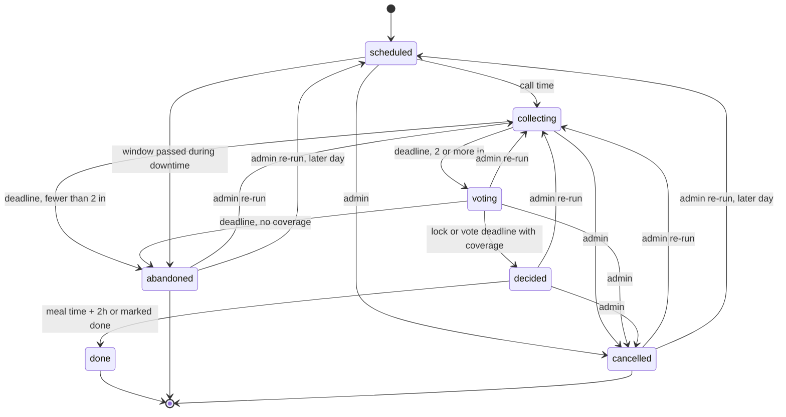

# Dinnerbell: requirements and architecture

| | |
|---|---|
| Status | Draft v0.2 |
| Date | 2026-10-21 |
| Owner | David Morgan |
| Scope | Version 1 (single household) with a roadmap for later phases |

Dinnerbell helps a household answer, at a fixed time each day, three questions: who is eating, what are we eating, and who is cooking, picking up, or ordering it. It runs as one container on a homelab, talks to the family through Slack, and keeps the catalog, preferences, history, and badges in a mobile-friendly web app.

Decisions that shaped this document are recorded in [docs/adr](adr/).

## 1. Problem

Four adults share a home and almost none of their schedules. The question "what are we eating?" arrives at the moment someone is hungry, then takes a long time to settle because:

- Nobody knows who is home, who is hungry, or who can go get food.
- Not everyone eats every option, and the group forgets who won't eat what.
- The household drifts toward the same cuisines week after week.
- The same person ends up coordinating, cooking, and picking up most of the time.

Dinnerbell moves the question to a scheduled time, collects participation and constraints before anyone proposes a meal, ranks options that fit everyone who is eating, assigns the work, and records who did it so the household can celebrate contributions.

## 2. Goals and non-goals

### Goals for version 1

| ID | Goal |
|---|---|
| G1 | Ask the question at a set time, not at the moment of hunger. |
| G2 | Make the choice fit the people eating: hard vetoes, soft preferences, variety, and which roles are actually available. |
| G3 | Make the decision stick: deadlines, named assignments, reminders, and a clear fallback when nobody answers. |
| G4 | Make contribution visible and rewarding. Positive framing only. |
| G5 | Work on iPhones without an App Store app. Slack carries notifications and quick actions; the web app carries depth. |
| G6 | Run as one self-hosted container behind Pangolin, with the code open source under AGPL-3.0. |
| G7 | Let a reluctant adopter participate fully by tapping buttons in Slack, without ever opening the web app. |

### Non-goals for version 1

- Recipes, ingredients, grocery lists, or pantry inventory. Home meals are a name plus tags.
- Cost tracking or bill splitting.
- Writing to anyone's calendar.
- Multiple households in one deployment. The data model carries a household ID so this is a migration later, not a rewrite.
- A native iOS app or chat platforms other than Slack. The channel layer is an adapter so Discord and web push can follow.

### Success criteria

Measure these 30 days after the household starts using Dinnerbell for dinner.

| Metric | Target |
|---|---|
| Dinners decided through Dinnerbell before the decision deadline | At least 80% of days with two or more participants |
| Roles (cook, pickup, order, coordinate) filled by someone other than the admin | At least 40% of decided dinners |
| Same cuisine chosen twice within 7 days | Only when the household votes for it over a higher-ranked alternative |
| Members who respond to the call on a typical day | At least 3 of 4 |

## 3. People and roles

| Role | Who | Can do |
|---|---|---|
| Admin | David | Everything a member can, plus: invite and deactivate members, edit household settings other than the meal schedule, override or reassign a coordinator, lock or cancel a decision, rename and merge tags, connect Slack. |
| Member | Each household adult | Respond to calls, make offers, change the meal schedule, claim roles, propose and vote, maintain the catalog, set their own preferences, invite guests, log meals, give feedback on meals, view history and badges. |
| Guest | A partner or friend at a meal | Has no account. A member adds guests to their own response with a head count and optional dietary needs. |

Each member declares capability flags: can cook, can pick up, can order. The flags are defaults. A member can still volunteer for a role on a given day, and the flags drive who gets asked.

## 4. Concepts

| Term | Meaning |
|---|---|
| Household | The one family using this deployment. Owns members, catalog, settings, and history. |
| Slot | A meal of the day: lunch or dinner. Each slot has its own schedule and defaults. |
| Event | One coordination of one slot on one date. Two kinds: Call and Offer. |
| Call | The scheduled group question: who is in, what can you do, what do you suggest. Produces a decision with assignments. |
| Offer | One person announcing a meal they are already getting or making, with spare capacity: "I'm picking up Thai at 12:30, three servings spare." Others join until it's full. |
| Response | A member's answer to an event: in, out, or maybe; guest count; the window when they can eat; roles they can fill; a suggestion. |
| Coordinator | The member who owns a Call's decision. Self-nominated. The admin can assign or override. Defaults to nobody, in which case the system's top-ranked option is proposed and the admin can lock it. |
| Catalog item | Something the household can eat. Kind: home meal or restaurant. Carries tags and supported fulfillment modes. |
| Fulfillment mode | How the food arrives: cook, pickup, or delivery. |
| Tag | A label on catalog items: cuisine (Thai, Mexican), protein (chicken, vegetarian), dietary (gluten-free option), or other. |
| Preference | A member's stance on a tag or item: a hard veto, or a soft score from −2 to +2. |
| Proposal | A candidate (item plus fulfillment mode) put forward for a Call, by the ranking engine, the coordinator, or a member. |
| Decision | The locked outcome of a Call: item, mode, meal time, and assignments. |
| Assignment | A member attached to a decision in a role: cook, pickup, order, or coordinator. |
| Meal log | The record of what the household ate, whether or not Dinnerbell coordinated it. Feeds variety and history. |
| Contribution | A counted act: cooked, picked up, ordered, coordinated, added a catalog item, responded on time, hosted guests, participated. |
| Badge | A named award earned by reaching a contribution milestone. |
| Feedback | A member's reaction to a meal they ate, on up to three subjects: the food, the place (restaurants), and the cook (home meals). |

## 5. How it works

### 5.1 A dinner call

Default times are configurable per slot. The example uses the defaults.

| Time | What happens |
|---|---|
| 15:00 | The bot posts the dinner call in the Slack channel and mentions every active member. Buttons: **In**, **Out**, **Maybe**, **I can cook**, **I can pick up**, **I'll order**, **I'll coordinate**, **Details**. **Details** opens a modal for guest count, eat window, a suggestion, and a note. |
| 15:00 to 16:30 | Members respond. The call message updates in place with the roster, roles offered, and suggestions. |
| 16:15 | Members who haven't responded get one direct-message reminder. |
| 16:30 | Response window closes. Maybes become outs. If fewer than two people are in, the bot posts "Everyone's on their own tonight" and the event ends. Otherwise the bot posts the top three ranked proposals with a one-line reason each and a **Vote** button per proposal. The coordinator sees **Lock this** on each. |
| 16:30 to 17:15 | Members vote. The coordinator can lock early, add a proposal, or extend the window. |
| 17:15 | Vote window closes. The highest-voted proposal wins; the coordinator breaks ties, or the admin does if there's no coordinator. The bot posts the decision with the meal time, the item, and named assignments, and direct-messages each assignee with details and a link. |
| Meal time plus 2 hours | The event is marked done. Contributions are recorded. Any new badges are announced in the channel. |

If nobody claims **I'll coordinate**, the system's top-ranked proposal is the default and the vote decides. If nobody votes either, the top-ranked proposal is announced as the decision as long as its roles are covered. If no one can fulfill it, the bot posts the on-your-own message.

### 5.2 A lunch offer

Lunch has no scheduled call by default. David, working from home, taps **Offer** in the App Home or runs `/dinnerbell offer`, picks a catalog item or types one, sets the time and spare servings, and posts. The channel message reads "David is picking up Thai from Siam Garden at 12:30. 3 servings spare." with **Count me in** and **+1 guest** buttons. The message updates as people join and disables the buttons when the capacity is reached. The offer closes at the stated time.

### 5.3 A cooking offer

Any member can make an offer for dinner too: "I'm making tacos tonight, 6 servings." A cooking offer posted before the dinner call replaces that day's call. Members join, add guests within capacity, and the cook sees the head count. The cook earns the cook contribution when the event completes.

### 5.4 Nobody answers

A call with fewer than two people in at the response deadline ends with the on-your-own message. A call where nobody votes and nobody can fulfill the top proposal ends the same way. Nothing is assigned and no one is nagged further.

### 5.5 Guests

A member adds guests to their own response: a head count and, optionally, dietary needs chosen from the dietary tags. Guest needs act as required tags in ranking. Guests count toward capacity on offers and toward the head count in the decision message. The member who brought guests earns the host contribution.

### 5.6 Logging a meal outside Dinnerbell

Anyone can record what the household ate when there was no call or offer, with `/dinnerbell log` or from the web app. Logged meals feed variety and history but award no role contributions.

### 5.7 Admin override

The admin can, from Slack or the web app: assign or replace the coordinator, extend or shorten a window, lock a decision, cancel an event, re-run a call, and correct an assignment after the fact.

### 5.8 Changing the schedule

Calls run at the same times every day by default. Any member can change a slot's standing schedule, such as moving the dinner call from 15:00 to 14:00, from the web app or `/dinnerbell schedule`. The bot posts the change in the channel with who made it, and the change applies from the next call. Moving only today's call is an admin override.

### 5.9 Feedback after meals

When an event is done, the decision message gains a **How was it?** button, and the meal shows on the member's App Home and History page as awaiting feedback. Feedback is three quick taps, each optional:

- **Food**: loved it, fine, or not again.
- **Place** (restaurants only): loved it, fine, or not again, with optional chips such as "late," "wrong order," or "cold."
- **Cook** (home meals only): a thank-you, with an optional short note.

There's no nudge by default. A member who wants one turns on a feedback reminder in Preferences and gets one direct message per meal. Feedback stays open for 7 days after the meal.

In version 1, feedback is collected and displayed but doesn't affect ranking. After at least 8 weeks of data, a later milestone decides how feedback should influence proposals.

## 6. Functional requirements

Requirements use "must" for version 1 and "should" for items that can slip to a later milestone without blocking launch.

### 6.1 Schedule and events

| ID | Requirement |
|---|---|
| FR-1 | Each slot has: call enabled or disabled, call time, response window length, vote window length, reminder lead time, default fulfillment modes, and a usual meal time for when nobody gives an eat window (FR-19). Dinner defaults: enabled, 15:00, 90 minutes, 45 minutes, 15 minutes, pickup and delivery, 18:30. Lunch defaults: disabled, 10:30, 60, 30, 15, pickup, 12:30. The schedule is the same every day of the week. In M2 only the admin edits it (FR-44 is M3). |
| FR-2 | The scheduler must post a call for each enabled slot once per day at the configured time, in the household time zone, and must not double-post after a restart. A call whose response window ended while the server was down is not posted, and a call is only ever posted on its own day: it's stale at midnight after it, so a call time late in the evening gets cut off at midnight. |
| FR-3 | Any member must be able to start an ad-hoc call for a slot and date from Slack or the web app. A call for today opens at once; a call for a later day, up to 7 days ahead, opens at the slot's call time. A slot has at most one call per date. |
| FR-4 | Any member must be able to post an offer with item, fulfillment mode, time, and capacity. |
| FR-5 | An offer for a slot that already has an open call must attach to it as a proposal; a cooking offer posted before the call must replace that day's call. |
| FR-6 | The admin must be able to extend, shorten, lock, cancel, and re-run events. Re-running a voting, decided, abandoned, or cancelled call reopens it with fresh windows: now for today's call (not after the usual meal time plus two hours), or at the slot's call time for a later day. Responses stay; proposals, votes, the decision, and assignments are cleared. |

### 6.2 Responses

| ID | Requirement |
|---|---|
| FR-7 | A member responds in, out, or maybe, and can change the response until the response window closes. |
| FR-8 | A response may include guest count, guest dietary needs, an eat window (earliest and latest), roles offered (cook, pickup, order, coordinate), one or more suggestions, and a free-text note. |
| FR-9 | "Maybe" counts toward hard-veto filtering and not toward capacity. Unresolved maybes become out at the deadline and the member is told. |
| FR-10 | The first member to claim coordinate becomes coordinator. The coordinator can hand off. The admin can reassign. Offering to cook, pick up, or order counts a member in unless they said maybe; saying out withdraws their offers. |
| FR-11 | Non-responders receive exactly one direct-message reminder per call at the configured lead time. |

### 6.3 Proposals, ranking, and voting

| ID | Requirement |
|---|---|
| FR-12 | At the response deadline the ranking engine produces the top N proposals (default 3) from the catalog, filtered and scored as described in section 7, each with a human-readable reason. |
| FR-13 | The coordinator and any member can add a proposal from the catalog or as free text during the vote window. A free-text proposal needs a cuisine, and creates a catalog item on decision. A call holds at most 10 proposals, and each member adds at most 3. Added proposals pass the same vetoes, guest needs, and coverage checks as ranked ones; a refusal for a veto or a guest need always reads "That doesn't work for everyone who's in tonight." so it can't reveal whose stance it was (FR-29). |
| FR-14 | Each member casts at most one vote per proposal and can change it until the vote closes. Votes are visible. |
| FR-15 | The coordinator can lock any proposal at any time during the vote window. |
| FR-16 | At the vote deadline the system decides: highest votes, coordinator breaks ties, admin breaks ties when there is no coordinator, ranking order breaks ties otherwise. At the deadline, "breaks ties" means the tied proposal the coordinator (or, with no coordinator, an admin) voted for wins; either can also lock a proposal before then. |
| FR-17 | A proposal is only eligible if its fulfillment mode is covered: cook requires a member who offered to cook and can cook the item, pickup requires a member who offered to pick up, delivery requires any participating member who can order. Only active members who are in count. A member can cook an item when it has no cook list or they are on it. The first volunteer is assigned; the coordinator or admin can change it. |

### 6.4 Decisions and assignments

| ID | Requirement |
|---|---|
| FR-18 | A decision records item, fulfillment mode, meal time, participants with guest counts, and assignments. |
| FR-19 | Meal time defaults to the latest "earliest" across participants' eat windows, rounded up to the quarter hour, or the slot's usual meal time when nobody gave one, and never earlier than the decision. The coordinator can change it. |
| FR-20 | Each assignee receives a direct message with the decision, their role, meal time, item link, head count, and dietary notes. |
| FR-21 | Events become done at meal time plus 2 hours, or when any participant marks them done once it's meal time (the admin can at any time). Contributions are recorded on done. |
| FR-22 | Done events open feedback for their participants, as specified in section 6.10. |

### 6.5 Catalog

| ID | Requirement |
|---|---|
| FR-23 | Any member can add, edit, and deactivate catalog items. Deactivation hides an item without deleting history. |
| FR-24 | A catalog item has: kind (home meal or restaurant), name, tags, supported fulfillment modes, optional URL (menu or recipe link), optional order URL (restaurants), optional notes, optional default servings (home meals), optional list of members who can cook it (home meals). |
| FR-25 | Tags are shared across the household. Any member can add a tag; the admin can merge and rename tags. Tag kinds: cuisine, protein, dietary, other. A cuisine tag merges only into another cuisine tag, so every item keeps a cuisine. Merging moves the tag's items, preferences, and meal-log references to the surviving tag; when a member has a stance on both, a veto wins, otherwise the lower score. |
| FR-26 | Any member can bulk-import tags and catalog items from a file in the format defined in [catalog-format.md](catalog-format.md), by paste or upload, with a validated preview before anything is saved. The same file can seed the catalog at first run. Imports never delete. |

### 6.6 Preferences

| ID | Requirement |
|---|---|
| FR-27 | Each member sets, for any tag or item: veto, or a soft score of −2, −1, 0, +1, +2. Default is 0. |
| FR-28 | A veto on a tag excludes every item carrying that tag whenever that member is in or maybe. A veto on an item excludes that item. |
| FR-29 | Members see and edit only their own preferences. The coordinator sees an aggregated "won't work for" list per proposal, not who vetoed what. |

### 6.7 Variety and history

| ID | Requirement |
|---|---|
| FR-30 | The meal log records every decided event and every manually logged meal with date, slot, item, cuisine tags at the time, and participants. |
| FR-31 | The variety window is configurable; default 7 days. The same item within the window is excluded from ranking unless no other eligible item exists. The same cuisine within the window is penalized in proportion to recency. |
| FR-32 | The web app shows history by week and the cuisines eaten in the current window. |

### 6.8 Notifications

| ID | Requirement |
|---|---|
| FR-33 | Notifications are produced by the domain layer as typed events and delivered by a channel adapter. Version 1 ships the Slack adapter. |
| FR-34 | The notification matrix in section 9 defines what is sent, to whom, and where. Every notification is logged with an idempotency key so a restart never sends it twice. |

### 6.9 Web app

| ID | Requirement |
|---|---|
| FR-35 | The web app is mobile-first and works in Safari on iOS with no installation. |
| FR-36 | Pages: Today, Catalog, Preferences, History, Stats and badges, Admin. See section 11. |
| FR-37 | Every Slack message about an event links to that event's page. |

### 6.10 Feedback

| ID | Requirement |
|---|---|
| FR-45 | Any participant in a done event, or a member named on a logged meal, can give feedback for up to 7 days after the meal. Each member gives at most one feedback per meal and can edit it within the window. Feedback does not affect ranking in version 1. All feedback is stored with the item, mode, cook, and participants at the time, so a later milestone can use it. |
| FR-46 | Feedback has up to three subjects, each optional. Food: loved it, fine, or not again. Place, restaurants only: loved it, fine, or not again, plus optional issue chips (late, wrong order, cold, other). Cook, home meals only: a thank-you plus an optional note up to 200 characters. |
| FR-47 | Feedback is available from a button on the decision or offer message, from App Home, and from the History page. Feedback is never required. |
| FR-48 | Each member has a feedback reminder setting, default off. When on, the member gets one direct message per done meal they participated in. |
| FR-49 | Food and place feedback is shown on the catalog item as counts. Cook thank-yous and notes are shown to the cook. Other members see only the thank-you count. No one sees who chose "not again." |

### 6.11 Metrics and badges

| ID | Requirement |
|---|---|
| FR-38 | Contributions in section 12 are counted per member on event completion. |
| FR-39 | Badges in section 12 are awarded when thresholds are met, announced once in the channel, and shown on the member's Stats page and App Home. |
| FR-40 | A monthly recap posts on the first day of the month: meals coordinated, cuisines tried, new catalog items, badges earned. It never ranks members from worst to best. |

### 6.12 Administration

| ID | Requirement |
|---|---|
| FR-41 | The admin invites a member by email. The member's first sign-in with that email activates the account and links the identity. Unknown emails are refused with a message to ask the admin. |
| FR-42 | The admin maps or confirms each member's Slack user ID. Default mapping is by email match. |
| FR-43 | The admin edits time zone, variety window, ranking weights, and badge thresholds in the web app. |
| FR-44 | Any member can edit the standing schedule for a slot: call enabled, call time, and window lengths. Each change is announced in the channel with the member's name, written to the audit log, and applies from the next call. |

### 6.13 Later phases

| ID | Requirement | Phase |
|---|---|---|
| FR-50 | Each member may paste a Google Calendar secret iCal URL. The app polls it read-only and shows "busy at usual dinner time" as a hint on the call roster. Never writes to any calendar. | Calendar |
| FR-51 | A member can ask the assistant in natural language: "something we haven't had in a month that works for everyone in," or "tacos at 7, I'll cook." The assistant turns requests into proposals and offers through the same domain API and never bypasses filters. | Assistant |
| FR-52 | A Discord adapter implements the channel interface. | Channels |
| FR-53 | Web push for Home Screen web apps as an optional additional channel. | Channels |
| FR-54 | Multiple households per deployment. | Multi-tenant |
| FR-55 | Feedback influences ranking, for example a "not again" from a participant acting as a soft penalty for that item. The design is decided from at least 8 weeks of collected data and recorded in an ADR. | Feedback-informed ranking |

## 7. Ranking

Ranking is deterministic and explainable. Given a Call with participants P (in and maybe), roles offered R, and guest needs G:

1. **Candidate set.** All active catalog items, expanded into (item, mode) pairs for each mode the item supports. In version 1 every slot allows every mode; the slot's default modes earn the default-mode bonus.
2. **Hard filters.** Drop a pair if:
   - Any member in P vetoes the item or any of its tags. P counts maybes, so ranking runs before the deadline turns them out.
   - Guest needs in G include a dietary tag the item lacks.
   - The mode is not covered by R (FR-17).
   - The item was eaten within the variety window, unless that empties the set.
3. **Score.** For each remaining pair, sum:

| Component | Formula | Default weight |
|---|---|---|
| Soft preference | Sum over members in P of their item score, plus 0.5 × sum of their tag scores for the item's tags | 1.0 |
| Cuisine variety | For each cuisine tag eaten within the window, −(1 − days_since / window) | 3.0 |
| Novelty | +1 if the item has never been eaten | 1.0 |
| Suggested today | +1 for each participant who suggested the item in this call | 2.0 |
| Default mode | +0.5 if the mode is one of the slot's default fulfillment modes | 1.0 |
| Volunteer fit | +0.5 if the mode is cook and the volunteer cook is on the item's cook list | 1.0 |

4. **Order** by score descending. Break ties by the item eaten longest ago, with never-eaten items first, then by name.
5. **Explain.** Each proposal carries the top two positive components and any penalty as a sentence: "Suggested by Alex. Nobody has had Ethiopian in 3 weeks."

Feedback is not an input in version 1; FR-55 adds it once there is enough data. Weights are household settings. The engine is a pure function over a snapshot, so it is unit-testable without a database.

## 8. Event lifecycle



Offers use a shorter chain: open, then full or closed at the stated time, then done. A cancelled or abandoned event records nothing in the meal log and awards nothing.

Transitions are driven by two sources: user actions through a channel or the web, and scheduler ticks. Every transition is a single transaction that updates state, writes the notification outbox, and records the audit row. The outbox is drained by the channel adapter so a Slack outage never loses a state change.

The scheduler doesn't keep a job per deadline. One tick every 30 seconds opens each household's due calls and walks every open event through each step it owes, in order, so downtime past several deadlines is caught up on the next tick. A reminder whose response deadline has already passed is skipped.

Catch-up stops where it would be too late to matter. An undecided call (scheduled, collecting, or voting) expires once it passes the later of the slot's usual meal time plus two hours and its own vote deadline plus two hours, and always at midnight after its day; a scheduled call whose response window passed while the server was down expires without being posted (FR-2); and a decision whose meal time would fall after its day expires instead. An expired call is abandoned with the reason "missed", quietly: no new channel post and no direct messages, only its existing messages updated. [docs/channels.md](channels.md) is the outbox and adapter contract.

## 9. Notifications

| Trigger | Audience | Where |
|---|---|---|
| Call opens | All active members | Channel post with mentions |
| Response window closing | Non-responders | Direct message, once |
| Maybe turned out at the deadline | That member | Direct message (FR-9) |
| Proposals ready | All participants | Channel post, threaded under the call |
| Decision made | All participants | Channel post, threaded under the call |
| Assignment | Each assignee | Direct message |
| Abandoned | All members | Channel post |
| Offer posted | All active members | Channel post |
| Offer full | Offerer | Direct message |
| Badge earned | Everyone | Channel post |
| Monthly recap | Everyone | Channel post |
| Event cancelled by admin | Participants | Channel post, threaded |
| Schedule changed | Everyone | Channel post |
| Feedback reminder | Participants who turned the reminder on | Direct message, once per meal |

Each member can mute direct-message reminders in their preferences. Channel posts are never suppressed per member. The call, proposals, and decision messages are also edited in place as they change; see [docs/channels.md](channels.md).

## 10. Slack design

**Connection.** The app uses Socket Mode, so Slack never calls an inbound URL. Only the web app is exposed through Pangolin.

**Bot scopes.** `chat:write`, `channels:read`, `channels:history` (to resolve threads), `im:write`, `users:read`, `users:read.email`, `commands`. Events: `app_home_opened`. Interactivity: block actions and view submissions. The channel must be public; a private channel would also need `groups:read` and `groups:history`. The full configuration is [deploy/slack-app-manifest.yaml](../deploy/slack-app-manifest.yaml).

**Sign in with Slack.** User scopes `openid`, `email`, `profile`. Slack publishes an OpenID Connect discovery document, so the generic OIDC client in the web app works unchanged.

**Channel.** One configured channel, default `#dinnerbell`. The bot posts calls, proposals, decisions, offers, badges, and recaps there. Proposals and decisions thread under their call so the channel stays readable.

**Call message.** Header with slot and date. Roster section updated in place. Two button rows: participation (In, Out, Maybe) and roles (I can cook, I can pick up, I'll order, I'll coordinate). A **Details** button opens a modal with guest count, guest dietary needs, eat window pickers, suggestion select with free-text fallback, and note. A link to the event page.

**Proposals message.** One section per proposal: name, mode, reason, vote count, **Vote** button. The coordinator and admin also see **Lock**. An **Add proposal** button opens a modal.

**Decision message.** Item, mode, meal time, head count, assignments with mentions, item link, event link. **Mark done** button. After the event is done, a **How was it?** button opens the feedback modal.

**Offer message.** Offerer, item, mode, time, spare servings, roster. **Count me in** and **+1 guest** buttons, disabled when full.

**App Home.** Today's events with the member's status, quick buttons to offer or start a call, meals awaiting the member's feedback, badges earned, link to preferences on the web.

**Slash command.** `/dinnerbell` with subcommands `offer`, `call`, `log`, `schedule`, `prefs`, `help`. Each opens a modal or returns a link.

**Identity.** The bot acts only for Slack users mapped to active members. Unmapped users get an ephemeral message asking them to contact the admin.

## 11. Web app

Mobile-first server-rendered pages with HTMX for in-place updates. No JavaScript build step.

| Page | Content |
|---|---|
| Today | Open events with roster, proposals, votes, and the same actions Slack offers. Start a call or post an offer. |
| Catalog | Search and filter items by tag, kind, mode. Add and edit items. See last eaten and feedback counts. Tag management: any member adds tags; the admin renames and merges them. Import a catalog file with a preview (FR-26). |
| Preferences | Tags and items with veto and −2 to +2 controls. Capability flags. Mute reminders. Feedback reminder on or off. Calendar URL (later phase). |
| History | Meals by week. Cuisines in the current variety window. Give or edit feedback on recent meals. |
| Stats | Contribution counts, badges with progress to the next tier, household recap. |
| Admin | Members and invitations, Slack mapping, slot schedules, time zone, ranking weights, badge thresholds, backup status. |

## 12. Metrics and badges

### Contributions

| Kind | Recorded when |
|---|---|
| cooked | Assigned cook on a done event, or offerer of a done cooking offer |
| picked_up | Assigned pickup on a done event, or offerer of a done pickup offer |
| ordered | Assigned order on a done event |
| coordinated | Coordinator of a decided event |
| participated | In on a done event |
| responded_on_time | Responded within 15 minutes of a call opening |
| suggested | Made a suggestion that became the decision |
| added_item | Created a catalog item that was later chosen at least once |
| hosted | Brought one or more guests to a done event |
| gave_feedback | Gave feedback on a meal within the window |

### Badges

Badges have tiers at 1, 10, and 50 unless noted. Thresholds are settings.

| Badge | Earned by |
|---|---|
| First Flame / Home Chef / Head Chef | cooked ×1 / ×10 / ×50 |
| Road Runner | picked_up ×1 / ×10 / ×50 |
| Order Up | ordered ×1 / ×10 / ×50 |
| Quarterback | coordinated ×1 / ×10 / ×50 |
| Early Bird | responded_on_time ×10 / ×50 / ×200 |
| Scout | added_item ×3 / ×10 / ×25 |
| Explorer | suggested an item or cuisine the household had never eaten, and it was chosen, ×1 / ×5 / ×15 |
| Good Host | hosted ×1 / ×5 / ×20 |
| Full Table | participated ×10 / ×50 / ×200 |
| Food Critic | gave_feedback ×5 / ×25 / ×100 |
| On a Roll | cooked, picked_up, or ordered in each of 3 / 8 / 20 consecutive weeks |

Rules: badges announce once in the channel when earned. The Stats page shows progress toward the next tier. Nothing in the app ranks members against each other or names who did the least.

## 13. Architecture

### 13.1 Components

```
                 ┌──────────────┐  Socket Mode (outbound WebSocket)
   Slack ◄──────►│ Slack adapter│◄────────────┐
                 └──────┬───────┘             │
                        │ channel interface   │
                 ┌──────▼───────┐      ┌──────┴──────┐
 Pangolin ─────► │  Web (FastAPI│      │  Scheduler  │
 HTTPS           │  + HTMX)     │      │ (APScheduler│
                 └──────┬───────┘      └──────┬──────┘
                        │   domain services   │
                 ┌──────▼─────────────────────▼──────┐
                 │  Domain: events, ranking, badges, │
                 │  catalog, preferences, outbox     │
                 └──────────────┬────────────────────┘
                                │ SQLAlchemy
                         ┌──────▼──────┐
                         │   SQLite    │  /data/dinnerbell.db
                         └─────────────┘
```

One container, one Python process, one asyncio event loop running the web server, the scheduler, the Slack Socket Mode client, and the outbox drainer. SQLite in WAL mode handles the household's write volume with room to spare. If the process ever needs to split, the outbox table is the seam.

### 13.2 Layers

| Layer | Responsibility | Depends on |
|---|---|---|
| `domain` | Entities, state machine, ranking, badge rules, notification events. Pure Python, no I/O. | nothing |
| `services` | Use cases: respond to call, post offer, lock decision. Transactions, outbox writes. | domain, db |
| `db` | SQLAlchemy models, Alembic migrations, repositories. | domain |
| `channels` | `Channel` protocol plus `channels/slack`. Renders notification events to Slack blocks, maps interactions back to service calls. | services |
| `web` | FastAPI routes, Jinja templates, HTMX fragments, auth. | services |
| `scheduler` | Cron-style jobs: open calls, close windows, mark done, monthly recap, calendar poll, backups. | services |

The rule that keeps this maintainable: `domain` imports nothing from the other layers, and only `services` writes to the database.

### 13.3 Data model

Every table carries `household_id`. Timestamps are UTC; the household time zone is a setting.

| Table | Key fields |
|---|---|
| household | name, timezone, settings (JSON: slots, weights, variety window, badge thresholds, slack channel) |
| member | display name, email, oidc_subject, slack_user_id, role (admin, member), can_cook, can_pickup, can_order, mute_dm_reminders, feedback_reminder, active |
| tag | kind (cuisine, protein, dietary, other), name |
| catalog_item | kind (home, restaurant), name, notes, url, order_url, modes (cook, pickup, delivery), default_servings, created_by, active |
| catalog_item_tag | item, tag |
| catalog_item_cook | item, member |
| preference | member, tag (nullable), item (nullable), veto, score (−2 to +2). Exactly one of tag and item is set (check constraint); both are foreign keys. A veto has score 0, and neutral stances aren't stored. |
| event | slot, date, kind (call, offer), state, run (admin re-runs), version (the write lock), created_by, coordinator, opens_at, respond_deadline, vote_deadline, reminder and vote window lengths copied from the schedule, reminder_sent_at, decided_item, decided_mode, meal_time, decided_at, done_at, end_reason. One call per household, slot, and date. Offer fields arrive with M3; Slack message references live in the Slack adapter's own table or in the outbox, not here |
| response | event, member, status (in, out, maybe), guests, guest_needs (tags), eat_from, eat_until, offers_cook, offers_pickup, offers_order, note, maybe_at_deadline. Coordinating is event.coordinator, not a response field |
| suggestion | event, member, item (nullable), free_text |
| proposal | event, item (nullable), free_text and its cuisine (until it wins), mode, rank, score, reasons (JSON), source (system, coordinator, member), proposed_by |
| vote | proposal, member |
| assignment | event, member, role (cook, pickup, order, coordinator) |
| meal_log | date, slot, item, cuisine_tags snapshot, participants snapshot, event (nullable, unique), logged_by |
| feedback | meal_log, member, food (loved, fine, not_again, null), place (same, null), place_issues (JSON), cook_member (nullable), cook_thanks (bool), cook_note, created_at, updated_at |
| contribution | member, kind, event, created_at |
| badge_award | member, badge_key, tier, event, awarded_at |
| outbox | event, notification type, payload (JSON), idempotency_key, message_key, thread_key, available_at, claim_token, claimed_until, attempts, last_error, delivered_at, failed_at, and the delivered message's reference |
| session | id, member, created_at, expires_at, last_seen |
| audit | actor, action, target, payload, created_at |

### 13.4 Channel interface

```python
class Channel(Protocol):
    async def deliver(self, notification: Notification, *, thread: MessageRef | None = None) -> DeliveryResult: ...
    async def update(self, ref: MessageRef, notification: Notification) -> None: ...
```

`Notification` is a tagged union over the triggers in section 9, carrying only domain data. The protocol lives in `domain/notifications.py` so services can name it; `channels/base.py` re-exports it with `NullChannel`. [docs/channels.md](channels.md) has the full contract. The Slack adapter owns Block Kit rendering and the mapping from button payloads to service calls. A Discord adapter implements the same protocol. Nothing in `domain` or `services` imports from `channels`.

### 13.5 Authentication and authorization

- **Web sign-in** uses OpenID Connect with discovery, `state`, `nonce`, and PKCE where the provider supports it. The provider is configuration. The household configures Slack; open-source users can configure Google or any OIDC provider. See [ADR 0002](adr/0002-oidc-sign-in.md).
- **Membership** is invite-only. The admin creates a member with an email. On first sign-in the OIDC email must match an invited, active member; the subject is then stored and future sign-ins match on subject. Email matching requires the provider to report the email as verified.
- **Sessions** are server-side rows referenced by an `HttpOnly`, `Secure`, `SameSite=Lax` cookie. Lifetime 90 days, sliding. Sign-out deletes the row.
- **CSRF**: every state-changing request carries a per-session token, sent by HTMX via the `hx-headers` attribute, and the server also checks `Origin`.
- **Slack identity**: interactions are trusted because Socket Mode authenticates the connection with the app-level token. The adapter resolves `slack_user_id` to a member and refuses unknown users.
- **Authorization** is role-based: admin or member, plus ownership checks (members edit only their own preferences and responses; the coordinator and admin may lock).
- **Pangolin** is configured with resource authentication off for this resource, because stacking Pangolin's login in front of the app's login would mean two sign-ins per device and would break OIDC redirects. Pangolin still provides TLS, the public hostname, and its connection-level protections.

### 13.6 Configuration

All configuration comes from environment variables with a `DINNERBELL_` prefix, read once at start by a pydantic settings model. Secrets are never logged.

| Variable | Purpose |
|---|---|
| `DINNERBELL_DATABASE_URL` | SQLite path, default `sqlite:////data/dinnerbell.db` |
| `DINNERBELL_BASE_URL` | Public HTTPS URL as exposed by Pangolin |
| `DINNERBELL_SECRET_KEY` | Signing key for cookies and CSRF tokens |
| `DINNERBELL_ADMIN_EMAIL` | Bootstrap admin; created as a member on first start if missing |
| `DINNERBELL_HOUSEHOLD_NAME` | Seeds the household name on first start, default `Home`. Afterward the household row is authoritative |
| `DINNERBELL_OIDC_ISSUER`, `_CLIENT_ID`, `_CLIENT_SECRET` | OIDC provider; issuer must publish discovery |
| `DINNERBELL_OIDC_SCOPES` | Requested scopes, default `openid email profile` |
| `DINNERBELL_SLACK_TEAM_ID` | Required when the OIDC issuer is `https://slack.com`; Dinnerbell refuses to start without it. Sign-in requires the ID token's Slack team to match, which blocks accounts from other workspaces. Unused with other providers |
| `DINNERBELL_SLACK_BOT_TOKEN`, `_SLACK_APP_TOKEN` | Bot token (`xoxb-`) and Socket Mode app token (`xapp-`) |
| `DINNERBELL_SLACK_CHANNEL` | Channel ID for household posts |
| `DINNERBELL_TIMEZONE` | Seeds the household time zone on first start, default `America/New_York`. Afterward the household row is authoritative and is edited in Admin |
| `DINNERBELL_SEED_FILE` | Optional YAML of tags and catalog items to import on first start |
| `DINNERBELL_LOG_LEVEL` | Default `INFO` |
| `DINNERBELL_BIND` | Compose only, not read by the app: host address that `compose.yaml` publishes port 8013 on, default `127.0.0.1`. Set it to the interface the reverse proxy reaches |
| `DINNERBELL_TRUSTED_PROXIES` | Optional comma-separated IPs or CIDRs whose `X-Forwarded-For` is trusted for client IPs, such as the reverse proxy's address |

Household-level settings that change over time (slot schedule, weights, thresholds) live in the database and are edited in Admin, not in environment variables.

### 13.7 Deployment

- **Image**: multi-stage `Containerfile`, Python 3.12 slim, non-root user, dependencies installed from `uv.lock`, read-only root filesystem with `/data` as the only writable volume.
- **Run**: `compose.yaml` for podman-compose with one service, one named volume, `restart: unless-stopped`, and a health check on `/healthz`.
- **Expose**: one Pangolin resource pointing at the container's port 8013 with resource authentication off.
- **Backups**: a nightly scheduler job runs SQLite's online backup into `/data/backups/`, keeps 14 daily and 8 weekly copies, and exposes the last success time in Admin and `/healthz`. Copying `/data` off the host is the operator's existing backup routine.
- **Upgrades**: pull the new image, restart. Alembic migrations run at startup and refuse to start on an unknown schema version.

### 13.8 Security requirements

| ID | Requirement |
|---|---|
| SEC-1 | No secrets in the repository or image. All secrets arrive by environment or secret file. |
| SEC-2 | The web app sets `Content-Security-Policy` (self only, no inline scripts except HTMX with a nonce), `X-Content-Type-Options`, `Referrer-Policy`, and `Permissions-Policy`. HSTS is set by Pangolin. |
| SEC-3 | Authentication endpoints are rate-limited per IP and per session. |
| SEC-4 | All database access goes through the ORM with bound parameters. All inbound data is validated with pydantic models before reaching services. |
| SEC-5 | Logs contain member display names and IDs, never emails, tokens, or calendar URLs. |
| SEC-6 | Calendar secret URLs (later phase) are encrypted at rest with a key derived from `DINNERBELL_SECRET_KEY` and never rendered back in full. |
| SEC-7 | Dependencies are pinned with `uv.lock`, scanned in CI with `pip-audit`, and updated by Dependabot. |
| SEC-8 | The container runs as non-root with a read-only root filesystem and no added capabilities. |
| SEC-9 | Every admin action and every decision lock writes an audit row. |
| SEC-10 | The repository ships a `SECURITY.md` with a disclosure contact. |

### 13.9 Observability

- `/healthz` returns database reachability, scheduler last tick, Slack socket connection state, outbox backlog, and last backup time. Uptime Kuma polls it.
- Structured JSON logs to stdout with request ID, member ID, and event ID fields.
- Optional `/metrics` in Prometheus format behind an admin-only flag.

### 13.10 Testing

| Level | What | How |
|---|---|---|
| Unit | Ranking, state machine, badge rules, time-window math | pytest over `domain`, no database, property-style tests for ranking invariants |
| Service | Use cases against an in-memory SQLite with migrations applied | pytest fixtures, one transaction per test |
| Channel | Block rendering and interaction mapping | Golden-file tests for blocks; fake Slack client records calls |
| Web | Routes, auth flow, CSRF, authorization | httpx `TestClient`; a fake OIDC provider fixture |
| End to end | Scheduler drives a full call through decision with a fake clock | pytest with frozen time |

CI on every pull request: `ruff` (lint and format), `mypy --strict` on `domain` and `services`, pytest with coverage, `pip-audit`, and a container build. Coverage threshold starts at 85% for `domain`.

### 13.11 Repository layout

```
dinnerbell/
  src/dinnerbell/
    domain/        entities, state machine, ranking, badges, notifications
    services/      use cases and transactions
    db/            models, repositories, alembic/
    channels/      base.py, slack/
    web/           app.py, routes/, templates/, static/
    scheduler/     jobs
    config.py
    main.py
  tests/
  docs/
    spec.md
    adr/
  seed/            example tags and catalog YAML
  deploy/          Slack app manifest
  Containerfile
  compose.yaml
  .env.example
  pyproject.toml
  uv.lock
  README.md  LICENSE  SECURITY.md  CONTRIBUTING.md
```

## 14. Roadmap

| Milestone | Delivers | Done when |
|---|---|---|
| M0 Scaffold | Repository, CI, container, config, migrations, `/healthz`, OIDC sign-in with member allowlist | The admin signs in on a phone through Pangolin |
| M1 Catalog and preferences | Tags, catalog, preferences, manual meal log, catalog import with preview, History page | The family's catalog is loaded and each member has set vetoes |
| M2 Dinner call | Scheduler, Slack adapter, call lifecycle through decision, ranking, assignments, reminders, abandon path, admin overrides | A week of dinners decided through Slack |
| M3 Offers and guests | Offers with capacity, cooking offers replacing the call, guests with dietary needs, lunch defaults, ad-hoc calls, schedule changes by any member, feedback collection | Lunch offers and guest dinners work without workarounds |
| M4 Contributions and badges | Contribution counting, badges, channel announcements, Stats page, monthly recap | First badges awarded |
| M5 Calendar hints | Secret iCal URL polling, busy hints on the roster | Hints show for members who opted in |
| M6 Assistant | Natural-language proposals and discovery through the domain API; drafting catalog entries from a description or menu link, through the import preview | "Find us something new" produces valid, filtered proposals |
| M7 Feedback-informed ranking | An ADR on how feedback affects ranking, then the implementation. Starts after 8 weeks of feedback data and can move ahead of M5 or M6. | Proposals reflect "not again" and "loved it" with reasons that say so |
| Backlog | Discord adapter, web push, multi-household, recipes | |

M0 through M2 are the minimum for the household to switch over. M3 and M4 follow within weeks. Each milestone is a set of pull requests with review before merge.

## 15. Open questions

| # | Question | Default until answered |
|---|---|---|
| 1 | ~~Exact call and deadline times for weekdays versus weekends~~ | Resolved: same times every day; any member can change the standing schedule (FR-44) |
| 2 | ~~Should votes be anonymous?~~ | Resolved: visible, per FR-14 |
| 3 | ~~When two members both offer to cook, who decides?~~ | Resolved: the coordinator; with no coordinator, ranking's volunteer-fit bonus decides |
| 4 | ~~Should a "maybe" at the deadline be nudged once more before converting to out?~~ | Resolved: no; one reminder total, and maybes become out at the deadline |
| 5 | Should the Slack workspace be new or an existing one? | New workspace named for the household, one channel |
| 6 | ~~Seed list of cuisines and dietary tags~~ | Resolved: `seed/example.yaml` in the format from catalog-format.md |
| 7 | ~~Should feedback adjust ranking automatically?~~ | Resolved: collect only in version 1; decide in M7 after 8 weeks of data |
| 8 | Should cook notes be visible to the whole household or only the cook? | Only the cook; others see the thank-you count (FR-49) |

## 16. Decision records

| ADR | Decision |
|---|---|
| [0001](adr/0001-slack-first-channel.md) | Slack is the first channel, behind a channel adapter |
| [0002](adr/0002-oidc-sign-in.md) | Generic OpenID Connect sign-in with Slack as the configured provider; Pangolin resource open |
| [0003](adr/0003-agpl-license.md) | AGPL-3.0 license |
| [0004](adr/0004-stack.md) | Python, FastAPI, HTMX, SQLite, one container |
| [0005](adr/0005-deterministic-ranking-first.md) | Deterministic, explainable ranking before any LLM |
